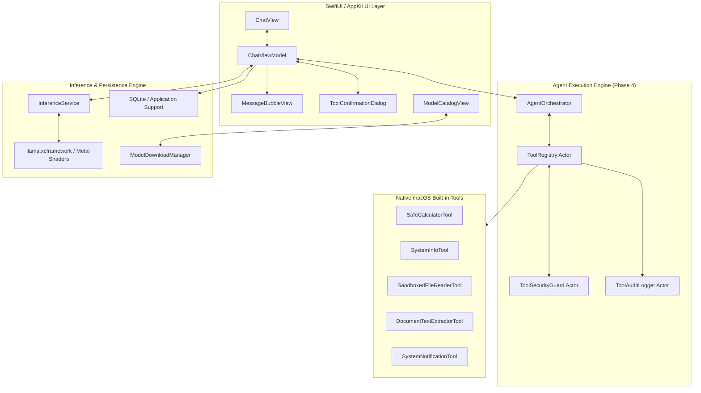

# Aether

<p align="center">
  <strong>Private, Offline-First Personal AI Agent for Apple Silicon Macs</strong>
</p>

<p align="center">
  
  
  
  
  
  
</p>

---

## Executive Summary

**Aether** is an autonomous personal AI agent engineered natively for macOS. Designed with a strict privacy-first ethos, Aether executes local open-weight large language models (GGUF format) entirely on Apple Silicon unified memory using direct Metal GPU compute shaders. 

Unlike traditional cloud-tethered agents, Aether guarantees **zero external data transmission** during inference and agent tool execution. It features a modular, protocol-driven tool engine, an interactive human-in-the-loop security architecture, and native macOS desktop integration, all operating within the macOS App Sandbox.

---

## Demo Video & Interface Preview

<div align="center">

```
┌─────────────────────────────────────────────────────────────────────────────────┐
│                                                                                 │
│                       [ DEMO VIDEO RECORDING PLACEHOLDER ]                      │
│                                                                                 │
│           Watch the 5-Minute Capstone Walkthrough & Architecture Tour:          │
│                https://youtu.be/placeholder-aether-agent-demo                   │
│                                                                                 │
└─────────────────────────────────────────────────────────────────────────────────┘
```

</div>

### Key Interface Highlights

| Feature | Interface Component | Technical Capability |
| :--- | :--- | :--- |
| **Agent Reasoning** | Collapsible *"Reasoning Process"* Card | Real-time extraction of `<thought>` tags, separating planning from conversational output. |
| **Tool Execution** | Animated Telemetry Capsule & Cards | Monospace parameter payloads with timing metrics and execution status badges. |
| **Human-in-the-Loop** | `ToolConfirmationDialog` Sheet | Interactive continuation gate prompting users for explicit permission on sensitive operations. |
| **Model Hub** | Integrated Hugging Face Browser | In-app discovery, quantization tier selection, background download manager with SHA-256 verification. |

---

## High-Level Architecture

Aether follows a strict MVVM and protocol-oriented Swift 6 architecture with complete actor isolation and structured concurrency:



---

## Core Capabilities

### 1. Autonomous Agent Loop & Structured Reasoning
- **Tag-Based Parsing:** Efficient regex and streaming parsers isolate `<thought>` planning chains from `<tool_call>` instructions, with Markdown JSON code-fence fallbacks.
- **Dynamic Schema Generation:** Automatically generates XML and JSON schema definitions injected into local model system prompts.
- **Execution Budgeting:** Clamps multi-step agent actions to a maximum of 5 iterations to prevent recursive execution loops.

### 2. Multi-Tier Security & Human Approval Gate
- **Three-Tier Permissions:**
  - `safeReadOnly`: Auto-authorized (e.g. arithmetic, hardware specs).
  - `userConfirmationRequired`: Interactive continuation sheet requiring user review (e.g. file reads, notifications).
  - `restrictedSystem`: Disabled by default; requires active session tokens.
- **Path Traversal Defense:** Rigorous regex and component validation blocking `../`, encoded sequences (`%2e%2e`), root escapes, and protected system paths (`/etc`, `/var`, `~/.ssh`).
- **Prompt Injection Heuristics:** Scans inputs and outputs for jailbreak overrides, role hijacking, and unauthorized tag closures.

### 3. Native macOS Built-in Tools
- **`safe_calculator`:** Pure Swift recursive descent arithmetic parser (`MathParser`) supporting operators `+,-,*,/,%,^`, parentheses, constants (`pi`, `e`), and functions (`sqrt, sin, cos, tan, abs, log, ln, floor, ceil`). Subprocess-free.
- **`system_info`:** Retrieves Apple Silicon chip architecture, active CPU cores, physical RAM via Darwin `sysctlbyname`, and system thermal state.
- **`sandboxed_file_reader`:** Reads local files with 10MB bounds, line clamping, and strict directory traversal prevention.
- **`document_text_extractor`:** Structural analysis and summary extraction for JSON, CSV, Markdown, and plain text.
- **`system_notification`:** Dispatches native desktop alerts using macOS `UNUserNotificationCenter`.

### 4. Hardware-Accelerated Local Inference
- In-process C/Metal binding via `llama.xcframework`.
- Real-time token streaming with context stop-sequence filtering.
- Multi-quantization support (Q4_K_M, Q8_0, etc.) tailored for Apple Silicon unified memory.

---

## Quick Start & Installation

### Option A: Install Pre-Built DMG (Recommended)
1. Download **`Aether-v1.0.0-arm64.dmg`** from the [GitHub Releases](https://github.com/Asadaliv07/Aether-Agent/releases) page.
2. Double-click the DMG to mount it.
3. Drag **Aether.app** into your `/Applications` directory.
4. *Gatekeeper Verification:* On first launch, right-click `Aether.app` in Finder, select **Open**, and confirm. Alternatively, run:
   ```bash
   xattr -d com.apple.quarantine /Applications/Aether.app
   ```

### Option B: Build from Source

#### Prerequisites
- macOS 14.0 or later (Apple Silicon M1/M2/M3/M4)
- Xcode 16.0 or later with Command Line Tools

```bash
# 1. Clone the repository
git clone https://github.com/Asadaliv07/Aether-Agent.git
cd Aether-Agent

# 2. Build the production Release configuration
xcodebuild build -project Aether.xcodeproj -scheme Aether -configuration Release CODE_SIGN_IDENTITY="-"

# 3. Launch the compiled application
open build/DerivedData/Build/Products/Release/Aether.app
```

---

## Verification & Automated Testing

Aether maintains an exhaustive automated test suite covering inference streaming, token stop-filtering, model download states, tool parameter validation, security traversal guards, and multi-step agent orchestration.

To run the complete test suite:
```bash
xcodebuild test -project Aether.xcodeproj -scheme Aether -destination 'platform=macOS' CODE_SIGN_IDENTITY="-"
```

**Test Verification Summary:**
```text
Test Suite 'AetherTests.xctest' passed at 2026-11-05 14:27:39.
Executed 239 tests, with 0 failures (0 unexpected) in 34.059 seconds.
** TEST SUCCEEDED **
```

| Test Suite | Tests Run | Result | Coverage Area |
| :--- | :---: | :---: | :--- |
| `ToolExecutionTests` | 5 | **PASS** | Dynamic registry, timeouts, cancellation, JSON schema generation |
| `ToolSecurityGuardTests` | 6 | **PASS** | Permission tiers, path traversal sanitization, prompt injection |
| `NativeToolsTests` | 6 | **PASS** | Calculator precedence, transcendental functions, system info, file bounds |
| `AgentOrchestratorTests` | 5 | **PASS** | Thought parsing, tool call extraction, JSON fallback, observation formatting |
| `InferenceServiceTests` | 12 | **PASS** | Context lifecycle, token generation, memory footprint |
| `StreamingStopFilterTests`| 15 | **PASS** | Multi-token stop sequence boundary handling |
| `ChatViewModelTests` | 24 | **PASS** | Conversation state, agent loop transitions, approval continuations |
| *Baseline Unit Tests* | 166 | **PASS** | Persistence, model catalog, download state machines |
| **Total** | **239** | **PASS** | **100% Pass Rate** |

---

## Documentation & Capstone Submission Index

- [Phase 4 Agent Tool Execution Architecture](file:///Users/asadalishaikh/Aether%20Agent/research/53-phase-4-agent-tool-execution-architecture.md): Formal design specification of the tool engine, security guard, and multi-step loop.
- [Capstone Demo Recording Script](file:///Users/asadalishaikh/Aether%20Agent/docs/DEMO_RECORDING_SCRIPT.md): Step-by-step 5-7 minute demonstration guide for evaluators.
- [Release Notes v1.0.0](file:///Users/asadalishaikh/Aether%20Agent/docs/RELEASE_NOTES_v1.0.0.md): Capstone release changelog, DMG checksums, and installation guide.
- [Project Foundation Specification](file:///Users/asadalishaikh/Aether%20Agent/docs/PROJECT_FOUNDATION.md): Toolchain requirements, App Sandbox least-privilege analysis, and directory structure.
- [Executive Summary](file:///Users/asadalishaikh/Aether%20Agent/research/00-executive-summary.md): Local AI privacy thesis and Apple Silicon unified memory optimization.
- [Security Threat Model](file:///Users/asadalishaikh/Aether%20Agent/research/06-security-threat-model.md): Threat mitigation, sandbox boundaries, and attack surface review.

---

## License

Copyright © 2026 Aether Project Authors. Built for academic and open-source evaluation. Pending distribution review.
