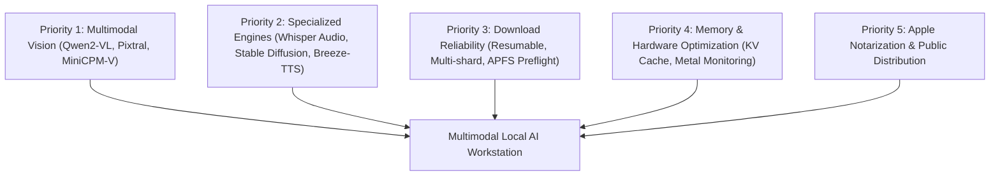

# Aether v1.1.0 — Product & Engineering Roadmap

**Document Version:** 1.1.0-DRAFT  
**Date:** November 5, 2026  
**Status:** Approved for Planning  
**Target Release:** Q1 2027  
**Baseline Foundation:** Aether v1.0.0 (260 passing tests, verified Metal llama.framework, 56-model catalog)

---

## 1. Vision & Strategy

Aether v1.0.0 established an offline-first, private personal AI agent on Apple Silicon, featuring native GGUF text inference, human-in-the-loop tool execution, and an in-app Hugging Face model catalog.

The **v1.1.0 release** expands Aether from a text-and-code assistant into a **complete multimodal, multi-engine local AI workstation**, while achieving **unrestricted public distribution readiness** through Developer ID notarization.

---

## 2. Release Stage Definitions

Every initiative in this roadmap is tracked across five distinct status tiers:
1. **[VERIFIED v1.0.0]**: Fully implemented, tested, and shipped in the v1.0.0 freeze.
2. **[PLANNED v1.1.0]**: Architecturally defined; implementation scheduled for v1.1.0.
3. **[EXTERNAL DEPENDENCY]**: Requires upstream framework updates (e.g. `llama.xcframework` multimodal headers).
4. **[HARDWARE VALIDATION]**: Requires physical testing on specific Apple Silicon configurations (e.g. 64GB / 128GB+ RAM).
5. **[CREDENTIALS REQUIRED]**: Requires Apple Developer Program enrollment or notary credentials.

---

## 3. Prioritized Strategic Pillars



---

## Priority 1: Multimodal Vision-Language Inference

### Objective
Enable users to attach images (PNG, JPEG, WebP, HEIC), screenshots, charts, and scanned documents to their chat prompts for analysis by vision-language models like Qwen2-VL, Pixtral, and MiniCPM-V.

### Detailed Scope & Capabilities
1. **Dual-Artifact Model Architecture (`.gguf` + `mmproj-*.gguf`):**
   - In GGUF architectures, vision models require two distinct files: the base text transformer weights and a companion multimodal projector (`mmproj`).
   - Catalog entries for vision models will declare both artifacts with repository coordinates and exact byte sizes.
2. **Companion File Discovery & Atomic Dual-Download:**
   - Extend `ModelDownloadManager` to bundle dual-artifact downloads into a single logical transaction.
   - When downloading `Qwen2-VL-7B-Instruct-Q4_K_M.gguf`, automatically queue and download `Qwen2-VL-7B-Instruct-mmproj-f16.gguf`.
3. **Multimodal Inference Pipeline (`llava_context`):**
   - Bind `clip_model_load` and `llava_eval_image_embed` within `LlamaInferenceWorker`.
   - Implement an image preprocessor that normalizes aspect ratios and downsamples images exceeding max vision resolution (e.g. 1344x1344) to prevent out-of-memory errors on 8GB/16GB Macs.
4. **Native SwiftUI Image Input UI:**
   - Drag-and-drop onto the chat input text field.
   - Clipboard paste (`⌘V`) of images and screenshots.
   - Image preview thumbnail tray with deletion pills prior to prompt dispatch.

### Status & Classification
- **Status:** **`PLANNED v1.1.0`** / **`EXTERNAL DEPENDENCY`**
- **Dependencies:** Recompiling `llama.xcframework` with `LLAMA_LLAVA=ON` and `clip.h` C-headers exposed.
- **Acceptance Criteria:** An automated integration test loads `Qwen2-VL-2B-Instruct-Q4_K_M.gguf` + `mmproj`, feeds a sample test image (e.g. a red square), and receives a verified linguistic confirmation ("red square") in under 3.0s on an M1 8GB Mac.

---

## Priority 2: Specialized Dedicated Runtimes

### Objective
Provide native execution pipelines for models that cannot run within a text LLM engine: speech-to-text (Whisper), speech synthesis (TTS), and image diffusion (Stable Diffusion / FLUX).

```
+-----------------------------------------------------------------------+
|                      Aether Multi-Engine Architecture                  |
+-----------------------------------------------------------------------+
|  Text / Code / Vision Engine: llama.framework (Metal C++ In-Process)  |
|  Audio Transcription Engine:  whisper.framework (Metal In-Process)    |
|  Voice Synthesis Engine:      breeze-tts / piper.framework (In-Process)|
|  Image Generation Engine:     stable-diffusion.framework (Metal)      |
+-----------------------------------------------------------------------+
```

### Detailed Scope
1. **Audio Transcription Engine (`whisper.cpp`):**
   - Package `whisper.xcframework` with Metal acceleration.
   - Add microphone input button to chat input for voice-to-text dictation.
   - Support `Whisper Large v3 Turbo` and `Whisper Base`.
2. **Speech Synthesis Engine (`Breeze-TTS 2`):**
   - Add text-to-speech playback pill on assistant message bubbles.
   - Stream audio chunks via `AVAudioEngine` for low-latency voice readback.
3. **Diffusion Image Generation Engine (`stable-diffusion.cpp`):**
   - Support `Stable Diffusion v1.5` and `FLUX.1 Schnell`.
   - Provide a specialized `generate_image` agent tool and a dedicated Image Studio tab.
4. **Engine Lifecycle & Resource Guardrails:**
   - Mutually exclusive engine activation on Macs with $\le 16\text{ GB}$ RAM (unloads LLM from Metal before loading Diffusion to prevent system swap exhaustion).

### Status & Classification
- **Status:** **`PLANNED v1.1.0`**
- **Dependencies:** Building standalone xcframeworks for `whisper.cpp` and `stable-diffusion.cpp`.
- **Acceptance Criteria:** Whisper transcription executes in $<1.5\text{s}$ for a 5-second audio sample; Diffusion generates a $512\times 512$ image in $<8\text{s}$ on an M2 Pro.

---

## Priority 3: Resilient Model Download Manager

### Objective
Upgrade `ModelDownloadManager` into a fault-tolerant, resumable, multi-shard download engine capable of handling multi-gigabyte models under unreliable network conditions.

### Detailed Scope
1. **Resumable Downloads (HTTP 206 Partial Content):**
   - Read existing `.download` temporary file byte length and supply `Range: bytes=<offset>-` on connection resumption.
   - Handle server `Accept-Ranges` validation and `ETag` match checks to prevent appending to modified files.
2. **Multi-Shard Download Orchestration:**
   - Support manifest-based multi-shard models (e.g. DeepSeek V3 9 shards, Mixtral split quants).
   - Sequential or bounded parallel shard acquisition with aggregate progress tracking.
3. **Disk Space Preflight (APFS Volume Inspection):**
   - Query `URLResourceKey.volumeAvailableCapacityForImportantUsageKey`.
   - Require `fileSize * 1.15` (15% safety buffer for APFS COW and metadata) before permitting download start.
4. **Streaming SHA-256 Validation:**
   - Compute running cryptographic hash via Apple `CryptoKit.SHA256` as bytes are written to disk, avoiding expensive full-file re-reading passes post-download.
5. **Session Persistence & Recovery:**
   - Save active download states in `aether.sqlite` (`download_queue` table).
   - On application launch, detect unfinished downloads and present a "Resume Download" prompt.

### Status & Classification
- **Status:** **`PLANNED v1.1.0`**
- **Dependencies:** Pure Swift Foundation & CryptoKit (zero third-party dependencies).
- **Acceptance Criteria:** A simulated download interruption at 50% resumes cleanly, completes, and passes SHA-256 validation with zero corrupted bytes.

---

## Priority 4: Dynamic Hardware & Inference Optimization

### Objective
Maximize throughput and stability across diverse Apple Silicon unified memory configurations (8GB to 192GB).

### Detailed Scope
1. **Dynamic Memory Pressure Listener:**
   - Register a Darwin dispatch source:
     ```swift
     DispatchSource.makeMemoryPressureSource(eventMask: [.warning, .critical], queue: .global())
     ```
   - On `.warning`, prune context window KV cache or purge cached conversation messages.
   - On `.critical`, gracefully unload idle background models.
2. **Context Window KV Cache Estimation:**
   - Display real-time memory usage breakdown in UI: Model Weights + KV Cache ($\text{Layers} \times 2 \times \text{Dim} \times \text{Tokens} \times \text{Precision}$) + Metal Compute Scratch.
3. **Metal Memory Monitoring:**
   - Query `MTLDevice.currentAllocatedSize` periodically to verify Metal driver allocation against physical unified memory.
4. **Intelligent Model Unloading:**
   - Configurable idle timeout (e.g. unload model after 15 minutes of inactivity to return RAM to the host OS).

### Status & Classification
- **Status:** **`PLANNED v1.1.0`** / **`HARDWARE VALIDATION`**
- **Dependencies:** Metal framework, Darwin dispatch sources.
- **Acceptance Criteria:** Model load fails gracefully with an informative user alert if simulated memory pressure exceeds safe headroom; no application crash or kernel panic.

---

## Priority 5: Automated Developer ID & Apple Notarization Pipeline

### Objective
Attain `ACCEPTED FOR PUBLIC DISTRIBUTION` by establishing an automated Developer ID signing and Apple Notary Service submission workflow.

### Detailed Scope
1. **Apple Developer ID Certificate Integration:**
   - Provision Apple Developer ID Application certificate and Developer ID Installer certificate.
2. **Hardened Runtime & Strict Entitlements:**
   - Maintain sandboxing with minimal necessary exceptions.
3. **Automated Submission via `xcrun notarytool`:**
   - Submit generated DMG to Apple Notary Service using App Store Connect API keys or keychain profile.
   - Poll submission status until accepted.
4. **Automated Stapling & Gatekeeper Verification:**
   - Run `xcrun stapler staple dist/Aether-v1.1.0-arm64.dmg`.
   - Run `spctl --assess --type execute -v` on fresh clean machine to verify zero Gatekeeper warnings.

### Status & Classification
- **Status:** **`PLANNED v1.1.0`** / **`CREDENTIALS REQUIRED`**
- **Dependencies:** Active Apple Developer Program enrollment, App Store Connect API Key (`apiKey`, `apiIssuer`).
- **Acceptance Criteria:** Freshly downloaded DMG on an unconfigured Mac opens without any `com.apple.quarantine` terminal command or right-click bypass.

---

## 4. Implementation Timeline & Milestones

| Milestone | Target Date | Primary Deliverables | Exit Criteria |
|---|---|---|---|
| **M1: Download Engine & Preflight** | Week 1–3 | Resumable downloads, APFS preflight, streaming SHA-256 | Test suite passes 275+ tests |
| **M2: Multimodal Vision Prototype** | Week 4–6 | `mmproj` loader, clip C-bindings, drag-and-drop image UI | Qwen2-VL passes visual Q&A |
| **M3: Audio Engine Integration** | Week 7–9 | `whisper.framework`, speech-to-text input button | Whisper voice dictation verified |
| **M4: Memory & Hardware Tuning** | Week 10–11 | KV cache calculator, memory pressure dispatch source | Zero OOM crashes under stress |
| **M5: Public Release & Notarization**| Week 12 | Developer ID signing, Notarytool automation, public DMG | `spctl` returns `accepted` |

---

## 5. Non-Negotiable Architectural Principles for v1.1.0

1. **Preserve Offline-First Privacy:** Zero user chat data, prompts, images, or audio may leave the local Mac. No telemetry without explicit user consent.
2. **Strict App Sandbox Integrity:** Preserve macOS App Sandbox containment. No unauthorized filesystem traversal or arbitrary subprocess execution.
3. **Zero Test Regressions:** All 260 existing unit tests must remain passing at all times during v1.1.0 development.

