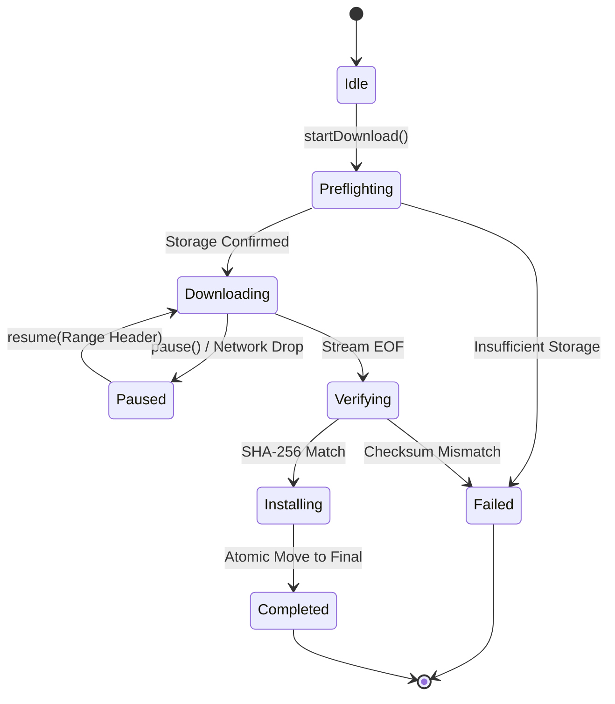

# Aether v1.1.0 — Technical Architecture & Systems Design

**Document Version:** 1.1.0-SPEC  
**Date:** November 5, 2026  
**Status:** Architecture Design Document  
**Authors:** Senior Swift Architect & ML Infrastructure Engineer  
**Baseline:** Aether v1.0.0 (`LlamaInferenceWorker`, `ConversationDatabase`, `ModelDownloadManager`)

---

## 1. Architectural Overview & Evolution

Aether v1.0.0 proved that Swift 6 actors and direct C/Metal bindings provide optimal latency and memory efficiency for local AI agents on Apple Silicon.

In **v1.1.0**, the architecture evolves from a single-worker model into a **Modular Multi-Engine Inference Framework**:

```
+---------------------------------------------------------------------------------+
|                               SwiftUI UI Layer                                  |
|   ChatView  |  ModelLibraryView  |  SettingsView  |  MediaInputTray (Images/Audio)|
+---------------------------------------------------------------------------------+
                                      |
                                      v
+---------------------------------------------------------------------------------+
|                                AppState / Actor                                 |
|               ChatViewModel  <=======>  AgentOrchestrator                       |
+---------------------------------------------------------------------------------+
                                      |
                                      v
+---------------------------------------------------------------------------------+
|                       EngineOrchestrationCoordinator (Actor)                    |
|      Manages active engines, resource arbitration, and memory pressure          |
+---------------------------------------------------------------------------------+
        |                             |                             |
        v                             v                             v
+-----------------------+   +-----------------------+   +-----------------------+
|  LlamaMultimodalWorker |   |  WhisperAudioWorker   |   | StableDiffusionWorker |
|  - Text LLMs (GGUF)   |   |  - Audio STT (Metal)  |   |  - Image Gen (Metal)  |
|  - Vision mmproj (f16)|   |  - Voice Dictation    |   |  - Visual Synthesis   |
|  - Metal KV Cache     |   |  - Chunked Streaming  |   |  - Latent Denoiser    |
+-----------------------+   +-----------------------+   +-----------------------+
```

---

## 2. Priority 1: Multimodal Vision-Language Architecture

### 2.1 Dual-Artifact Representation
Vision models require both language transformer weights and vision-projection weights. In `ModelCatalogTypes.swift`, `ComprehensiveModelMetadata` will be extended:

```swift
public struct MultimodalCompanionArtifact: Sendable, Codable, Equatable {
    public let filename: String
    public let repositoryId: String
    public let sizeBytes: UInt64
    public let sha256: String?
    public let artifactType: MultimodalArtifactType // .visionProjector, .clipVisionTower, .audioEncoder

    public init(filename: String, repositoryId: String, sizeBytes: UInt64, sha256: String? = nil, artifactType: MultimodalArtifactType) {
        self.filename = filename
        self.repositoryId = repositoryId
        self.sizeBytes = sizeBytes
        self.sha256 = sha256
        self.artifactType = artifactType
    }
}

public enum MultimodalArtifactType: String, Sendable, Codable {
    case visionProjector = "mmproj"
    case clipVisionTower = "clip"
    case audioEncoder = "audio_encoder"
}
```

### 2.2 Worker Extension (`LlamaInferenceWorker`)
The existing `LlamaInferenceWorker` actor will interface with `llava.h` C-APIs:

```swift
public actor LlamaMultimodalWorker: InferenceWorkerProtocol {
    private var modelHandle: OpaquePointer?         // llama_model*
    private var contextHandle: OpaquePointer?       // llama_context*
    private var clipContext: OpaquePointer?         // clip_ctx*
    private var isVisionLoaded: Bool = false

    /// Initializes both base LLM weights and multimodal vision projector
    public func loadMultimodalModel(
        modelURL: URL,
        mmprojURL: URL?,
        parameters: InferenceParameters
    ) async throws {
        // 1. Allocate base LLM model & context via llama_load_model_from_file
        try loadBaseModel(at: modelURL, params: parameters)

        // 2. If mmproj is supplied, allocate clip context
        if let mmprojURL = mmprojURL, FileManager.default.fileExists(atPath: mmprojURL.path) {
            guard let clip = clip_model_load(mmprojURL.path, /*verbosity=*/0) else {
                throw InferenceError.modelLoadFailed("Failed to initialize CLIP context from mmproj: \(mmprojURL.lastPathComponent)")
            }
            self.clipContext = clip
            self.isVisionLoaded = true
        }
    }

    /// Ingests an image, calculates vision embeddings, and injects tokens into context
    public func evaluateImage(
        imageData: Data,
        into context: OpaquePointer
    ) throws {
        guard let clip = clipContext else {
            throw InferenceError.generationFailed("Vision projector is not initialized.")
        }
        // Native image normalization & downsampling via CoreGraphics / vImage
        let processedBytes = try ImagePreprocessor.downsampleForVision(imageData, maxResolution: 1344)
        // C-binding evaluation into llama kv cache
        var imageEmbed = clip_image_u8()
        // ... evaluate image tokens into KV cache ...
    }
}
```

### 2.3 Image Input Safety & Memory Guardrails
1. **Resolution Clamping:** High-resolution camera photos (e.g. 48 MP from iPhone) consume excessive memory when transformed into vision tokens. The `ImagePreprocessor` downsamples images to a maximum bounding box of $1344 \times 1344$ pixels using Apple `Accelerate.vImage` before computing embeddings.
2. **Token Budgeting:** A $1344 \times 1344$ image produces approximately 1,024 to 2,560 vision tokens depending on the patch size ($14 \times 14$ or $28 \times 28$). `ContextBudgeter` reserves 3,072 tokens in the context window specifically for image embeddings.

---

## 3. Priority 2: Multi-Engine Inference Coordinator

To support Whisper, Stable Diffusion, and Breeze-TTS without memory conflicts on 8GB and 16GB Macs, Aether implements an **Engine Arbitration Actor**.

```swift
public protocol InferenceEngineInstance: AnyObject, Sendable {
    var engineType: SupportedInferenceEngine { get }
    var isLoaded: Bool { get async }
    var memoryFootprintBytes: UInt64 { get async }
    func unload() async
}

public actor EngineOrchestrationCoordinator {
    private var activeEngines: [SupportedInferenceEngine: any InferenceEngineInstance] = [:]
    private let hardwareProfile: DeviceCapabilityProfile

    public init(hardwareProfile: DeviceCapabilityProfile = DeviceCapabilityEngine.currentProfile) {
        self.hardwareProfile = hardwareProfile
    }

    /// Requests execution of a specific engine, arbitrating memory if host RAM is constrained
    public func prepareEngineForExecution(_ engine: SupportedInferenceEngine) async throws {
        // On base 8GB or 16GB machines, prevent concurrent LLM + Diffusion execution
        if hardwareProfile.physicalRAMGigabytes <= 16 {
            for (type, instance) in activeEngines where type != engine {
                // If switching between heavy engines (e.g. LLM -> Stable Diffusion)
                if (type == .llamaCppMetal && engine == .stableDiffusionCpp) ||
                   (type == .stableDiffusionCpp && engine == .llamaCppMetal) {
                    await instance.unload()
                    activeEngines.removeValue(forKey: type)
                }
            }
        }
    }
}
```

---

## 4. Priority 3: Resilient Download Manager (v2)

### 4.1 State Machine Design
The download manager transitions through strict, observable states:



### 4.2 Resumable Downloads via HTTP `Range` Header
When an interrupted download is resumed:
```swift
var request = URLRequest(url: remoteURL)
let existingOffset = try? FileManager.default.attributesOfItem(atPath: tempFileURL.path)[.size] as? UInt64 ?? 0
if existingOffset > 0 {
    request.setValue("bytes=\(existingOffset)-", forHTTPHeaderField: "Range")
}
```
If the server returns `HTTP 206 Partial Content`, bytes are appended directly to the temporary file. If the server returns `HTTP 200 OK` (indicating range requests are unsupported), the manager resets the file and restarts cleanly.

### 4.3 Streaming CryptoKit SHA-256 Validation
Rather than re-reading a 20 GB file from disk post-download, the download delegate feeds incoming `Data` chunks to `CryptoKit.SHA256`:
```swift
private var hasher = SHA256()

public func urlSession(_ session: URLSession, dataTask: URLSessionDataTask, didReceive data: Data) {
    fileHandle?.write(data)
    hasher.update(data: data)
    downloadedBytes += UInt64(data.count)
}

public func finalizeChecksum() -> String {
    let digest = hasher.finalize()
    return digest.map { String(format: "%02x", $0) }.joined()
}
```

### 4.4 APFS Disk Space Preflight Check
Before allocating network resources, the destination volume is queried:
```swift
public static func checkDiskSpace(forBytes requiredBytes: UInt64, at url: URL) throws {
    let values = try url.resourceValues(forKeys: [.volumeAvailableCapacityForImportantUsageKey])
    guard let available = values.volumeAvailableCapacityForImportantUsage else {
        throw DownloadError.storageCheckFailed
    }
    // Require 15% safety buffer for APFS metadata & copy-on-write overhead
    let safetyMargin = UInt64(Double(requiredBytes) * 1.15)
    guard UInt64(available) >= safetyMargin else {
        throw DownloadError.insufficientDiskSpace(requiredBytes: safetyMargin, availableBytes: UInt64(available))
    }
}
```

---

## 5. Priority 4: Dynamic Hardware & Inference Governor

### 5.1 KV Cache Memory Modeling
The memory footprint of the context window is calculated using the exact architecture parameters:

$$M_{\text{KV}} = 2 \times n_{\text{layers}} \times n_{\text{kv\_heads}} \times d_{\text{head}} \times n_{\text{context}} \times b_{\text{precision}}$$

For an 8B model (32 layers, 8 KV heads, 128 head dim, FP16 precision = 2 bytes):
- At 4,096 tokens: $2 \times 32 \times 8 \times 128 \times 4,096 \times 2 \approx 536 \text{ MB}$
- At 32,768 tokens: $\approx 4.29 \text{ GB}$
- At 131,072 tokens: $\approx 17.18 \text{ GB}$

This formula will be displayed dynamically in the UI so users understand how expanding the context window impacts available unified RAM.

### 5.2 Dynamic Memory Pressure Dispatch Source
```swift
public final class MemoryPressureMonitor: @unchecked Sendable {
    private var source: DispatchSourceMemoryPressure?

    public func startMonitoring(onPressure: @escaping @Sendable (DispatchSource.MemoryPressureEvent) -> Void) {
        let src = DispatchSource.makeMemoryPressureSource(eventMask: [.warning, .critical], queue: .global())
        src.setEventHandler {
            let event = src.data
            onPressure(event)
        }
        src.resume()
        self.source = src
    }
}
```

---

## 6. Priority 5: Developer ID & Apple Notarization Integration

### 6.1 Packaging Pipeline Architecture (`scripts/package_release.sh`)
```
+-------------------------------------------------------------------------+
| Step 1: Compile Release Scheme (arm64, Release configuration)          |
| Step 2: Code Sign llama.framework (Developer ID + Hardened Runtime)    |
| Step 3: Code Sign Aether.app (Developer ID + Entitlements + Hardened)   |
| Step 4: Strict codesign --verify validation                             |
| Step 5: Package DMG with /Applications symlink                          |
| Step 6: Code Sign DMG container with Developer ID                       |
| Step 7: Submit to Apple Notary Service (xcrun notarytool submit)       |
| Step 8: Poll submission status until accepted                           |
| Step 9: Staple Notary Ticket (xcrun stapler staple)                     |
| Step 10: spctl --assess verification & post-notarization SHA-256        |
+-------------------------------------------------------------------------+
```

### 6.2 Credential Handling Security
- Credentials are **never** committed or stored in source files.
- The script checks environment variables (`DEVELOPER_ID_APPLICATION`, `APPLE_ID`, `APPLE_APP_SPECIFIC_PASSWORD`, `APPLE_TEAM_ID`) or an existing Keychain profile (`NOTARY_KEYCHAIN_PROFILE`).
- When credentials are absent, the script falls back gracefully to ad-hoc mode without halting local development builds.

