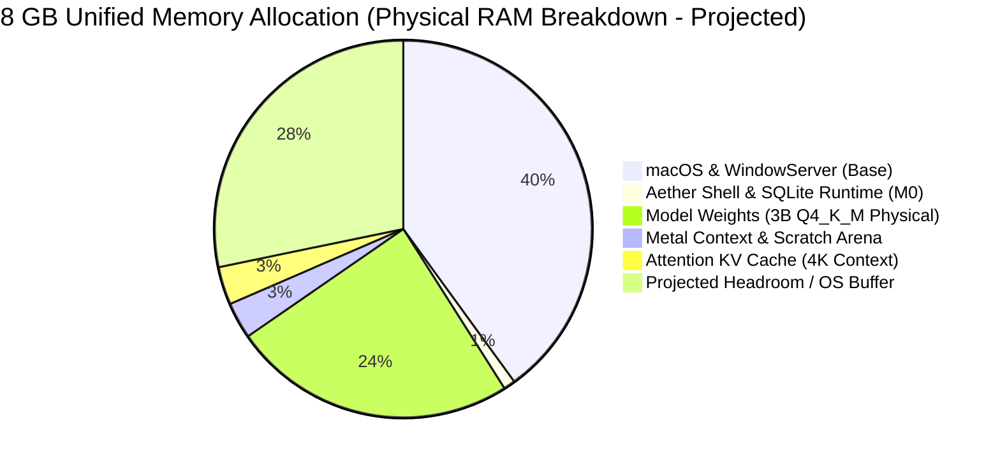
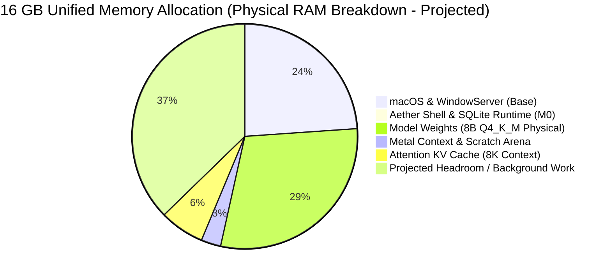

# Aether: Product Requirements & Specification (PRD)

**Document:** Product Requirements Document (PRD)  
**Target Platform:** macOS 14.0+ (Sonoma) and macOS 15.0+ (Sequoia) on Apple Silicon  
**Target Hardware Matrix:**  
- **Primary Development & Validation Target:** Apple M5 MacBook Air with 16 GB Unified Memory (Performance targets are provisional projections pending empirical benchmarking).  
- **Secondary Compatibility Tier:** Apple Silicon Macs with 8 GB Unified Memory (M1–M4 Base MacBook Air / Mac mini — strictly resource-constrained tier with restricted model sizes $\le 3\text{B}-4\text{B}$ and context $\le 4,096$ tokens).  
- **Other Supported Hardware Classes:**  
  - *M1/M2 16 GB Tier:* Base 16 GB Macs (~68–100 GB/s bandwidth).  
  - *M3/M4 16 GB Tier:* Modern 16 GB Macs (~100–150 GB/s bandwidth).  
  - *M1–M5 Workstation Tier:* Pro/Max/Ultra with 32 GB – 128 GB Unified Memory (200–800 GB/s bandwidth).  
  *(Note: M1 through M5 are treated as distinct hardware performance classes and are not represented as an equivalent performance tier).*  
**Status:** Validated Technical Specification (Phase 2.2 Complete — Awaiting Human Approval Before Phase 3)  

---

## 1. Product Vision & Core Value Proposition

**Aether** is an autonomous, private, local-first personal AI computing platform designed for knowledge workers, developers, researchers, and privacy-conscious users on macOS.

### Core Value Pillars:
1. **Absolute Data Sovereignty & Offline Guarantee:** `[VERIFIED FACT]` Aether operates with zero external network connectivity required for core functionality. Chat conversations, source code, corporate documents, indexed vector databases, and agent memory remain strictly on the user's encrypted local drive.
2. **Native Apple Silicon Architecture:** `[VERIFIED FACT]` Engineered directly for Apple's Unified Memory Architecture (UMA) and Metal Performance Shaders (MPS), delivering optimized token generation throughput and low cold-start latency with minimal power draw.
3. **Ultra-Lightweight Desktop Presence:** `[ESTIMATED TARGET]` Unlike bloated Electron wrappers that consume 500–1,200 MB idle RAM `[ESTIMATED]`, Aether's native desktop shell is designed to idle at ~25–35 MB of RAM `[ESTIMATED TARGET]`, leaving the maximum possible memory budget for model weights and attention context.
4. **Transparent & Safe Extensibility (Deferred to M1):** `[VERIFIED FACT]` Integrates with local files, terminals, and external services via the standard Model Context Protocol (MCP), enforced by an uncompromising human-in-the-loop permission gateway.

---

## 2. Target User Personas

| Persona | Primary Needs & Use Cases | Hardware Profile | Critical Success Metric |
| :--- | :--- | :--- | :--- |
| **Privacy-First Developer** | Code exploration, inline generation, local debugging without leaking proprietary IP. | MacBook Pro / Air (M3–M5, 16 GB – 36 GB RAM) | Fast token streaming (>30 tok/s projected), sub-second responsiveness, zero outbound network packets. |
| **Researcher / Writer** | Deep analysis of notes, draft synthesis, local reference retrieval. | MacBook Air (M1–M5, 8 GB – 16 GB RAM) | Reliable local inference, zero hallucination in context, responsive UI without system lag. |
| **Enterprise Knowledge Worker** | Private meeting summaries, local spreadsheet analysis, strict offline compliance. | Mac Studio / MacBook Pro (M2–M5, 16 GB – 64 GB RAM) | Complete absence of telemetry, offline compliance guarantees, robust local persistence. |

---

## 3. Hardware Profiles & Physical Memory Budgets

### 3.1 Strict Memory Accounting Rules:
`[VERIFIED FACT]` Software running on unified memory architectures must budget memory rigorously. Aether explicitly distinguishes between:
1. **Model file size on disk:** Quantized GGUF payload stored on NVMe flash.
2. **Virtual address space:** Virtual addresses mapped via `mmap`.
3. **Resident physical memory (RSS):** Actual RAM frames held by the kernel for model execution.
4. **Runtime and Metal allocations:** Metal command buffers, intermediate tensors, and scratch arenas.
5. **Attention KV-cache memory:** Dynamic attention memory scaling with active context length and layer dimensions.
6. **Application and OS memory:** RAM occupied by macOS (WindowServer, system daemons) and the native host app.
7. **Memory pressure and swap activity:** Kernel memory pressure levels (`normal`, `warning`, `critical`) and anonymous swap page-outs.

> [!IMPORTANT]
> **The `mmap` Reality:** Memory-mapping (`mmap`) avoids intermediate user-space heap allocation buffers, but **does not make model weights free in physical memory**. As tensor operations execute during inference, touched weight pages fault into resident physical RAM (RSS). While clean file-backed pages can be reclaimed by the macOS kernel under memory pressure without writing to swap, re-faulting evicted pages on subsequent tokens introduces storage I/O latency, leading to stutter and throughput degradation. Therefore, memory budgets must realistically account for the active resident working set to avoid excessive page reclamation and latency spikes.

---

### 3.2 Detailed Hardware Support Matrix:

| Hardware Class | Chip & Memory Configuration | Intended Use Cases & Workloads | Candidate Models & Quants (Provisional) | Context Length Policy | Expected Memory Pressure | Model Loading / Unloading | Responsiveness Goals (Target) | Unsupported / Degraded Workloads | Required Empirical Tests (Phase 3) |
|---|---|---|---|---|---|---|---|---|---|
| **Tier 0: Constrained Compatibility Tier** | **M1–M4 Base** 8 GB Unified Memory (~68–150 GB/s) | Lightweight local chat, single-turn prompts, quick desktop Q&A. | 3B–4B Models (`Q4_K_M`, `Q5_K_M`) *(Llama-3.2-3B, Qwen-2.5-3B)* | **Conservative cap at 4,096 tokens** (~256 MB KV cache) pending testing | **Elevated / Warning:** Combined app+model allocation ~2.5 GB; total system RAM ~5.7 GB. Margin ~2.3 GB. | Aggressive unload: Release model from RAM after 5 min idle. | TTFT < 200 ms (512 ctx); Gen $\ge 30\text{ tok/s}$ `[ESTIMATED TARGET]`. | Models $\ge 7\text{B}$ may cause excessive memory pressure, swapping, or unacceptable performance; 3B–4B models and 4K context cap are conservative proposed policies pending testing. | Memory pressure escalation test, swap write monitoring, 4K context thrash test. |
| **Tier 1A: Primary Target** | **Apple M5 MacBook Air** 16 GB Unified Memory (153 GB/s Memory Bandwidth) | Primary development and validation baseline: multi-turn chat, complex reasoning. | 7B–9B Models (`Q4_K_M`, `Q8_0`) *(Llama-3.1-8B, Qwen-2.5-7B)* | **Standard 8,192 tokens**; expandable to 16K with quantized KV cache | **Normal:** Combined app+model allocation ~6.2 GB; total system RAM ~10.0 GB. Headroom ~6.0 GB. | Standard unload: Release model after 10 min idle or OS memory pressure signal. | TTFT < 150 ms (512 ctx); Gen $\ge 30-42\text{ tok/s}$ `[ESTIMATED TARGET pending benchmark]`. | 32B+ models; dense unquantized 70B models. | Cold/warm load latency, sustained 10-minute generation thermal profile, TTFT at 2K ctx. |
| **Tier 1B: Legacy Base 16 GB** | **M1 / M2** 16 GB Unified Memory (~68–100 GB/s) | Standard desktop chat, multi-turn dialogue on earlier Apple Silicon. | 7B–8B Models (`Q4_K_M`) *(Llama-3.1-8B, Mistral-7B)* | **Standard 8,192 tokens** (~1.0 GB KV cache) | **Normal:** Slower bandwidth limits throughput; memory safety margin remains ~5.5 GB. | Standard unload: Release model after 10 min idle. | TTFT < 250 ms (512 ctx); Gen $\ge 18-24\text{ tok/s}$. | Concurrent heavy indexing; models $\ge 14\text{B}$. | Bandwidth saturation benchmark, token throughput under memory pressure. |
| **Tier 1C: Modern Base 16 GB** | **M3 / M4** 16 GB Unified Memory (~100–150 GB/s) | High-speed desktop chat, code assistance, long-context evaluation. | 7B–9B Models (`Q4_K_M`, `Q5_K_M`) *(Llama-3.1-8B, Qwen-2.5-7B)* | **Standard 8,192 – 16,384 tokens** | **Normal:** Ample headroom (~5.8 GB) with fast Metal 3 shader execution. | Standard unload: Release model after 10 min idle. | TTFT < 180 ms (512 ctx); Gen $\ge 24-32\text{ tok/s}$. | Models $\ge 32\text{B}$. | TTFT scaling from 512 to 2048 tokens, cancellation latency. |
| **Tier 2: Workstation Power Tier** | **M1–M5 Pro / Max / Ultra** 32 GB – 128 GB UMA (200–800 GB/s) | Heavy local reasoning, large context windows, future on-device fine-tuning. | 14B–32B Models (`Q4_K_M`, `Q8_0`), 70B MoE (`Q3_K_M`) | **32,768 – 65,536 tokens** | **Unconstrained:** <50% total physical memory occupied. | Lazy unload: Retain model in RAM until explicit user purge. | TTFT < 100 ms (512 ctx); Gen $\ge 40-80+\text{ tok/s}$. | None. | High-concurrency throughput, 32K context KV allocation, multi-engine switching. |

---

### 3.3 KV Cache Memory Formula & Scale Table:
`[VERIFIED FACT]` Attention KV-cache memory scales deterministically according to:
$$\text{Memory}_{\text{KV}} = 2 \times N_{\text{layers}} \times N_{\text{kv\_heads}} \times D_{\text{head}} \times L_{\text{ctx}} \times \text{bytes\_per\_element}$$

> [!NOTE]
> **Architecture-Dependent KV Assumptions:**
> - **Attention Architecture:** The memory scale above assumes **Grouped-Query Attention (GQA)** with $N_{\text{kv\_heads}} = 8$ (e.g., Llama-3.1-8B, which has 32 query heads and 8 KV heads, reducing KV cache by $4\times$ compared to Multi-Head Attention). If evaluating a model with standard Multi-Head Attention (MHA, $N_{\text{kv\_heads}} = N_{\text{heads}} = 32$), the KV cache is $4\times$ larger ($512\text{ KB/token}$). Models with Sliding Window Attention (SWA, e.g., Mistral-7B) cap active cache size to the window length (typically 4,096 tokens).
> - **Smaller Models (3B):** For Llama-3.2-3B (28 layers, 8 KV heads, head dim 128, FP16): $\text{Bytes per token} = 114,688\text{ bytes} \approx 112\text{ KB/token}$. At 4,096 tokens, unquantized FP16 KV cache is $\approx 448\text{ MiB}$ ($458\text{ MB}$). With FP8 / Q8_0 quantized KV cache, this drops to $\approx 229\text{ MB}$.
> - **Element Precision:** Standard unquantized KV cache uses FP16 ($2\text{ bytes/element}$). Quantized KV caches (`Q8_0` at 1 byte/element, `Q4_0` at 0.5 byte/element) reduce cache memory by $50\%$ to $75\%$ respectively.

- For **Llama-3.1-8B** (32 layers, 8 KV heads, 128 head dim, FP16 = 2 bytes): $\text{Bytes per token} = 131,072\text{ bytes} \approx 128\text{ KB/token}$.
  - At **2,048 tokens:** $256\text{ MB}$ `[CALCULATED]`
  - At **4,096 tokens:** $512\text{ MB}$ `[CALCULATED]`
  - At **8,192 tokens:** $1,024\text{ MB}$ ($1.0\text{ GB}$) `[CALCULATED]`
  - At **16,384 tokens:** $2,048\text{ MB}$ ($2.0\text{ GB}$) `[CALCULATED]`
  - At **32,768 tokens:** $4,096\text{ MB}$ ($4.0\text{ GB}$) `[CALCULATED]`

---

## 4. Non-Functional Requirements (NFRs)

### Performance & Latency Targets (Provisional — Pending Phase 3 Benchmark):
- **NFR-P1 (Cold Start):** Time from launching `Aether.app` to interactive chat readiness shall be `< 500 ms` `[ESTIMATED TARGET]`.
- **NFR-P2 (Model Load Time):** Loading a 3B Q4_K_M model into resident memory shall take `< 400 ms` on NVMe SSD `[ESTIMATED TARGET]`; loading an 8B Q4_K_M model shall take `< 750 ms` `[ESTIMATED TARGET]`.
- **NFR-P3 (Time-to-First-Token - TTFT):**
  - Prompt length $\le 512$ tokens: TTFT target shall be `< 200 ms` on M1–M4 `[ESTIMATED TARGET]`, `< 150 ms` on M5 `[ESTIMATED TARGET pending benchmark]`.
  - Prompt length $\le 2048$ tokens: TTFT target shall be `< 500 ms` on M1–M4 `[ESTIMATED TARGET]`, `< 350 ms` on M5 `[ESTIMATED TARGET pending benchmark]`.
- **NFR-P4 (Token Generation Speed):**
  - Tier 0 (8 GB M1–M4, 3B Model): Target $\ge 35\text{ tokens/sec}$ `[ESTIMATED TARGET]`.
  - Tier 1B (16 GB M1/M2, 8B Model): Target $\ge 18-24\text{ tokens/sec}$ `[ESTIMATED TARGET]`.
  - Tier 1C (16 GB M3/M4, 8B Model): Target $\ge 24-32\text{ tokens/sec}$ `[ESTIMATED TARGET]`.
  - Tier 1A Primary (16 GB M5, 8B Model): Target $\ge 30-42\text{ tokens/sec}$ `[ESTIMATED TARGET pending benchmark; official M5 bandwidth is 153 GB/s]`.
- **NFR-P5 (Cancellation Latency):** User-initiated token generation cancellation shall post an immediate cancellation request in `< 1 ms` (updating UI state to Stopping), with actual Metal GPU compute halt, loop break, and buffer reset completing within an estimated target range of `5 – 50 ms` at the completion of the in-flight GPU token dispatch `[UNVERIFIED TARGET PENDING EMPIRICAL MEASUREMENT]`.

### Memory, Power & System Integrity:
- **NFR-M1 (Idle Footprint):** Native application idle memory (with zero models loaded) shall not exceed `35 MB RSS` `[ESTIMATED TARGET]`.
- **NFR-M2 (Zero Swap Guarantee):** Under Tier 0 and Tier 1 recommended workloads, macOS swap file write activity shall remain strictly `0 bytes` `[PROPOSED TARGET]`.
- **NFR-M3 (Energy & Thermal Throttling):** Sustained 10-minute generation on fanless MacBook Airs shall not drop token throughput by more than `15%` due to thermal throttling `[ESTIMATED TARGET]`.

### Security, Privacy & Extensibility:
- **NFR-S1 (Zero Telemetry & Offline-First Core):** Zero telemetry, tracking, or outbound analytics. All core platform operations (chat, persistence, model execution) run 100% offline. The only network capability is an optional, user-initiated model download client (using Apple `URLSession`) to retrieve GGUF files from user-specified endpoints (e.g., Hugging Face) `[VERIFIED FACT]`.
- **NFR-S2 (App Sandbox):** Host process compiled with macOS App Sandbox enabled (`com.apple.security.app-sandbox`) `[VERIFIED FACT]`.
- **NFR-S3 (Local-First Persistence):** Conversations, model metadata, and configurations stored strictly locally in SQLite `[VERIFIED FACT]`.
- **NFR-S4 (Memory Reclamation):** Inactive model weights completely purged from physical memory upon user command or after configurable idle timeout `[VERIFIED FACT]`.

---

## 5. Milestone M0 MVP Scope Lock

Milestone M0 is strictly defined as a minimal, local-first chat application designed to validate core ergonomics, inference stability, and memory budgeting before advanced capabilities are introduced.

### Included in Milestone M0:
1. **Native macOS Interface:** Pure native desktop interface built using SwiftUI 6, with AppKit components where justified (e.g., custom text input responders, MenuBarExtra).
2. **Single Local Inference Backend:** Embedded `llama.cpp` Metal engine linked via direct C FFI, mapping GGUF models (`Q4_K_M`, `Q5_K_M`, `Q8_0`).
3. **Local Model Discovery & Management:** Scanning local directories for GGUF files, basic file import or optional user-initiated download from trusted repositories (e.g., Hugging Face), SHA-256 integrity verification, and available disk-space checks.
4. **Chat Conversations & Local Persistence:** SQLite 3 in WAL mode providing single-file transactional storage for conversation metadata and message trees.
5. **Streaming Responses & Cancellation:** Real-time token streaming synchronized to display refresh, with immediate UI cancellation toggling an atomic break in the C++ decode loop.
6. **Conversation History & Navigation:** Sidebar listing past chats, conversation switching, message deletion, and title editing.
7. **Robust State Handling:** Explicit UI states for model loading, active generation, error recovery, unexpected interruption, and model unloading.
8. **Privacy-First Defaults:** 100% offline operation by default for inference and storage, zero analytics or telemetry, no mandatory user accounts, and no cloud inference fallback.
9. **Accessibility & Keyboard Support:** Full VoiceOver labeling, dynamic type support, native macOS keybindings (e.g., `Cmd+K` clear, `Cmd+N` new chat, `Esc` cancel).
10. **Test & Benchmark Protocol:** A rigorous benchmark harness specification covering both the primary M5 16 GB baseline and the 8 GB compatibility tier (to be implemented and executed upon Phase 3 authorization).

### Explicitly Deferred from Milestone M0:
- **Retrieval-Augmented Generation (RAG) & Vector Search:** Document chunking, embedding generation, and vector indexing (`sqlite-vec`, `LanceDB`) deferred to M1.
- **MCP Hosting & External Tool Execution:** Subprocess management, stdio JSON-RPC tool dispatch, and tool schemas deferred to M1.
- **Autonomous Agent Orchestration:** Multi-step tool graphs, plan-and-solve loops, and reflective agents deferred to M1.
- **Terminal Execution & Filesystem Modification:** Automated shell execution, code file editing, and Git automation deferred to M1.
- **On-Device Fine-Tuning & LoRA Training:** MLX gradient computation and parameter adaptation deferred to M3.
- **Voice Input & Audio Processing:** `whisper.cpp` dictation, voice activity detection, and speech synthesis deferred to M2.
- **Multimodal Workflows:** Image analysis, vision LLM projections, and document OCR deferred to M2.
- **Multi-Device Synchronization:** Peer-to-peer encrypted sync over local network deferred to M4.
- **Complex Automation & Scheduling:** Background cron workflows and triggers deferred to M4.
- **Cloud Inference Integrations:** Third-party cloud API wrappers (OpenAI, Anthropic) deferred.
- **Plugin Ecosystems & Marketplaces:** Third-party extensions, custom package registries, and external scripts deferred to M4.
