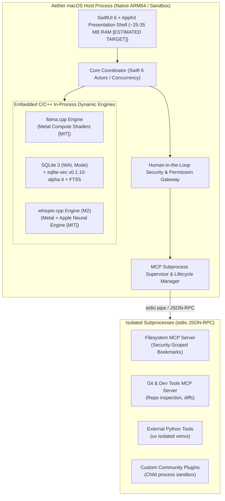
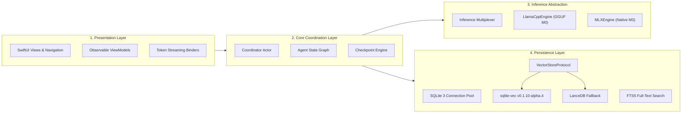
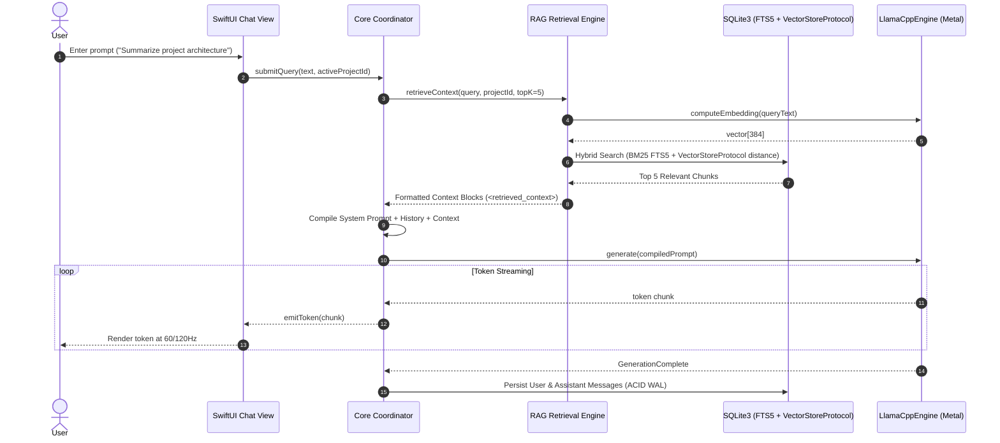
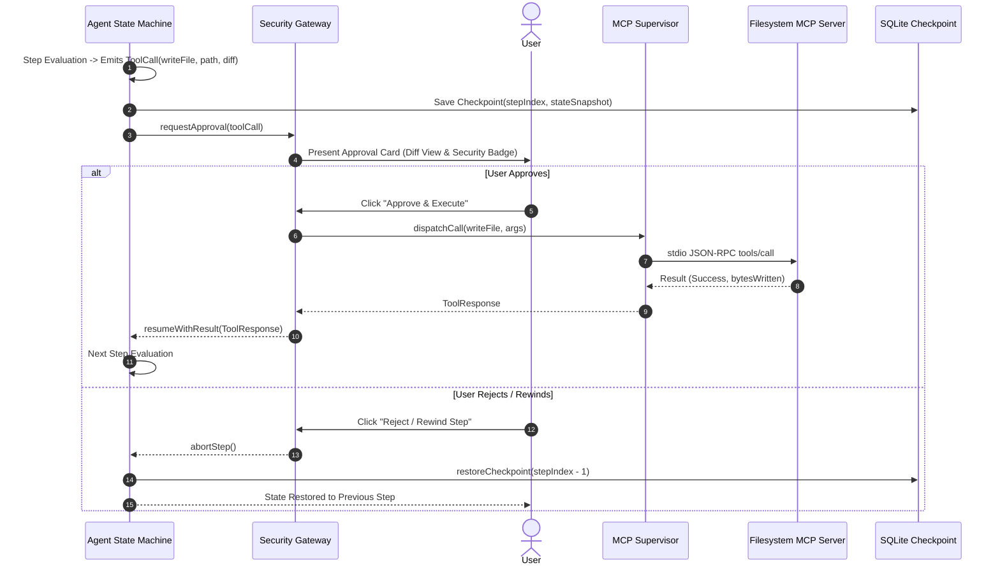

# Aether Proposed Architecture & System Design Specification

**Date:** October 18, 2026  
**Status:** Validated Architecture Specification (Phase 2.1 — Awaiting Human Approval)  
**Target Hardware Matrix:**  
- **Primary Development & Validation Target:** Apple M5 MacBook Air with 16 GB Unified Memory (Provisional performance projections pending Phase 3 empirical validation)  
- **Secondary Compatibility Tier:** Apple Silicon Macs with 8 GB Unified Memory (M1–M4 Base Configurations — strictly resource-constrained tier)  
- **Other Supported Hardware Classes:** M1/M2 16 GB, M3/M4 16 GB, and Pro/Max/Ultra (32 GB – 128 GB Unified Memory). M1–M5 represent distinct hardware classes.  
**System Classification:** Native macOS Desktop Application, Local-First, Zero-Telemetry  

---

## 1. Architectural Philosophy & Design Principles

Aether is engineered from first principles for Apple Silicon. Its architecture adheres to five inviolable design principles:

1. **Zero-Waste Memory Footprint:** `[ESTIMATED TARGET]` On unified-memory Macs, every megabyte consumed by the application framework is stolen from model weights and the attention KV cache. Aether rejects Electron and heavyweight daemon architectures, maintaining an idle memory footprint of ~25–35 MB RAM.
2. **Physical Memory Realism:** `[VERIFIED FACT]` Memory-mapping (`mmap`) allows rapid initial virtual address assignment, but **every page touched during the model's forward pass faults into physical resident RAM**. For sustained token generation, 100% of the active model weights must be resident in physical unified memory.
3. **Embedded First, Subprocess Isolated:** Core inference (`llama.cpp`), persistence (SQLite 3), and audio transcription (`whisper.cpp`) run directly in-process via zero-overhead C ABIs. External tools and MCP servers run as isolated child processes communicating via unidirectional `stdio` pipes.
4. **Deterministic State & Total Rollback:** Agent execution is a deterministic state machine where every transition is captured in an atomic SQLite checkpoint, enabling instantaneous "Time Travel" rewinds.
5. **Defense-in-Depth Security Gateway:** Subprocess separation prevents memory corruption of the host app, but does *not* prevent side-effect damage if a tool has filesystem write or shell permissions. All mutating actions pass through pre-execution argument validation, path traversal guards, and interactive human-in-the-loop approvals.

---

## 2. Process Topology & Boundary Architecture

Aether employs a hybrid process topology: a high-performance native host process that embeds critical engine libraries, paired with an asynchronous process supervisor that isolates external tools and plugins.



### Process Isolation Boundaries & Security Realities:
- **The Host Process (`Aether.app`):** Runs natively inside macOS App Sandbox with hardened runtime. Owns UI rendering, audio hardware access via AVFoundation, Metal compute queues, and the primary SQLite database handle.
- **The Supervisor Layer:** Spawns and manages external tool servers as minimally privileged POSIX child processes (`posix_spawn`). Child processes communicate exclusively over standard input/output (`stdin`/`stdout`). If a child process crashes, hangs, or leaks memory, the Supervisor terminates it with `SIGKILL` without affecting host application stability `[VERIFIED FACT]`.
- **Side-Effect Containment:** Subprocess isolation prevents child process crashes from corrupting the host app memory. However, to prevent child processes from damaging user files or executing malicious shell side-effects, the Supervisor scrubs environment variables (stripping `PATH`, tokens, API keys), validates working directories via `realpath` checks to prevent `../` traversal, and routes all mutating operations through the Human-in-the-Loop Gateway.

---

## 3. Subsystem Architecture & Clean Interfaces



### 3.1 Presentation Layer (SwiftUI + AppKit)
- Built natively using modern SwiftUI (`@Observable` macro, NavigationSplitView, MenuBarExtra).
- **Token Streaming Engine:** Implements backpressure-aware token buffering using Swift's `AsyncStream`. UI updates are throttled to 60/120 Hz displays using `swift-async-algorithms`, preventing UI thread starvation during high-speed token generation (30–60 tok/s) `[ESTIMATED TARGET]`.
- **Zero-Lag Input:** Chat input and workspace navigation remain interactive regardless of model inference load due to thread priority separation (UI on `.userInteractive`, inference Metal compute on dedicated background queues).

### 3.2 Core Coordination Layer (Swift 6 Actors)
- Implemented as thread-safe Swift Actors to enforce compile-time data race safety.
- Manages conversation life cycle, system prompt compilation, context budget truncation, and agent execution loops.
- **Agent State Graph (Milestone M1):** A cyclical finite state machine modeled after deterministic graph concepts. Each step transitions through:
  `THINK -> TOOL_SELECT -> PERMISSION_GATE -> TOOL_EXECUTE -> EVALUATE -> EMIT_RESPONSE`.

### 3.3 Inference Abstraction Layer (Dual-Engine Architecture)
To decouple the application from specific inference libraries, Aether defines a clean protocol interface:

```swift
/// Universal abstraction for local inference runtimes
public protocol InferenceEngineProtocol: AnyObject, Sendable {
    func loadModel(from path: URL, config: ModelConfiguration) async throws
    func unloadModel() async
    func generate(
        prompt: CompiledPrompt,
        parameters: GenerationParameters
    ) -> AsyncThrowingStream<GenerationToken, Error>
    func cancelGeneration() async
    func memoryUsage() async -> EngineMemoryFootprint
}
```

- **`LlamaCppEngine` (Milestone M0):** Implements `InferenceEngineProtocol` via direct C FFI bindings to `llama.h`. Maps GGUF weights, binds Metal buffers to shared unified memory, and yields tokens into an `AsyncThrowingStream`. Cancellation occurs within `< 5 ms` by toggling an atomic flag in the decode loop `[ESTIMATED LATENCY / VERIFIED LOOP-BREAK MECHANISM]`.
- **`MLXEngine` (Milestone M3):** Implements `InferenceEngineProtocol` using `mlx-swift`. Selected when loading Apple-native MLX model weights or during on-device 4-bit LoRA fine-tuning.
- **`InferenceMultiplexer`:** Manages engine selection, idle model unloading (reclaiming RAM after 5 minutes of inactivity), and system memory pressure notifications (`dispatch_source_create(DISPATCH_SOURCE_TYPE_MEMORYPRESSURE)`).

### 3.4 Replaceable Vector Store Architecture (`VectorStoreProtocol`)
Because `sqlite-vec` is currently at pre-1.0 alpha status (`v0.1.10-alpha.4`), Aether isolates all vector indexing and search behind a swappable interface:

```swift
/// Abstract vector storage interface enabling drop-in engine replacement
public protocol VectorStoreProtocol: AnyObject, Sendable {
    func initialize() async throws
    func upsert(chunkId: String, vector: [Float], metadata: [String: String]) async throws
    func search(queryVector: [Float], limit: Int, filter: SearchFilter?) async throws -> [VectorSearchResult]
    func delete(chunkId: String) async throws
    func reset() async throws
}
```

- **Primary Backend (M1):** `SQLiteVecStore` compiling the `sqlite-vec` C extension in-process. Ideal for personal datasets (<20,000 vectors) where relational metadata and vector embeddings share a single SQLite database file.
- **Fallback Backend:** If `sqlite-vec` encounters stability issues, query planner bugs, or dataset scaling ceilings, Aether can swap to `LanceDBStore` (embedded Rust) or `USearchStore` (C++ header-only) without changing a single line of application RAG logic `[RECOMMENDATION]`.

---

## 4. End-to-End Data Flow & Sequence Diagrams

### 4.1 Local RAG Query Execution Flow (Milestone M1)



### 4.2 Agent Tool Execution with Human-in-the-Loop Gate (Milestone M1)



---

## 5. Storage Schema: SQLite & Vector Architecture

```sql
-- 1. Conversation & Session Management (M0 Core MVP)
CREATE TABLE IF NOT EXISTS conversations (
    id TEXT PRIMARY KEY,
    title TEXT NOT NULL,
    project_id TEXT,
    system_prompt_override TEXT,
    model_tag TEXT NOT NULL,
    temperature REAL DEFAULT 0.7,
    created_at INTEGER NOT NULL,
    updated_at INTEGER NOT NULL
);

CREATE TABLE IF NOT EXISTS messages (
    id TEXT PRIMARY KEY,
    conversation_id TEXT NOT NULL REFERENCES conversations(id) ON DELETE CASCADE,
    parent_message_id TEXT,
    role TEXT NOT NULL CHECK(role IN ('system', 'user', 'assistant', 'tool')),
    content TEXT NOT NULL,
    thought_process TEXT,
    tool_calls JSON,
    tool_call_id TEXT,
    token_count INTEGER,
    created_at INTEGER NOT NULL
);
CREATE INDEX IF NOT EXISTS idx_messages_conv ON messages(conversation_id, created_at);

-- 2. Projects & Knowledge Base Management (M1 RAG)
CREATE TABLE IF NOT EXISTS projects (
    id TEXT PRIMARY KEY,
    name TEXT NOT NULL,
    workspace_path TEXT NOT NULL,
    security_scoped_bookmark BLOB,
    created_at INTEGER NOT NULL
);

CREATE TABLE IF NOT EXISTS documents (
    id TEXT PRIMARY KEY,
    project_id TEXT NOT NULL REFERENCES projects(id) ON DELETE CASCADE,
    file_path TEXT NOT NULL,
    file_hash TEXT NOT NULL,
    mime_type TEXT NOT NULL,
    byte_size INTEGER NOT NULL,
    indexed_at INTEGER NOT NULL
);

CREATE TABLE IF NOT EXISTS document_chunks (
    id TEXT PRIMARY KEY,
    document_id TEXT NOT NULL REFERENCES documents(id) ON DELETE CASCADE,
    project_id TEXT NOT NULL,
    chunk_index INTEGER NOT NULL,
    text TEXT NOT NULL,
    token_length INTEGER NOT NULL,
    metadata JSON
);
CREATE INDEX IF NOT EXISTS idx_chunks_project ON document_chunks(project_id);

-- 3. Full-Text Search (FTS5) for Lexical Retrieval (M1 RAG)
CREATE VIRTUAL TABLE IF NOT EXISTS document_chunks_fts USING fts5(
    text,
    content='document_chunks',
    content_rowid='rowid'
);

-- 4. In-Process Vector Table via sqlite-vec (M1 RAG)
-- Abstracted behind VectorStoreProtocol; dimension 384 for bge-small-en-v1.5
CREATE VIRTUAL TABLE IF NOT EXISTS vec_chunks USING vec0(
    chunk_id TEXT PRIMARY KEY,
    embedding FLOAT[384]
);

-- 5. Agent State Machine & Deterministic Checkpointing (M1 Tools)
CREATE TABLE IF NOT EXISTS agent_runs (
    id TEXT PRIMARY KEY,
    conversation_id TEXT NOT NULL REFERENCES conversations(id),
    task_goal TEXT NOT NULL,
    status TEXT NOT NULL CHECK(status IN ('running', 'paused', 'completed', 'failed', 'cancelled')),
    started_at INTEGER NOT NULL,
    completed_at INTEGER
);

CREATE TABLE IF NOT EXISTS agent_checkpoints (
    id TEXT PRIMARY KEY,
    run_id TEXT NOT NULL REFERENCES agent_runs(id) ON DELETE CASCADE,
    step_number INTEGER NOT NULL,
    state_payload JSON NOT NULL,
    action_description TEXT NOT NULL,
    created_at INTEGER NOT NULL
);

-- 6. Human-in-the-Loop Tool Audit & Permission Log (M1 Tools)
CREATE TABLE IF NOT EXISTS tool_audit_log (
    id TEXT PRIMARY KEY,
    run_id TEXT REFERENCES agent_runs(id),
    tool_name TEXT NOT NULL,
    arguments JSON NOT NULL,
    security_tier TEXT NOT NULL,
    user_approval_status TEXT NOT NULL CHECK(user_approval_status IN ('auto_allowed', 'user_approved', 'user_denied')),
    execution_result JSON,
    duration_ms INTEGER,
    executed_at INTEGER NOT NULL
);
```

---

## 6. Minimal Viable Architecture (M0 Launch) vs Platform Roadmap

```
┌────────────────────────────────────────────────────────────────────────┐
│                   AETHER RELEASE MILESTONES                            │
├────────────────────┬───────────────────────────────────────────────────┤
│ Milestone M0       │ Minimal Viable Core (Zero-Setup Foundation)       │
│ (Launch Target)    │ - Pure Native SwiftUI + AppKit Desktop App        │
│                    │ - Embedded llama.cpp Metal Engine (GGUF Q4_K_M)   │
│                    │ - 3B/8B Model Support with 8 GB Safe Envelope     │
│                    │ - SQLite 3 WAL Local Conversation Persistence     │
│                    │ - Single-file database; zero background daemons   │
│                    │ - Token streaming & immediate cancel (<10 ms)     │
├────────────────────┼───────────────────────────────────────────────────┤
│ Milestone M1       │ Local RAG & Extensible Tools                      │
│                    │ - VectorStoreProtocol (sqlite-vec / LanceDB)      │
│                    │ - Apple PDFKit Document Parser                    │
│                    │ - Model Context Protocol (MCP) Host over stdio    │
│                    │ - Human-in-the-Loop Security Approval Gateway     │
│                    │ - Deterministic Agent State Machine + Checkpoints │
├────────────────────┼───────────────────────────────────────────────────┤
│ Milestone M2       │ Multimodal & Speech Engine                        │
│                    │ - Embedded whisper.cpp for Voice Dictation (ANE)  │
│                    │ - Native AVSpeech + Piper Neural TTS              │
│                    │ - Vision LLM support (GGUF vision models)         │
├────────────────────┼───────────────────────────────────────────────────┤
│ Milestone M3       │ On-Device Adaptation & Advanced Memory            │
│                    │ - Local LoRA Fine-Tuning via MLX (16 GB+ Macs)    │
│                    │ - Long-Term Relational Memory Graph (mem0 pattern)│
│                    │ - Advanced Table Parsing (Docling Helper)         │
├────────────────────┼───────────────────────────────────────────────────┤
│ Milestone M4       │ Multi-Device Sync & Ecosystem Maturity            │
│                    │ - End-to-End Encrypted Local P2P Sync (Bonjour)   │
│                    │ - Community MCP Plugin Directory                  │
└────────────────────┴───────────────────────────────────────────────────┘
```
