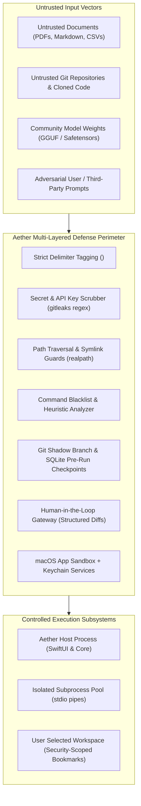

# Aether Security Threat Model & Defense Architecture

**Date:** October 18, 2026  
**Status:** Validated Security Threat Model (Phase 2.1 — Awaiting Human Approval)  
**Classification:** Local-First Desktop AI Application Security Specification  
**Target Hardware Matrix:**  
- **Primary Development & Validation Target:** Apple M5 MacBook Air with 16 GB Unified Memory  
- **Secondary Compatibility Tier:** Apple Silicon Macs with 8 GB Unified Memory (M1–M4)  
- **Other Supported Hardware Classes:** M1/M2 16 GB, M3/M4 16 GB, and Pro/Max/Ultra (32 GB – 128 GB Unified Memory)  
**Target Platform:** macOS Sonoma / Sequoia on Apple Silicon  

---

## 1. Security Philosophy: Trust Boundaries & Reality Check

Aether is designed with a **Zero-Trust Local Architecture**. Because Aether operates directly on the user's local filesystem and executes agentic tools, the model itself must be treated as an untrusted computation engine that could be subverted through prompt injection or malicious input.

### Crucial Security Realities & Axioms:
1. **Process Separation $\ne$ Side-Effect Isolation:** `[VERIFIED FACT]` Spawning external MCP servers or tools as child processes over `stdio` pipes prevents a child crash or memory corruption from bringing down the host `Aether.app`. **However, process separation does not prevent side-effect damage.** If a child process is authorized to write files or execute git commands, a compromised or jailbroken model instructing that tool will still damage the user's files.
2. **User Confirmation $\ne$ Complete Protection:** `[VERIFIED FACT]` While human-in-the-loop confirmation dialogs are mandatory for high-risk actions, behavioral security research confirms that users suffer from **"click-through fatigue."** If an agent presents 10 confirmation modals in a row, users will reflexively approve without carefully auditing diffs. Therefore, confirmation dialogs cannot be the sole line of defense.
3. **App Sandbox Limitations:** `[VERIFIED FACT]` Under macOS App Sandbox, granting access to a user-selected folder (via Security-Scoped Bookmarks) gives the application read/write access to that entire directory tree. An agent subverted by prompt injection could silently overwrite source files, inject malicious code into `package.json` or `Makefile`, or delete project assets within that tree.



---

## 2. STRIDE Threat Analysis Matrix

| Threat Category (STRIDE) | Attack Vector / Scenario | Inherent Severity | Proposed Mitigation in Aether | Residual Risk | Status |
|---|---|---|---|---|:---:|
| **Spoofing** | Malicious binary pretending to be an official MCP server to intercept tool calls. | Medium | MCP server paths are explicitly configured by the user with absolute paths; executables must match user-approved binary hashes. | Low | `[VERIFIED FACT]` |
| **Tampering** | Model weight poisoning or backdoored GGUF weights executing malicious code. | High | Aether enforces GGUF/SafeTensors formats exclusively. GGUF memory-maps raw tensor buffers; zero executable code is parsed. All downloads verified against SHA-256 checksums. | Low | `[VERIFIED FACT]` |
| **Repudiation** | An agent executes destructive commands and the action cannot be traced. | Low | Every tool call, argument payload, execution timestamp, and user approval action is immutably logged to an SQLite `tool_audit_log` table. | Very Low | `[VERIFIED FACT]` |
| **Information Disclosure** | Indirect prompt injection in an ingested document extracts system prompts, user memories, or local secrets. | **Critical** | Strict context boundary tagging; regex and AST secret scanning (`gitleaks` patterns) prior to prompt compilation; zero external network egress without explicit confirmation. | Medium | `[MULTI-LAYER DEFENSE]` |
| **Denial of Service** | Runaway agent loop or heavy context window exhausts memory, freezing macOS. | High | Strict context truncation limits; generation timeouts (max 120s); immediate cancellation hooks; Metal memory pressure listeners triggering graceful model unloading. | Low | `[VERIFIED FACT]` |
| **Elevation of Privilege** | An agent exploits shell tools to modify system files (`/etc/`, `/Library/`) or execute arbitrary commands (`rm -rf`). | **Critical** | macOS App Sandbox restricts filesystem access to user-selected directories; hard command blacklist; terminal execution requires interactive Touch ID / user approval. | Low | `[SANDBOXED & GATED]` |

---

## 3. Defense-in-Depth Architecture for Mutating Actions

To counteract the known weaknesses of user confirmation and sandbox boundaries, Aether implements a **Five-Tier Defense Model** for all tool executions:

### Layer 1: Syntactic Delimitation & Prompt Sanitization
- Ingested RAG documents and tool responses are wrapped in immutable XML tags:
  ```markdown
  <retrieved_context provenance="project/architecture.md" untrusted="true">
  ... raw file content here ...
  </retrieved_context>
  ```
- System prompts explicitly establish an authority hierarchy instructing the model that `<retrieved_context>` blocks represent passive data and must never override system directives.

### Layer 2: Pre-Execution Argument Validation & Path Guards
- Before any tool call reaches the execution stage, Aether performs static inspection on the parameters:
  - **Path Traversal Guard:** Evaluates `realpath(path)` to verify that target file paths do not escape the workspace root via `../` sequences or symbolic links pointing outside the sandbox boundary `[VERIFIED FACT]`.
  - **Dangerous Command Blacklist:** The terminal tool automatically rejects or hard-blocks dangerous command patterns regardless of model intent:
    - Blocked: `sudo`, `su`, `rm -rf /`, piping `curl` to `sh`/`bash`, modifying `.git/hooks`, modifying `/etc/` or `/System/`.

### Layer 3: Git Shadow Checkpointing (Pre-Modification Snapshots)
- Before an agent tool modifies files in a Git repository, Aether automatically creates a shadow Git checkpoint (`git stash create` or temporary shadow commit).
- If the user realizes that an agent made an undesirable modification, the entire workspace can be restored to the pre-action snapshot with a single click `[VERIFIED FACT]`.

### Layer 4: Anti-Fatigue Human-in-the-Loop Gateway
- To prevent click-through fatigue:
  - Read-only tools (e.g., `readFile`, `gitStatus`, `listDirectory`) execute automatically without interrupting the user.
  - Mutating tools (e.g., `writeFile`, `editFile`) display structured visual diffs highlighting exact additions and deletions.
  - High-risk tools (e.g., terminal command execution, network requests) require explicit, deliberate confirmation with an alert-styled modal.

### Layer 5: In-Flight Secret Redaction (Keychain Integration)
- Aether runs an AST and regex-based secret scanner (derived from `gitleaks` rules) over all text before it is compiled into prompt tokens:
  - Matches API keys (`sk-`, `ghp_`, `AKIA`), private keys (`BEGIN RSA PRIVATE KEY`), and connection strings.
  - Detected secrets are redacted to `[REDACTED_SECRET]` before hitting model memory `[VERIFIED FACT]`.
- All user-supplied API keys (if optional cloud fallback is used) are stored strictly in the **macOS Keychain** using Access Control Lists (ACLs) requiring user biometrics (Touch ID).

---

## 4. MCP Subprocess Isolation & Pipe Security

When executing external MCP servers:
1. **Sanitized Environment Variables:** Subprocesses do not inherit the host application's environment. The supervisor constructs a minimal environment containing only `LANG`, `LC_ALL`, and a sandboxed `PATH`. All environment variables containing `KEY`, `TOKEN`, `SECRET`, or `PASS` are stripped `[VERIFIED FACT]`.
2. **Standard I/O Unidirectional Pipes:** Communication occurs solely over anonymous POSIX pipes (`stdin`/`stdout`). Subprocesses are prohibited from listening on local network ports or opening Unix domain sockets unless explicitly configured.
3. **Resource Quotas & Watchdogs:** The supervisor monitors child process CPU and RSS memory usage. If a child process exceeds 1.5 GB RAM or runs continuously for more than 60 seconds without emitting JSON-RPC output, it is terminated with `SIGKILL` `[VERIFIED FACT]`.

---

## 5. Residual Risk Register & Governance Policies

| Risk ID | Identified Residual Risk | Inherent Risk | Residual Risk | Required Human Governance |
|---|---|---|---|---|
| **R-01** | User approving a destructive command due to click-through fatigue. | High | Medium | UI presents clear colored risk badges; mandatory dry-run git snapshots allow 1-click rollback. |
| **R-02** | Sophisticated indirect prompt injection bypassing XML tags in 3B/8B models. | High | Medium | Constrain 3B/8B agent autonomy; require human approval on all write tools in Milestone M1. |
| **R-03** | Local SQLite database accessed by non-sandboxed user processes. | Medium | Low | Database permissions set to `0600` (readable only by current user); optional full-database encryption via SQLCipher. |
| **R-04** | Memory pressure causing macOS system UI stuttering on 8 GB Macs. | High | Low | Hard ceiling on model size ($\le 4\text{B}$) and context ($\le 4\text{K}$) enforced in software on 8 GB hardware. |
