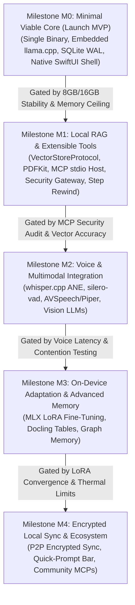

# Aether Implementation Roadmap: Staged Milestone Specification

**Date:** October 18, 2026  
**Status:** Validated Engineering Roadmap (Phase 2.1 — Awaiting Human Approval)  
**Scope:** Staged delivery plan from Minimal Viable Core (M0) through Ecosystem Maturity (M4).  
**Target Hardware:**  
- **Primary Development & Validation Baseline:** Apple M5 MacBook Air with 16 GB Unified Memory (Provisional performance targets pending Phase 3 benchmark)  
- **Secondary Compatibility Tier:** Apple Silicon Macs with 8 GB Unified Memory (M1–M4 Base Configurations — strictly resource-constrained tier)  
- **Other Supported Hardware Classes:** M1/M2 16 GB, M3/M4 16 GB, and Pro/Max/Ultra (32 GB – 128 GB Unified Memory). M1–M5 represent distinct hardware classes.  

---

## 1. Roadmap Strategy: The Radical MVP Scoping Philosophy

Aether's roadmap is built on a fundamental engineering principle: **Ship an exceptional, zero-bloat, local-first core before expanding into complex multi-process ecosystems.**

Attempting to ship agent tool execution, multimodal voice, vector RAG, on-device fine-tuning, and multi-device sync simultaneously creates immense debugging surface, increases memory leak risks, and risks unstable execution on 8 GB Macs. Aether isolates platform layers into five sequentially gated milestones:

---

## 2. Detailed Milestone Specifications

### Milestone M0: Minimal Viable Core (The Smallest Useful Aether MVP)
*Goal: Provide a lightning-fast, zero-setup, private desktop AI experience that runs flawlessly within 8 GB and 16 GB Unified Memory.*

#### Deliverables & Architecture:
- **Presentation Layer:** Pure native SwiftUI + AppKit desktop application (`Aether.app`).
  - Native multi-turn chat view with syntax-highlighted Markdown rendering.
  - Streaming token binder with 60/120 Hz display synchronization via Swift `AsyncStream` `[ESTIMATED TARGET]`.
  - Immediate generation cancellation button (<10 ms stop response) `[ESTIMATED LATENCY / VERIFIED LOOP-BREAK]`.
  - Model manager UI: local GGUF file importer, folder scanner, and one-click downloader from Hugging Face with progress indicators.
- **Inference Runtime:** Embedded `llama.cpp` Metal C++ engine linked directly via Swift C FFI.
  - Zero external background processes or network daemons `[VERIFIED FACT]`.
  - Direct zero-copy memory-mapping (`mmap`) of GGUF model files.
  - Automatic idle model unloading (reclaims memory to <35 MB after 5 minutes of inactivity).
  - Out-of-the-box support for Llama 3.2 (3B), Qwen 2.5 (3B/7B), and Mistral Nemo (8B) quantized at `Q4_K_M` and `Q5_K_M`.
- **Persistence:**
  - Single-file SQLite 3 database (`~/Library/Application Support/Aether/aether.sqlite`) in WAL mode.
  - Stores conversation metadata and message trees with full ACID transaction safety.
- **Target Hardware Envelope:**
  - **8 GB Compatibility Tier:** Llama-3.2-3B Q4_K_M (1.95 GB weights) + 4K context (0.26 GB KV) = **~2.46 GB total app memory**. Zero swap disk writes `[CALCULATED / PROPOSED TARGET]`.
  - **16 GB Baseline Tier (M1–M5):** Llama-3.1-8B Q4_K_M (4.70 GB weights) + 8K context (1.02 GB KV) = **~6.17 GB total app memory**. Leaves ~6.0 GB headroom `[CALCULATED]`.

#### Explicitly Deferred from M0:
- **Deferred to M1:** Document Ingestion & Vector RAG (Capabilities 05 & 06) — eliminates initial indexing overhead and vector database complexity during launch.
- **Deferred to M1:** MCP Tool Execution & Subprocess Host (Capabilities 08 & 09) — preserves security until core conversation loops are verified.
- **Deferred to M2:** Voice Dictation & Text-to-Speech (Capability 11) — avoids audio framework complexity in M0.
- **Deferred to M3:** On-Device LoRA Fine-Tuning (Capability 10) — requires extensive Metal backpropagation testing.
- **Deferred to M4:** Peer-to-Peer Multi-Device Sync (Capability 19).

#### Exit Criteria / Release Gate:
- Pass 100 consecutive streaming test prompts without memory growth.
- Zero external daemons running (`ps aux | grep aether` shows only `Aether.app`).
- Installer package size < 25 MB compressed.

---

### Milestone M1: Local RAG & Extensible Tools
*Goal: Transform Aether from a chat client into an autonomous developer and knowledge assistant with strict human-in-the-loop security.*

#### Deliverables & Architecture:
- **Local Document RAG:**
  - Document ingestion via Apple's native, memory-safe `PDFKit` framework.
  - Local semantic vector search via `VectorStoreProtocol` (defaulting to `sqlite-vec v0.1.10-alpha.4` with an explicit fallback to `LanceDB`).
  - Hybrid lexical-semantic retrieval combining SQLite FTS5 BM25 with vector similarity.
- **Tool Protocol:** Full Model Context Protocol (MCP) Host implementation.
  - Subprocess supervisor executing MCP servers over unidirectional `stdio` POSIX pipes.
  - Support for community MCP servers (filesystem, Git, SQLite, Fetch).
- **Human-in-the-Loop Security Gateway:**
  - Interactive approval cards rendered in the chat interface displaying exact tool names, parameters, and unified file diffs.
  - Pre-execution static analysis: command blacklists and `realpath` path traversal guards.
  - Mandatory Git shadow checkpoints (`git stash create`) prior to file modifications.
- **Agent State Graph & Time Travel:**
  - Deterministic Swift Actor state machine.
  - Atomic state checkpointing to SQLite after every tool step.
  - User "Step Rewind" UI: easily revert bad tool decisions back to any prior checkpoint.

#### Exit Criteria / Release Gate:
- Zero unauthorized file modifications in red-team prompt injection tests.
- Reverting a 5-step agent task restores SQLite database state with 100% fidelity.

---

### Milestone M2: Voice & Multimodal System Integration
*Goal: Enable hands-free voice interaction and visual document understanding without compromising offline privacy.*

#### Deliverables & Architecture:
- **Audio Dictation Engine (Capability 14):**
  - Embedded `whisper.cpp` engine compiled with Apple Neural Engine (ANE) Core ML acceleration.
  - Silero VAD (`silero-vad`) for real-time speech boundary detection in under 1 ms.
  - Push-to-talk and voice-activated hands-free conversational loops.
- **Offline Speech Synthesis:**
  - Built-in macOS `AVSpeechSynthesizer` integration for zero-disk, zero-memory speech playback.
  - Optional high-fidelity local neural TTS via `Piper` ONNX runtime.
- **Multimodal Vision:**
  - Support for multi-modal GGUF models (e.g., Llama 3.2 Vision, Qwen 2 VL) via `llama.cpp` clip projection.
  - Drag-and-drop image analysis, screenshot inspection, and UI diagram interpretation.

#### Exit Criteria / Release Gate:
- Audio transcription real-time factor < 0.15x on base M1 Macs `[ESTIMATED TARGET]`.
- Concurrent audio transcription and 3B model generation operates stably within 8 GB RAM.

---

### Milestone M3: On-Device Adaptation & Advanced Memory
*Goal: Provide personalized local intelligence through on-device fine-tuning and deep document table extraction.*

#### Deliverables & Architecture:
- **On-Device LoRA Fine-Tuning (Capability 15 - 16 GB+ Macs Only):**
  - Native Metal gradient computation and LoRA adapter training using `mlx` / `mlx-swift`.
  - User-driven preference tuning (DPO) on local conversation exports.
  - Dynamic LoRA adapter hot-swapping during inference.
- **Advanced Document Processing (Capability 09):**
  - Out-of-process `Docling` helper process for complex PDF table and mathematical formula extraction.
  - Automatic fallback to Apple `PDFKit` when available unified memory is below 4 GB.
- **Long-Term Memory Graph (Capability 08):**
  - Entity and preference extraction inspired by `mem0` stored in local relational SQLite tables.

#### Exit Criteria / Release Gate:
- Successfully train a 4-bit LoRA adapter on an M2 Pro (16 GB) without exceeding thermal or memory throttling limits.

---

### Milestone M4: Encrypted Local Sync & Ecosystem Maturity
*Goal: Enable multi-Mac workflows and an open ecosystem while maintaining absolute zero-cloud privacy.*

#### Deliverables & Architecture:
- **Peer-to-Peer Encrypted Sync (Capability 13 & 21):**
  - Direct local network synchronization between user Macs and iPads using Apple's Network framework and Bonjour discovery.
  - End-to-end encryption with keys stored strictly in the macOS Keychain; zero central cloud servers.
- **Community MCP Plugin Directory:**
  - Curated, sandboxed catalog of one-click installable MCP tools.

#### Exit Criteria / Release Gate:
- Sync 1,000 conversations between two Macs over local Wi-Fi in under 30 seconds with 100% consistency.

---

## 3. Milestone Summary & Hardware Feasibility Matrix

| Feature / Subsystem | M0 (MVP) | M1 (RAG/Tools) | M2 (Voice) | M3 (Adapt) | M4 (Sync) | 8 GB Compatibility Tier | Primary: M5 16 GB / M1–M4 16 GB |
|---|:---:|:---:|:---:|:---:|:---:|:---:|:---:|
| Native SwiftUI Desktop Shell | ✅ | ✅ | ✅ | ✅ | ✅ | **Yes** (<35 MB RAM) `[ESTIMATED TARGET]` | **Yes** |
| Embedded llama.cpp Metal Engine | ✅ | ✅ | ✅ | ✅ | ✅ | **Yes** (3B Models) `[VERIFIED FACT]` | **Yes** (8B Models) |
| SQLite WAL Conversation Persistence | ✅ | ✅ | ✅ | ✅ | ✅ | **Yes** (<10 MB RAM) `[ESTIMATED TARGET]` | **Yes** |
| VectorStoreProtocol RAG | ❌ | ✅ | ✅ | ✅ | ✅ | **Yes** (Filtered context) | **Yes** |
| Apple PDFKit Ingestion | ❌ | ✅ | ✅ | ✅ | ✅ | **Yes** `[VERIFIED FACT]` | **Yes** |
| MCP Host & stdio Subprocesses | ❌ | ✅ | ✅ | ✅ | ✅ | **Yes** (1 tool at a time) | **Yes** (Multi-tool) |
| Human-in-the-Loop Gateway | ❌ | ✅ | ✅ | ✅ | ✅ | **Yes** | **Yes** |
| Agent State Checkpoints & Rewind | ❌ | ✅ | ✅ | ✅ | ✅ | **Yes** | **Yes** |
| whisper.cpp Speech-to-Text | ❌ | ❌ | ✅ | ✅ | ✅ | **Yes** (`base.en` ~140 MB) | **Yes** (`small.en`) |
| Vision LLM Support | ❌ | ❌ | ✅ | ✅ | ✅ | **Tight** (Requires 3B Vision) | **Yes** (11B Vision) |
| MLX LoRA Fine-Tuning | ❌ | ❌ | ❌ | ✅ | ✅ | **NO (Blocked: >12GB RAM)** | **Yes** (4-bit LoRA) |
| Out-of-Process Docling Tables | ❌ | ❌ | ❌ | ✅ | ✅ | **NO (Heavy vision model)** | **Yes** |
| P2P Encrypted Local Sync | ❌ | ❌ | ❌ | ❌ | ✅ | **Yes** | **Yes** |
