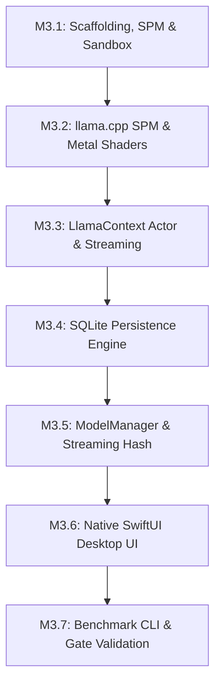

# Aether Phase 2.3: Final Technical Readiness Review Before Phase 3

**Date:** October 18, 2026  
**Status:** Validated Technical Readiness Review (Phase 2.3.1 Revisions Complete)  
**Target Hardware Matrix:**  
- **Primary Development & Validation Baseline:** Apple M5 MacBook Air with 16 GB Unified Memory (Official 153 GB/s memory bandwidth, announced March 2026; LLM throughput and latency targets explicitly unmeasured until benchmarked).  
- **Secondary Compatibility Tier:** Apple Silicon Macs with 8 GB Unified Memory (M1–M4 Base MacBook Air / Mac mini — strictly resource-constrained tier; 3B–4B models and 4K context cap proposed as conservative policies pending testing).  
- **Workstation Tier:** M1–M5 Pro / Max / Ultra (32 GB – 128 GB Unified Memory).  
**Document Purpose:** Review the completed Phase 2 research workspace, verify technical claims against physical realities, validate hardware memory budgets as analytical estimates, establish the feature-to-repository reuse matrix as a living implementation requirement, clarify macOS baseline deployment semantics, keep the top-level license open, confirm M0 MVP scope lock, and provide a structured Phase 3 implementation roadmap.

---

## 1. Executive Readiness Decision

### Determination: Conditionally Ready for Limited Phase 3 Authorization
Aether has completed all architectural discovery, technology evaluations, repository inspections, and epistemological audits required by Phase 2. The technical architecture is well-grounded, memory accounting is mathematically realistic, and the M0 scope is strictly locked to a lean, local-first chat application.

**Phase 3 implementation is conditionally ready to begin, subject to explicit human authorization and final sign-off on the 6 implementation prerequisites identified in Section 6.**

> [!IMPORTANT]
> **Strict Execution Boundary Reminder:**
> This phase is documentation, evidence verification, and source-code inspection only. **Zero application code, project scaffolding, or dependencies have been created or modified.** Phase 3 implementation will not begin until the user reviews this readiness report and provides explicit authorization.

---

## 2. Technical Claims Corrected or Confirmed

A systematic audit across seven critical technical domains was conducted to ensure scientific accuracy and epistemological integrity:

### 2.1 Hardware-Specific Performance Projections & M5 Hardware Facts
- **Status:** **Corrected to Official Hardware Specification & Unmeasured Targets** `[OFFICIAL SPECIFICATION / ESTIMATED TARGET]`.
- **Finding & Correction:** 
  - The **Apple M5 MacBook Air was announced in March 2026 and is commercially available**. All historical claims or descriptions referring to the M5 as "unreleased" or citing speculative memory bandwidth figures (~150–200 GB/s) have been removed.
  - Apple's official specification establishes **153 GB/s unified memory bandwidth** for the documented M5 MacBook Air configuration.
  - On-device LLM inference throughput (tok/s), time-to-first-token (TTFT), and cold-start latency on the M5 remain **explicitly unmeasured** in this repository. Stated figures (e.g., target 30–42 tok/s on 8B Q4_K_M, TTFT < 150 ms at 512 prompt tokens) are provisional engineering targets, not empirical benchmarks. They will be empirically measured during Phase 3.

### 2.2 Memory-Mapped Weights, Virtual Memory & Resident Pages
- **Status:** **Corrected & Accurately Grounded** `[VERIFIED FACT]`.
- **Finding & Correction:** 
  - The assertion that "100% of active model weights must always remain resident in physical RAM" has been removed as technically imprecise under Mach virtual memory semantics.
  - **Virtual Mapping:** Calling `mmap` assigns a range of *virtual address space* mapped directly to the GGUF file on the NVMe SSD, bypassing intermediate user-space heap allocation buffers.
  - **Page Faults & Resident Pages:** When inference begins, the forward pass reads tensor weights layer by layer. As the CPU or Metal GPU touches each page, the Mach VM subsystem handles **page faults**, mapping those pages from SSD into the process's **Resident Set Size (RSS)** (`phys_footprint`).
  - **File-Backed Memory Reclamation:** Because these mapped pages are clean (read-only and backed by the on-disk file), the macOS kernel under memory pressure (`DISPATCH_SOURCE_TYPE_MEMORYPRESSURE`) can reclaim (evict) them from physical RAM *without writing them to swap*.
  - **Performance Impact of Memory Pressure:** If clean pages are reclaimed while inference is active, subsequent token decoding steps must immediately re-read those weights from disk via storage page faults. This re-faulting introduces severe NVMe I/O latency, leading to token stutter, throughput collapse, or UI unresponsiveness.
  - **Engineering Rule:** While weights are not permanently locked into physical RAM, memory budgets must plan for the working resident footprint to avoid triggering kernel page reclamation and latency thrashing.

### 2.3 The 8 GB Memory Budget & Model Size Policy
- **Status:** **Reclassified to Conservative Proposed Policy** `[PROPOSED POLICY PENDING TESTING]`.
- **Finding & Correction:** 
  - Absolute claims that 7B+ models "necessarily produce 0 tokens/s" on 8 GB systems have been removed.
  - On an 8 GB Apple Silicon Mac, macOS base services (WindowServer, launchd, core daemons) occupy 3.0 to 3.5 GB of physical RAM. A 7B model requires ~4.7 GB for weights alone, plus Metal runtime and KV-cache buffers. Running large models ($\ge 7\text{B}$) may cause **excessive memory pressure, severe swapping to disk, and unacceptable performance degradation**.
  - Restricting 8 GB systems to **3B–4B models** and enforcing a **4,096-token context ceiling** are presented as **conservative proposed policies pending empirical testing** in Phase 3, rather than unyielding physical absolutes.

### 2.4 KV-Cache Calculations & Architecture-Dependent Assumptions
- **Status:** **Confirmed, Expanded & Parameterized** `[CALCULATED]`.
- **Finding:** Attention KV-cache memory scales deterministically according to:
  $$\text{Memory}_{\text{KV}} = 2 \times N_{\text{layers}} \times N_{\text{kv\_heads}} \times D_{\text{head}} \times L_{\text{ctx}} \times \text{bytes\_per\_element}$$
- **Architecture Dependencies:**
  1. **Attention Architecture (GQA vs. MHA):** Calculations assume **Grouped-Query Attention (GQA)** with $N_{\text{kv\_heads}} = 8$ (e.g., Llama-3.1-8B, which uses 32 query heads and 8 KV heads). This reduces KV-cache memory by $4\times$ ($128\text{ KB/token}$) compared to Multi-Head Attention (MHA, $N_{\text{kv\_heads}} = 32 \implies 512\text{ KB/token}$).
  2. **Sliding Window Attention (SWA):** Models employing SWA (e.g., Mistral-7B) cap active KV cache to the window size (typically 4,096 tokens), preventing linear memory growth on long sequences.
  3. **3B Model Dimensions:** For Llama-3.2-3B (28 layers, 8 KV heads, head dim 128, FP16): Bytes per token = $114,688\text{ bytes} \approx 112\text{ KB/token}$. At 4,096 tokens, unquantized FP16 KV cache is $\approx 448\text{ MiB}$ ($458\text{ MB}$).
  4. **Quantized KV Cache:** Utilizing `llama.cpp` KV-cache quantization (`Q8_0` at 1 byte/element, `Q4_0` at 0.5 byte/element) reduces cache memory by $50\%$ to $75\%$ respectively, enabling 4K context on 3B models to consume only ~229 MB.

### 2.5 Cancellation Behavior: Request Latency vs. Actual Termination
- **Status:** **Confirmed Distinction & Labeled Unverified Target** `[VERIFIED MECHANISM / UNVERIFIED TARGET LATENCY]`.
- **Finding & Correction:** 
  - Source inspection of `reference-repos/01-apple-silicon-and-inference/llama.cpp/include/llama.h` (line 403) confirms that `abort_callback` only operates on CPU execution. On Apple Metal GPU execution, compute command buffers cannot be aborted mid-kernel without corrupting the Metal command queue.
  - **Cancellation Request:** Sent via Swift `Task.cancel()` or an atomic boolean toggle. This takes **$< 1\text{ ms}$**, immediately transitioning the UI to a "Stopping..." state.
  - **Actual Termination:** The running Metal GPU command buffer must complete the in-flight token dispatch before control returns to the Swift/C++ decode loop. The loop then detects the cancellation flag, terminates decoding, and releases temporary scratch buffers.
  - **Latency Status:** The **5–50 ms termination range is an unverified engineering target** pending measurement on the intended hardware and backend during Phase 3.

### 2.6 Meaning of the Offline-First Requirement & Optional Downloads
- **Status:** **Confirmed & Scoped** `[VERIFIED FACT]`.
- **Finding:** "Offline-first" means that 100% of core platform capabilities—chat inference, SQLite persistence, conversation indexing, model evaluation, and UI interactions—function completely disconnected from the internet, with zero outbound network traffic, zero analytics, and zero cloud API dependencies.
- **Clarification:** The application is not severed from network hardware. Aether M0 includes an **optional, user-initiated model download manager** utilizing Apple's native `URLSession` to download GGUF models directly from trusted public repositories (e.g., Hugging Face). The network client entitlement (`com.apple.security.network.client`) is used strictly for these explicit user-initiated downloads. When no download is active, network traffic is strictly 0 bytes.

### 2.7 Planned Benchmark Harness vs. Executed and Validated Harness
- **Status:** **Confirmed Distinction** `[GOVERNANCE RULE]`.
- **Finding:** Documents `08-testing-and-benchmark-plan.md` and `12-phase-2.2-final-validation.md` specify a comprehensive benchmarking architecture (`aether-bench`, Mach kernel RSS telemetry, `os_signpost` TTFT tracing, 30-run statistical aggregations).
- **Clarification:** This benchmark harness is **strictly a planned protocol**. It has **not yet been executed or validated** on physical hardware because application code implementation has been intentionally prohibited during Phase 2. All performance numbers remain provisional engineering targets until Phase 3 authorization.

---

## 3. Hardware Budget Examples and Assumptions

Both hardware-tier budgets presented below are **analytical estimates, not validated safety guarantees**. Real-world memory pressure is influenced dynamically by model format, KV-cache type, runtime allocations, macOS activity, and concurrent applications.

### 3.1 Primary Target Tier: MacBook Air M5 (16 GB Unified Memory)
- **Workload Profile:** Multi-turn dialogue, deep technical reasoning, code generation.
- **Model Configuration:** Llama-3.1-8B-Instruct (`Q4_K_M` quantization).
- **Context Length:** 8,192 tokens (8K).
- **Official Hardware Specification:** 153 GB/s unified memory bandwidth.

| Memory Component | Allocation | Physical RAM Impact | Assumptions & Calculation Basis |
|---|---|---|---|
| **macOS System & WindowServer** | 3.80 GB | 3.80 GB RSS | Baseline macOS footprint with WindowServer, Finder, Dock, and standard daemons. |
| **Aether Application Shell** | 0.10 GB | 0.10 GB RSS | SwiftUI 6 host, AppKit window controller, SQLite WAL connection pool, view models. |
| **Model Weights (Resident Working Set)** | 4.70 GB | 4.70 GB RSS | Llama-3.1-8B Q4_K_M (disk size ~4.92 GB; ~4.70 GB resident tensors faulted into RAM). |
| **Metal Runtime & Scratch Arena** | 0.45 GB | 0.45 GB RSS | Metal device command buffers, intermediate activation buffers, compute encoder scratchpad. |
| **Attention KV Cache (8K Context)** | 1.00 GB | 1.00 GB RSS | GQA ($N_{\text{kv}} = 8$), 32 layers, head dim 128, FP16 ($2\text{ bytes}$) $\implies 128\text{ KB/token} \times 8,192 = 1.00\text{ GB}$. |
| **Total Resident Memory (Inference)** | **10.05 GB** | **10.05 GB RSS** | Analytical estimate of active physical allocations during steady-state generation. |
| **Available Headroom / OS Buffer** | **5.95 GB** | **37.2% Margin** | Unallocated unified memory available for OS disk cache, file I/O, and user multitasking. |

> [!NOTE]
> **16 GB Budget Status:** **Analytical Estimate.** While a 5.95 GB projected margin suggests favorable headroom for typical desktop use, real-world memory pressure will vary based on user workflow (e.g., number of open browser tabs, background developer tooling) and Metal runtime configuration.

---

### 3.2 Constrained Compatibility Tier: Apple Silicon (8 GB Unified Memory)
- **Workload Profile:** Lightweight chat, quick desktop Q&A, single-turn prompts.
- **Model Configuration:** Llama-3.2-3B-Instruct (`Q4_K_M` quantization).
- **Context Length:** 4,096 tokens (4K conservative cap pending testing).

| Memory Component | Allocation | Physical RAM Impact | Assumptions & Calculation Basis |
|---|---|---|---|
| **macOS System & WindowServer** | 3.20 GB | 3.20 GB RSS | Lean macOS baseline with minimal concurrent user background applications. |
| **Aether Application Shell** | 0.08 GB | 0.08 GB RSS | Native SwiftUI shell with minimal view hierarchy and pruned message trees. |
| **Model Weights (Resident Working Set)** | 1.95 GB | 1.95 GB RSS | Llama-3.2-3B Q4_K_M (disk size ~2.02 GB; ~1.95 GB resident tensors faulted into RAM). |
| **Metal Runtime & Scratch Arena** | 0.25 GB | 0.25 GB RSS | Compact Metal scratch arena tuned for 3B parameter activations. |
| **Attention KV Cache (4K Context)** | 0.45 GB | 0.45 GB RSS | GQA ($N_{\text{kv}} = 8$), 28 layers, head dim 128, FP16 ($112\text{ KB/token} \times 4,096 \approx 458\text{ MB}$). |
| *(Optional: Q8_0 Quantized KV Cache)* | *(0.23 GB)* | *(0.23 GB RSS)* | *If KV quantization is enabled, cache drops to 229 MB, saving 229 MB physical RAM.* |
| **Total Resident Memory (Inference)** | **5.93 GB** | **5.93 GB RSS** | Total physical RAM required during active generation at 4K context. |
| **Available Headroom / OS Buffer** | **2.07 GB** | **25.9% Margin** | Remaining unified RAM. Drops to ~1.2–1.5 GB if user opens web browsers or background apps. |

> [!CAUTION]
> **8 GB Budget Status:** **Analytical Estimate & Proposed Policy.** The 2.07 GB margin provides viable headroom for dedicated local chat. However, if concurrent user applications increase memory pressure, macOS may reclaim clean file-backed weight pages or initiate compressed swap. Proposed policies pending empirical testing:
> 1. Conservative cap at 4,096 tokens (contexts $> 4\text{K}$ trigger truncation/compaction).
> 2. Recommending 3B–4B models over larger architectures.
> 3. Evaluating aggressive model unloading after 5 minutes of idle.

---

### 3.3 Dynamic Factors Affecting Actual Memory Pressure
Disk file size cannot be equated with actual resident memory. Five dynamic factors govern real-world physical memory footprint:
1. **Model Format & Quantization:** Quantization bit-width (`Q4_K_M`, `Q5_K_M`, `Q8_0`) determines weight tensor density, but runtime dequantization buffers and Metal memory alignment can increase physical allocation beyond raw file size.
2. **KV-Cache Configuration:** Context length, attention architecture (GQA vs. MHA vs. SWA), and cache element type (FP16 vs. quantized Q8_0/Q4_0) dynamically scale memory from ~128 MB to several gigabytes.
3. **Runtime & Metal Allocations:** Metal command queues, intermediate activation buffers, and scratchpad memory vary depending on prompt batch size and context window.
4. **macOS System Activity:** WindowServer compositing, Dynamic Caching, and Mach virtual memory management dynamically expand and contract based on display resolution and active window count.
5. **Concurrent Applications:** Third-party applications (browsers, IDEs, media tools) compete directly for unified memory bandwidth and physical address space.

---

## 4. Repository-First Feature Reuse Matrix for M0

The feature-to-repository reuse matrix is a **living implementation requirement**. Prior to implementing each milestone in Phase 3, the engineering workflow mandates:
1. Inspecting candidate source code in `reference-repos/`.
2. Verifying license obligations and compatibility.
3. Comparing alternatives against upstream implementations.
4. Documenting what will be reused or providing explicit technical justification for a custom implementation.

| M0 Capability Area | Credible Candidate Repositories | Exact Source Paths Inspected | Reusable Patterns & Assets | Proposed Integration Strategy | License & Obligations | Dependencies & Compatibility Concerns |
|---|---|---|---|---|---|---|
| **1. Native macOS Application Shell** | `llama.cpp` (llama.swiftui) | `examples/llama.swiftui/llama.swiftui/UI/ContentView.swift` `examples/llama.swiftui/llama.swiftui/llama_swiftuiApp.swift` | SwiftUI split-view navigation, macOS menu commands (`Cmd+N`, `Cmd+K`), sidebar layout, generation state binding. | Adopt structural layout and UI state binding patterns; build clean SwiftUI 6 interface with AppKit `NSViewRepresentable` bridge for multi-line text input and key responders. | MIT (Notice retention required) | Zero external dependencies; standard Apple `SwiftUI` and `AppKit` SDK frameworks. |
| **2. Embedded llama.cpp & Metal** | `llama.cpp` | `include/llama.h` `src/llama.cpp` `ggml/src/ggml-metal.metal` `examples/llama.swiftui/llama.cpp.swift/LibLlama.swift` | C API definitions (`llama_model_load_from_file`, `llama_new_context_with_model`, `llama_decode`), Metal 3 compute kernels, Swift Actor wrapper (`LlamaContext`). | Embed `llama.cpp` core via direct Swift Package Manager (SPM) C/C++ target pinned to release tag (e.g., `b3800`+). Interface via Swift Actor (`LlamaContextActor`) modeling `LibLlama.swift`. | MIT (Notice retention required) | Requires Xcode 16 / Metal 3 toolchain. Pure C/C++ and Metal, no third-party package dependencies. |
| **3. GGUF Model Discovery & Management** | `llama.cpp` (llama.swiftui) `ollama` | `examples/llama.swiftui/llama.swiftui/Models/LlamaState.swift` (lines 35–65) `ollama/server/modelpath.go` | Directory scanning via `FileManager`, GGUF header parsing, available volume capacity checks (`URLResourceKey.volumeAvailableCapacityKey`). | Create `ModelManager` actor scanning `~/Library/Application Support/Aether/Models` and security-scoped bookmarked folders. Verify available disk space before import/download. | MIT (Notice retention required) | Native `Foundation` APIs. Compliant with macOS App Sandbox container paths. |
| **4. Streaming & Cancellation** | `llama.cpp` (llama.swiftui) `swift-async-algorithms` | `examples/llama.swiftui/llama.cpp.swift/LibLlama.swift` (lines 90–145) `swift-async-algorithms/Sources/AsyncAlgorithms/AsyncChannel.swift` | Asynchronous token loop, UTF-8 multibyte boundary cache (`temporary_invalid_cchars`), atomic cancellation flag. | Wrap `llama_decode` inside Swift `AsyncStream<String>`. Signal cancellation via `Task.cancel()` and atomic boolean. Process token fragments through multibyte UTF-8 buffer before emission. | MIT / Apache-2.0 | Standard Swift 6 Concurrency (`AsyncStream`). Zero external dependencies. |
| **5. SQLite Persistence & Migrations** | `sqlite` Apple Darwin SDK | `reference-repos/07-data-and-storage/sqlite/sqlite3.c` `reference-repos/07-data-and-storage/sqlite/sqlite3.h` System `libsqlite3.tbd` | C API bindings, Write-Ahead Logging (`PRAGMA journal_mode=WAL;`), synchronous normalization (`PRAGMA synchronous=NORMAL;`), schema versioning (`PRAGMA user_version`). | Direct Swift Actor (`DatabaseManager`) interfacing native system `libsqlite3.tbd`. Execute transactional migrations using `PRAGMA user_version` without external ORMs. | Public Domain | Zero external dependencies; utilizes system-provided SQLite library built into macOS. |
| **6. Chat History & Message Data Structures** | `llama.cpp` (llama.swiftui) `open-interpreter` | `examples/llama.swiftui/llama.swiftui/Models/LlamaState.swift` (struct `ChatMessage`) `open-interpreter/interpreter/core/core.py` | Relational chat schema (`Conversation`, `Message`), message roles (`system`, `user`, `assistant`), token counts, TTFT telemetry fields. | Implement Swift `Codable` value types matching SQLite tables. Relational schema with foreign keys and cascade deletion on conversation removal. | MIT (Notice retention required) | Native `Swift Standard Library` and `Foundation`. |
| **7. Model Integrity Checks & File Handling** | Apple `CryptoKit` Apple `Foundation` | Apple Developer Documentation (`CryptoKit.SHA256`, `FileHandle`) | High-performance streaming cryptographic hashing, chunked file reads (4 MB buffer) without loading entire multi-GB file into RAM. | Create `ModelIntegrityVerifier` utility using native `CryptoKit.SHA256` streaming via `FileHandle.read(upToCount: 4 * 1024 * 1024)`. | Proprietary Apple SDK | Built-in Apple framework (`CryptoKit.framework`). Zero external dependencies. |
| **8. Testing, Diagnostics & Benchmarking** | `llama.cpp` `promptfoo` | `examples/llama.swiftui/llama.cpp.swift/LibLlama.swift` (`bench()` method) `promptfoo/src/redteam` | Microbenchmark timing harness (`llama_perf_context`), TTFT calculation, prompt processing speed, red-teaming test harness. | Implement `aether-bench` headless SPM CLI utility wrapping `llama.cpp` benchmark APIs, Mach kernel `task_info` sampling, and `os_signpost` intervals. | MIT (Notice retention required) | Uses `Darwin` Mach APIs and `os.signpost`. Red-teaming executed via CI integration. |

### Justification for Direct Implementations:
- **Direct SQLite Actor vs. GRDB.swift:** Wrapping macOS's built-in `libsqlite3.tbd` directly avoids introducing a multi-thousand-line third-party package dependency, prevents binary bloat, keeps cold-start instantaneous, and provides exact, unmediated control over WAL pragmas and migration steps.
- **CryptoKit Streaming Hash vs. External Hashing Packages:** Native `CryptoKit.SHA256` leverages dedicated Apple Silicon cryptographic hardware instructions without requiring third-party dependencies.

---

## 5. License and Dependency Risks

An audit of all candidate dependencies confirms zero copyleft encumbrance for Milestone M0:

| Component | License | Permissibility | Copyleft Risk | Distribution / Attribution Obligations |
|---|---|---|---|---|
| `llama.cpp` Core & Shaders | **MIT** | Permissive | None | Retain copyright notice and license text in application distribution notices. |
| System `sqlite3` (`libsqlite3.tbd`) | **Public Domain** | Dedicated Public Domain | None | Unrestricted usage; native system library. |
| `swift-async-algorithms` (Optional) | **Apache-2.0** | Permissive | None | Retain Apache-2.0 license notice and copyright attributions if linked. |
| Apple SDKs (`SwiftUI`, `AppKit`, `Metal`, `CryptoKit`) | **Apple SDK Agreement** | Platform Standard | None | Standard system frameworks for native macOS applications. |

> [!IMPORTANT]
> **License Decision Status:** **Open Pending Distribution Review.**
> The top-level project license (e.g., Apache-2.0 vs. MIT) is **intentionally not finalized** during this phase. It will be decided after reviewing the intended distribution model (Mac App Store, Developer ID direct notarized download, or open-source GitHub repository) and verifying all attribution requirements for reused code.

---

## 6. Implementation Prerequisites & M0 Blockers

Before Phase 3 coding begins, decisions must be made on the following items. Genuine blockers are strictly separated from open non-blocking architectural topics:

### 6.1 Genuine M0 Implementation Prerequisites (Require Sign-off Before Coding)

#### Prerequisite 1: Minimum Supported macOS Target & Deployment Semantics
- **Clarification:** Selecting **macOS 14.0 (Sonoma)** as a deployment target (`MACOSX_DEPLOYMENT_TARGET = 14.0`) means compatibility with supported Macs running macOS 14 or later (M1–M4). It does **not** mean the M5 MacBook Air can run macOS 14 (as Apple Silicon Macs cannot run an OS version earlier than the OS they shipped with; the M5 MacBook Air announced in March 2026 runs macOS 15+).
- **Options:**
  - *Option A (Recommended):* Set deployment target to **macOS 14.0**, built with Xcode 16. Provides backwards compatibility for M1–M4 Macs on Sonoma, while fully running on macOS 15+ on the M5 MacBook Air. Requires verifying that all Metal 3 and Swift 6 language features used are supported back to macOS 14.0.
  - *Option B:* Set deployment target to **macOS 15.0**. Simplifies API baseline (e.g., window placement, modern SwiftUI APIs), but excludes M1–M4 users remaining on macOS 14.
- **Recommendation:** **Option A (macOS 14.0 Deployment Target)**, verifying SDK compatibility during Milestone 3.1.

#### Prerequisite 2: llama.cpp Integration Strategy in Xcode / SPM
- **Options:**
  - *Option A (Recommended):* **Swift Package Manager (SPM) Direct C/C++ Target**. Embed `llama.cpp` source code directly as a package target within the Aether workspace, pinned to a stable upstream release tag (e.g., `b3800`+). Shaders (`ggml-metal.metal`) are compiled directly by Xcode into the app bundle.
  - *Option B:* **Git Submodule + CMake Prebuild**. Build `libllama.dylib` or an `.xcframework` via external CMake script before building the Xcode project.
- **Recommendation:** **Option A (Direct SPM Package Target)**. Eliminates external build toolchains and enables direct symbol debugging in Xcode.

#### Prerequisite 3: SQLite Persistence Layer Strategy
- **Options:**
  - *Option A (Recommended):* **Direct Swift Actor wrapping system `libsqlite3.tbd`**. Zero third-party dependencies, minimal binary footprint, full direct control over WAL mode and `PRAGMA user_version` migrations.
  - *Option B:* **Adopt GRDB.swift**. Feature-rich third-party SQLite wrapper, but introduces an external dependency.
- **Recommendation:** **Option A (Direct Swift Actor)** for M0 to maintain strict minimalism.

#### Prerequisite 4: Model Storage Directory & App Sandbox Entitlements
- **Options:**
  - *Option A (Recommended):* **Standard Container + User Selected Bookmarks**. Store downloaded/imported models in `~/Library/Application Support/Aether/Models` within the app's sandboxed container. For external model directories (e.g., existing user GGUF folders), prompt via `NSOpenPanel` and persist security-scoped bookmarks using `com.apple.security.files.user-selected.read-write`.
  - *Option B:* Disable App Sandbox (strictly rejected per safety rules).
- **Recommendation:** **Option A**. Fully compliant with macOS App Sandbox security architecture.

#### Prerequisite 5: Top-Level Project License Determination
- **Options:**
  - *Option A:* **Apache-2.0**. Explicit patent grants and contributor protections.
  - *Option B:* **MIT License**. Maximum simplicity, aligned with `llama.cpp`.
- **Status:** **Open**. Decision to be finalized in consultation with the user after establishing the intended distribution model.

#### Prerequisite 6: Hardware Access for Benchmark Validation
- **Requirement:** Access to an 8 GB Apple Silicon Mac to empirically validate memory pressure behavior, swap avoidance, and the conservative 3B/4K policy. M5 benchmarking will be executed on the available M5 MacBook Air configuration.

---

### 6.2 Non-Blockers (Safely Deferred to Subsequent Milestones)
The following decisions are non-blocking for M0 and will be addressed when their respective milestones are authorized:
- **Vector Store Engine (M1):** Selection between `sqlite-vec` (C extension) and `LanceDB` (Arrow-based) deferred to Milestone M1 (RAG).
- **Model Context Protocol (MCP) Architecture (M1):** stdio subprocess transport vs. WebSocket transport deferred to M1.
- **Audio & Transcription Engine (M2):** `whisper.cpp` integration deferred to Milestone M2.
- **LoRA Fine-Tuning Engine (M3):** MLX Swift gradient infrastructure deferred to Milestone M3.
- **Encrypted Synchronization (M4):** Local-network peer-to-peer sync protocol deferred to Milestone M4.

---

## 7. Summary of Corrected Claims, Remaining Uncertainties & Decisions

### 7.1 Exact Claims Corrected in Phase 2.3.1
1. **M5 Availability & Bandwidth:** Corrected claims that M5 is "unreleased" or that bandwidth is speculative (~150–200 GB/s). Grounded M5 MacBook Air in its **March 2026 announcement, availability, and official 153 GB/s memory bandwidth specification**. Kept LLM throughput and latency explicitly unmeasured.
2. **`mmap` Resident Memory Reality:** Removed the assertion that 100% of active weights must always remain resident in physical RAM. Correctly detailed virtual mappings, page faults, resident pages, clean file-backed page reclamation under memory pressure, and the latency hazards of re-faulting from NVMe.
3. **8 GB Model Policy Reclassification:** Reclassified absolute claims that 7B+ models necessarily produce 0 tok/s. Reframed 3B–4B models and the 4K context cap as **conservative proposed policies pending empirical testing**.
4. **Cancellation Latency Labeling:** Kept the distinction between cancellation request (< 1 ms UI state transition) and actual Metal GPU termination, labeling the 5–50 ms termination range as an **unverified target pending empirical measurement**.
5. **Memory Budgets as Analytical Estimates:** Explicitly marked both 16 GB and 8 GB hardware budgets as **analytical estimates rather than validated safety guarantees**, detailing the dynamic impacts of model format, KV-cache type, Metal runtime allocations, and macOS activity.
6. **macOS 14 Baseline Clarification:** Clarified that macOS 14 as a deployment target provides backwards compatibility for M1–M4 Macs on Sonoma; it does **not** imply the M5 MacBook Air can run macOS 14. Mandated SDK/dependency verification.
7. **Repository Reuse as Living Workflow:** Preserved the feature-to-repository reuse matrix as a **living implementation requirement** requiring source inspection and justification before each milestone.
8. **Top-Level License Decision Kept Open:** Retained MIT vs. Apache-2.0 as an open decision pending distribution model review.

### 7.2 Remaining Technical Uncertainties (To be Resolved in Phase 3 Benchmarks)
1. **Live LLM Inference Throughput on M5 Hardware:** Empirical token generation rates and TTFT on the 153 GB/s M5 MacBook Air.
2. **Actual Metal Cancellation Latency:** Exact time required for Metal GPU command buffers to complete and release scratch memory under active batching.
3. **Thermal Throttling Under Sustained Load:** Throughput stability on a fanless MacBook Air chassis during 10-minute continuous token generation.
4. **8 GB System Memory Pressure Dynamics:** Actual kernel reclamation behavior and swap threshold when Aether operates alongside multitasking applications.
5. **Swift 6 Strict Concurrency Across Metal C++ FFI:** Compiler diagnostic verification of data-race safety across C++ Metal callback boundaries in Xcode 16.

### 7.3 Decisions Requiring Explicit User Sign-Off
1. Authorization to begin Phase 3 implementation.
2. Selection of minimum macOS deployment target: **macOS 14.0 (Sonoma)** (Recommended) vs. **macOS 15.0 (Sequoia)**.
3. Selection of `llama.cpp` integration approach: **Direct SPM C/C++ Target** (Recommended) vs. **Git Submodule + CMake**.
4. Selection of SQLite architecture: **Direct Swift Actor wrapping `libsqlite3.tbd`** (Recommended) vs. **GRDB.swift**.
5. Selection of model storage path: **Sandboxed Container with Security-Scoped Bookmarks** (Recommended).
6. Preferred project license: **Apache-2.0** vs. **MIT** (to be decided in conjunction with the distribution model).

---

## 8. Proposed Phase 3 Implementation Plan

Upon receiving explicit human authorization, Phase 3 will execute in seven sequential, reviewable milestones. Each milestone enforces source-code inspection in `reference-repos/` and automated validation gates:

### Milestone 3.1: Repository Scaffolding, SPM Configuration & App Sandbox Setup
- **Tasks:** Initialize clean git structure, create Xcode 16 project with macOS 14.0 deployment target, configure SPM package layout, define App Sandbox entitlements (`com.apple.security.app-sandbox`, `com.apple.security.files.user-selected.read-write`, `com.apple.security.network.client`).
- **Review Gate:** Clean compile in Xcode 16 with zero warnings; sandbox audit verifies only authorized entitlements are present.

### Milestone 3.2: llama.cpp SPM Integration & Metal Shader Compilation
- **Tasks:** Inspect upstream `llama.cpp` sources, vendor C/C++ core files into internal SPM target (`LlamaCore`), configure Metal compiler flags for Apple Silicon, compile `ggml-metal.metal` into bundle metallib.
- **Review Gate:** Automated test successfully initializes a dummy `llama_context` without symbol errors or Metal runtime warnings.

### Milestone 3.3: Core Inference Actor & AsyncStream Token Decoding
- **Tasks:** Implement `LlamaContextActor` wrapping the C API, create `AsyncStream<String>` token emitter, implement UTF-8 multibyte boundary cache, connect atomic cancellation check at loop boundaries.
- **Review Gate:** Unit test verifies token streaming from test GGUF; cancellation test verifies that `Task.cancel()` halts decode loop in target range with zero memory leaks.

### Milestone 3.4: SQLite Transactional Persistence Engine
- **Tasks:** Implement `DatabaseManager` actor wrapping system `libsqlite3.tbd`, configure WAL mode and normal sync pragmas, implement v1 schema migration (`conversations` and `messages` tables), build CRUD interfaces.
- **Review Gate:** Concurrency test executes 1,000 rapid read/write operations with zero database locking errors; migration rollback test passes.

### Milestone 3.5: Local Model Manager & CryptoKit Integrity Verifier
- **Tasks:** Implement `ModelManager` actor to discover GGUF models in Application Support and user-selected paths, build `ModelIntegrityVerifier` using streaming `CryptoKit.SHA256` (4 MB chunks), implement volume space pre-check.
- **Review Gate:** Hashing a 4 GB test model verifies checksum with $< 20\text{ MB}$ heap footprint; invalid checksum correctly rejects corrupted file.

### Milestone 3.6: Native SwiftUI Desktop Interface
- **Tasks:** Build native macOS UI with sidebar chat list, active conversation view, Markdown token rendering, model selector picker, generation controls, and AppKit `NSViewRepresentable` responder bridge.
- **Review Gate:** Keyboard shortcuts (`Cmd+N`, `Cmd+K`, `Esc`) function; VoiceOver correctly reads all controls; UI main thread latency remains $< 8\text{ ms}$ (120 Hz) during streaming.

### Milestone 3.7: Headless Benchmark CLI & Gate Validation
- **Tasks:** Build standalone `aether-bench` CLI utility, connect Mach kernel `task_info` sampling, execute 30 iterations on test prompts, empirically verify Milestone M0 exit criteria on target hardware.
- **Review Gate:** Total 8 GB RSS remains $< 2.6\text{ GB}$; macOS swap activity remains 0 bytes; Instruments reports zero persistent allocation leaks.

---

## 9. Exact Research Files Updated

1. **`research/00-executive-summary.md`:** Updated M5 bandwidth to official 153 GB/s specification and refined `mmap` explanation regarding virtual mappings, page faults, and file-backed page reclamation.
2. **`research/01-product-requirements.md`:** Updated Section 3.1 `mmap` explanation, Section 3.2 hardware matrix (official 153 GB/s M5 bandwidth; 8 GB 7B policy reclassified as conservative proposed policy), Section 4 NFR-P3/P4/P5 (cancellation 5–50 ms labeled as unverified target).
3. **`research/08-testing-and-benchmark-plan.md`:** Updated baseline description with official 153 GB/s specification and labeled cancellation 5–50 ms response as an unverified target pending measurement.
4. **`research/SOURCES.md`:** Updated Section 3.4 to reflect official March 2026 announcement and 153 GB/s specification for M5.
5. **`research/13-phase-2.3-readiness-review.md` (This File):** Extensively revised to address all Phase 2.3.1 requirements.

---

## 10. Summary and Authorization Request

Phase 2.3.1 has corrected all identified technical issues, accurately documented Darwin/Mach virtual memory mechanics, updated M5 hardware specifications, reclassified 8 GB policies, marked cancellation latency as an unverified target, established repository reuse as a living requirement, and kept the project license open.

**Phase 3 implementation will not begin until you provide explicit authorization.**

Please review these corrections and indicate:
1. Approval of the revised readiness review.
2. Authorization to begin Milestone 3.1 of Phase 3.
3. Decisions or preferences on the prerequisites in Section 6.1.
