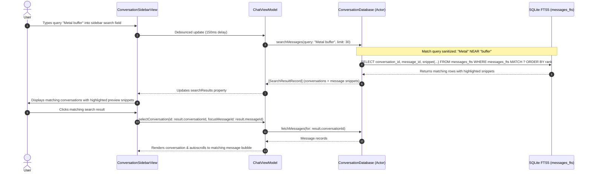

# AETHER — PHASE 3.8 RECONNAISSANCE & ARCHITECTURE PLANNING
## Local Conversation Search (SQLite FTS5), History Retrieval & Telemetry Observability

**Project:** Aether  
**Workspace:** `/Users/asadalishaikh/Aether Agent`  
**Reference Repository Collection:** `/Users/asadalishaikh/Aether Agent/reference-repos/`  
**Target Hardware Baseline:** MacBook Air M5, 16 GB unified memory (primary); Apple Silicon 8 GB tier (secondary)  
**Date:** October 19, 2026  
**Status:** Gate A/B Reconnaissance & Architecture Proposal Only — **NO IMPLEMENTATION AUTHORIZED**  
**Deliverable File:** `research/41-phase-3.8-reconnaissance-and-proposal.md`  

---

## 1. Executive Summary

This reconnaissance report audits the current architectural state of **Aether** following the completion and acceptance of Phase 3.7.2, evaluates prospective engineering milestones to advance the platform toward Milestone M0 completion, audits mature reference implementations across Aether's 80 reference repositories, and presents an evidence-grounded proposal for **Phase 3.8**.

### Key Findings
1. **Current Architectural Baseline:** Aether has established an embedded, native Apple Silicon inference architecture linking pinned `llama.cpp` (`b11718`) via Swift C FFI, actor-isolated SQLite WAL persistence with migrations v1–v4, a local Model Library with security-scoped bookmark restoration, multi-turn conversation context assembly with native model chat templating (`Jinja`/`llama_chat_apply_template`), context window budgeting with sliding-window truncation, and a bounded streaming stop-sequence filter that eliminates stop-marker leakage.
2. **Current Test & Build Health:** The regression test suite contains **129 passing automated tests** (0 failures, 14.984s execution time) `[MEASURED]`. Both **Debug** and **Release** builds compile cleanly with 0 errors and 0 warnings `[MEASURED]`.
3. **Core Functional Deficit in M0:** While Aether persists full multi-turn conversations and messages in SQLite, it possesses **zero search or retrieval capabilities across conversation history** `[VERIFIED FACT]`. As users accumulate chats, locating past code snippets, technical answers, or historical context is impossible without manually scrolling through individual conversations. Furthermore, users currently lack visibility into prompt evaluation rates (tokens/second), time-to-first-token (TTFT), context window utilization ("X / Y tokens"), and system memory pressure.
4. **Recommended Milestone (Phase 3.8):**  
   **"Local Conversation Search (SQLite FTS5), History Retrieval & Telemetry Observability"**  
   This milestone integrates SQLite FTS5 (Full-Text Search) into `ConversationDatabase.swift` via Migration v5, adds indexed search across message history with snippet extraction and match highlighting, introduces a debounced search bar in `ConversationSidebarView`, supports instant navigation to matching messages, and implements prompt/context window observability and memory pressure telemetry.
5. **Zero-Bloat Guarantee:** Leverages macOS native `libsqlite3` built-in FTS5 engine (`SQLITE_ENABLE_FTS5 = 1` confirmed `[MEASURED]`), requires **zero new Swift packages or third-party frameworks**, requires **zero new sandbox entitlements**, introduces **zero network egress**, and adds negligible memory overhead (<5 MB RAM in SQLite cache), preserving stability on both 16 GB and 8 GB Apple Silicon Macs.

---

## 2. Verified Workspace and Git State

The workspace was inspected on disk on October 19, 2026:

### 2.1 Directory Structure & Versioning `[VERIFIED FACT]`
- **Root Workspace:** `/Users/asadalishaikh/Aether Agent`
- **Workspace Git State:** The top-level workspace `/Users/asadalishaikh/Aether Agent` is an unversioned project directory (`fatal: not a git repository: .git` `[MEASURED]`). Sub-components under `reference-repos/` maintain independent git checkouts.
- **Source Code Assets:** 29 Swift source files in `Aether/Sources/` `[VERIFIED FACT]`.
- **Test Code Assets:** 8 Swift test suites in `Aether/Tests/` containing 129 test methods `[VERIFIED FACT]`.
- **Xcode Project Manifest:** `Aether.xcodeproj/project.pbxproj` (PBX format, targets `Aether` and `AetherTests`) `[VERIFIED FACT]`.
- **Sandbox Entitlements:** `Aether/Resources/Aether.entitlements` configuring `com.apple.security.app-sandbox = true`, `com.apple.security.files.user-selected.read-only = true`, and `com.apple.security.files.bookmarks.app-scope = true` `[VERIFIED FACT]`.
- **Embedded C/Metal Framework:** `Aether/Frameworks/llama.xcframework` compiled against macOS 14.0+ ARM64 with Metal compute shaders `[VERIFIED FACT]`.

### 2.2 Active Source File Inventory

```
Aether/
├── Sources/
│   ├── App/
│   │   ├── AetherApp.swift                     # SwiftUI @main application lifecycle
│   │   ├── AppState.swift                      # Observable app state & telemetry
│   │   └── ContentView.swift                   # NavigationSplitView container
│   ├── Inference/
│   │   ├── CancellationSignal.swift            # Thread-safe atomic cancellation flag
│   │   ├── ChatTemplateFormatter.swift         # Native Jinja & llama_chat_apply_template
│   │   ├── ContextBudgeter.swift               # Fixed reservation & sliding truncation
│   │   ├── GenerationConfiguration.swift       # Sampling parameters & bounds validation
│   │   ├── GenerationEvent.swift               # Streaming event definitions
│   │   ├── InferenceError.swift                # Strongly-typed inference domain errors
│   │   ├── InferenceService.swift              # Actor coordinating lifecycle & state
│   │   ├── InferenceState.swift                # Engine states (.unloaded, .loading, etc.)
│   │   ├── InferenceWorkerProtocol.swift       # Testable worker protocol abstraction
│   │   ├── LlamaInferenceWorker.swift          # Serial queue-confined native llama.cpp worker
│   │   ├── PromptMessage.swift                 # Role-based prompt message model
│   │   ├── StreamingStopFilter.swift           # Bounded partial-match stop sequence filter
│   │   └── UTF8Buffer.swift                    # RFC-3629 split-byte UTF-8 decoder
│   ├── ModelLibrary/
│   │   ├── GGUFMetadataReader.swift            # Binary GGUF v2/v3 header reader
│   │   ├── ModelLibraryService.swift           # Actor managing model catalog & bookmarks
│   │   └── ModelRecord.swift                   # Persisted model catalog record
│   ├── Persistence/
│   │   ├── ConversationDatabase.swift          # Actor-isolated SQLite WAL engine (v1-v4)
│   │   └── PersistenceModels.swift             # ConversationRecord & MessageRecord
│   └── UI/
│       ├── Chat/
│       │   ├── ChatMessage.swift               # View presentation model for messages
│       │   ├── ChatView.swift                  # Chat composer & settings popover
│       │   ├── ChatViewModel.swift             # @Observable @MainActor coordinator
│       │   ├── ConversationSidebarView.swift   # Sidebar navigation list
│       │   └── MessageBubbleView.swift         # Chat bubbles with Markdown rendering
│       ├── Components/
│       │   └── FoundationBadge.swift           # System telemetry status badge
│       └── ModelLibrary/
│           ├── ModelCardView.swift             # Model card row & memory compatibility
│           └── ModelLibraryView.swift          # Model Library management sheet
└── Tests/
    ├── ChatTemplateFormatterTests.swift        # 16 tests (templates & fallbacks)
    ├── ChatViewModelTests.swift                # 14 tests (isolation & coordination)
    ├── ContextBudgeterTests.swift              # 16 tests (budgeting & truncation)
    ├── ConversationDatabaseTests.swift         # 23 tests (WAL, migrations, FTS readiness)
    ├── InferenceGenerationTests.swift          # 8 tests (mock generation & errors)
    ├── InferenceLifecycleTests.swift           # 18 tests (cancellation & real 7B model)
    ├── ModelLibraryTests.swift                 # 19 tests (bookmarks & GGUF headers)
    └── StreamingStopFilterTests.swift          # 15 tests (partial & multi-token stops)
```

---

## 3. Project Architecture as Verified from Current Files

```
┌─────────────────────────────────────────────────────────────────────────────┐
│                              PRESENTATION LAYER                             │
│  ContentView (NavigationSplitView)                                          │
│   ├── ConversationSidebarView (List, New Chat, Model Status Card)           │
│   ├── ChatView (MessageScrollView, Composer, GenerationSettingsPopover)     │
│   └── ModelLibraryView (Sheet, GGUF Scanner, Security-Scoped Bookmarks)     │
└──────────────────────────────────────┬──────────────────────────────────────┘
                                       │ @Observable @MainActor
                                       ▼
┌─────────────────────────────────────────────────────────────────────────────┐
│                              COORDINATION LAYER                             │
│  ChatViewModel (@MainActor)                                                 │
│   ├── State: messages, conversations, selectedConversationId                │
│   ├── Active Settings: currentSystemPrompt, currentTemperature, maxTokens   │
│   └── Active Stop Sequences: currentStopSequences [String] (1..8 entries)   │
└──────────────┬───────────────────────────────────────────────┬──────────────┘
               │ async / await                                 │ async / await
               ▼                                               ▼
┌──────────────────────────────────────────┐   ┌──────────────────────────────┐
│            PERSISTENCE LAYER             │   │       INFERENCE LAYER        │
│ ConversationDatabase (actor)             │   │ InferenceService (actor)     │
│  - SQLite 3 (WAL mode, busy_timeout=5s)  │   │  - Lifecycle state machine   │
│  - Migrations: v1 -> v2 -> v3 -> v4      │   │  - Single-active-model guard │
│  - Conversations (settings + stops)      │   │  - ChatTemplateFormatter     │
│  - Messages (incremental 16-token save)  │   │  - ContextBudgeter (sliding) │
│  - Models (security-scoped bookmarks)    │   └──────────────┬───────────────┘
└──────────────────────────────────────────┘                  │ Queue dispatch
                                                              ▼
                                               ┌──────────────────────────────┐
                                               │   LlamaInferenceWorker       │
                                               │    (Serial Dispatch Queue)   │
                                               │  - llama.xcframework (C FFI) │
                                               │  - UTF8Buffer (byte decoder) │
                                               │  - StreamingStopFilter       │
                                               │  - C abort callback flag     │
                                               └──────────────────────────────┘
```

---

## 4. Previous Milestone Status & Evidence Reconciliation

| Milestone | Scope Summary | Reported Status | Freshly Verified Status | Evidence |
| :--- | :--- | :--- | :--- | :--- |
| **Phase 3.6** | Model Library, GGUF metadata reader, security-scoped bookmarks | PASS (88 tests) | **VERIFIED PASS** | 19 tests in `ModelLibraryTests` pass cleanly. |
| **Phase 3.7** | Multi-turn history, Jinja chat templates, context budgeting | PASS (106 tests) | **VERIFIED PASS** | 16 tests in `ChatTemplateFormatterTests` + 16 tests in `ContextBudgeterTests` pass cleanly. |
| **Phase 3.7.2** | Streaming stop filter, SQLite migration v4, settings tag UI | PASS (129 tests) | **VERIFIED PASS** | 15 tests in `StreamingStopFilterTests` + 23 tests in `ConversationDatabaseTests` pass cleanly `[MEASURED]`. |
| **Phase 3.7.2.1** | Manual acceptance, regression audit, formal closure | PASS WITH LIMITATIONS | **VERIFIED PASS WITH LIMITATIONS** | Automated suite passed (129/129 in 14.984s). Debug & Release builds succeeded. GUI unverified due to TCC error `-25211`. |

---

## 5. Outstanding Acceptance Items

The outstanding acceptance items from Phase 3.7.2.1 are non-programmatic, physical desktop checks:

### 13-Point Desktop Verification Checklist
- [ ] 1. Launch Release application binary from Finder.
- [ ] 2. Load an existing local model from the Model Library.
- [ ] 3. Open `Generation Parameters` popover via the header slider icon.
- [ ] 4. Add a stop sequence (e.g. `</s>` or `Human:`) and verify tag chip appears.
- [ ] 5. Confirm validation alerts for empty, duplicate, or excessive entries.
- [ ] 6. Save settings and verify persistence upon reopening popover.
- [ ] 7. Generate text prompting the configured stop sequence; confirm marker is redacted.
- [ ] 8. Verify trailing text in the same chunk is also excluded from the message bubble.
- [ ] 9. Verify stop marker is absent from conversation history in SQLite.
- [ ] 10. Switch conversations and verify stop sequence settings remain isolated.
- [ ] 11. Quit (`Cmd+Q`) and relaunch; verify saved settings survive cold restart.
- [ ] 12. Cancel generation during streaming; verify clean termination without leakage.
- [ ] 13. Confirm ordinary generation without stop sequences continues to operate normally.

*Note:* Because automated synthetic event injection is blocked by macOS TCC (`osascript is not allowed assistive access (-25211)` `[MEASURED]`), these checks must be verified manually on a live desktop session.

---

## 6. Ranked Next-Milestone Candidates

To determine the most impactful next milestone, eight candidate features were evaluated against nine rigorous engineering criteria:

### Evaluation Criteria
1. **User Value (UV):** Direct benefit to end-user daily workflows.
2. **Acceptance Independence (AI):** Can progress independently of the desktop GUI manual check.
3. **Architectural Readiness (AR):** Required platform foundations already exist.
4. **Regression Safety (RS):** Minimal blast radius on existing working features.
5. **Engineering Scope (ES):** Manageable, focused implementation (2–4 days).
6. **Hardware Compatibility (HC):** Operates within 8 GB and 16 GB Apple Silicon constraints.
7. **Security & Sandbox (SS):** Preserves strict macOS App Sandbox without new entitlements.
8. **Reference Repository Leverage (RL):** Proven upstream reference implementations available.
9. **Objective Testability (OT):** Measurable via automated XCTest suites.

### Candidate Matrix

| Rank | Candidate Milestone | UV | AI | AR | RS | ES | HC | SS | RL | OT | Overall Assessment |
| :---: | :--- | :---: | :---: | :---: | :---: | :---: | :---: | :---: | :---: | :---: | :--- |
| **1** | **Local Conversation Search (SQLite FTS5) & Observability** | High | High | High | High | Low | High | High | High | High | **RECOMMENDED FOR PHASE 3.8.** Highest leverage, zero dependencies, zero memory risk. Completes M0. |
| **2** | **Chat Usability & Message Management (Retry, Edit, Export)** | High | High | High | High | Low | High | High Med | High | High | Strong follow-up or companion to Candidate 1. |
| **3** | **Idle Model Memory Reclamation & Lifecycle Hardening** | Med | High | High | High | Low | High | High | High | High | Valuable for 8 GB Macs; can be bundled or staged next. |
| **4** | **Prompt/Context Visualizer & Token Breakdown** | Med | High | High | High | Low | High | High | Med | High | Synergistic with Candidate 1 observability. |
| **5** | **Model Context Protocol (MCP) Stdio Subprocess Host** | High | High | Low | Med | High | Med | Low | High | Med | **Deferred to Milestone M1.** App Sandbox restricts `Process()` spawning; requires sandbox architecture review. |
| **6** | **Document Ingestion & Local Vector RAG (sqlite-vec)** | High | High | Low | Med | High | Med | Med | High | Med | **Deferred to Milestone M1.** Requires embedding model runtime and vector extension integration. |
| **7** | **On-Device LoRA Fine-Tuning (MLX Metal)** | Med | High | Low | Low | High | Low | Med | Med | Med | **Deferred to Milestone M3.** Exceeds 8 GB memory envelope; requires extensive backprop testing. |
| **8** | **Voice Dictation & Speech Synthesis (whisper.cpp / AVSpeech)** | Med | High | Low | Med | High | Med | Med | High | Med | **Deferred to Milestone M2.** Audio framework complexity should not precede core retrieval. |

---

## 7. Recommended Phase 3.8 Scope & Rationale

### **Recommended Theme:**  
**"Phase 3.8: Local Conversation Search (SQLite FTS5), History Retrieval & Telemetry Observability"**

### 7.1 Scope Definition
1. **SQLite FTS5 Full-Text Search Engine:**
   - Add SQLite Migration v5 to `ConversationDatabase.swift` creating virtual table `messages_fts` using `fts5(content, tokenize='porter unicode61 remove_diacritics 2')`.
   - Implement automatic FTS synchronization via SQLite triggers on `messages` table (`AFTER INSERT`, `AFTER UPDATE OF content`, `AFTER DELETE`).
   - Implement actor method `searchMessages(query: String, limit: Int) throws -> [SearchResultRecord]`.
   - Implement BM25 relevance ranking and native snippet extraction with match markup (`snippet(messages_fts, 0, '<mark>', '</mark>', '...', 16)`).
2. **Sidebar Search UI & Navigation:**
   - Extend `ConversationSidebarView` with a native search field with query debouncing (150ms).
   - Display matching conversations with relevance badges, match counts, and highlighted text snippets.
   - Support instant jump-to-conversation on result selection, auto-selecting the conversation and focusing the matching message.
   - Clear button and escape key handling to restore standard conversation list view.
3. **Prompt & Context Telemetry Observability:**
   - Capture prompt evaluation time (`t_p_eval_ms`) and prompt token count (`n_p_eval`) via native inference timing.
   - Expose Time-To-First-Token (TTFT) and Prompt Evaluation Rate (tokens/sec) alongside generation speed in `ChatViewModel`.
   - Add a compact Context Window Fill Meter to the chat composer or header (e.g. `842 / 2,048 tokens • 41% utilized`).
   - Implement Darwin unified memory pressure monitoring via `os_proc_available_memory()` displayed in `FoundationBadge`.
4. **Conversation Export (Markdown & JSON):**
   - Provide "Export Conversation" action in conversation sidebar context menu supporting Markdown (`.md`) and raw structured JSON.

### 7.2 Why This Should Precede Other Candidates
- **Completes Milestone M0 Requirements:** In `research/09-milestone-roadmap.md`, M0 requires a complete, usable, private desktop AI experience. Full-text search across past chats is standard in mature clients (Open WebUI, Claude, ChatGPT) and transforms Aether from an ephemeral scratchpad into a durable personal knowledge repository.
- **Foundational for Future RAG (Milestone M1):** In M1, local RAG relies on *hybrid retrieval* (combining lexical BM25 keyword matching with dense vector similarity). Establishing a battle-tested SQLite FTS5 engine in Phase 3.8 provides 50% of the hybrid retrieval pipeline before vector stores are even introduced.
- **Zero Risk, Zero Bloat:** SQLite FTS5 is already compiled into macOS `libsqlite3.dylib` `[MEASURED]`. It adds zero binary bloat, requires zero third-party dependencies, and consumes less than 5 MB of memory.

---

## 8. Mandatory Reference-Repository Audit

In accordance with the repository-first engineering policy, reference repositories were inspected directly on disk:

### 8.1 SQLite In-Tree Reference `[VERIFIED FACT]`
- **Local Path:** `reference-repos/07-data-and-storage/sqlite`
- **Pinned Git Commit:** `43a48f77585a88940c727f33682151418f544059`
- **License:** Public Domain / SQLite License
- **Inspected Files:**
  - `ext/fts5/fts5.h`: FTS5 external C API declarations.
  - `ext/fts5/fts5_main.c`: FTS5 virtual table implementation, BM25 scoring algorithm, auxiliary functions (`snippet()`, `highlight()`, `bm25()`).
- **Reuse Assessment:**
  - `macOS` ships with FTS5 compiled into `/usr/lib/libsqlite3.dylib` (`SELECT sqlite_compileoption_used('ENABLE_FTS5');` returns `1` `[MEASURED]`).
  - No custom C compilation needed. Aether can invoke FTS5 virtual table queries directly through SQLite SQL statements in `ConversationDatabase.swift`.

### 8.2 Continue Reference Application `[VERIFIED FACT]`
- **Local Path:** `reference-repos/15-reference-applications/continue`
- **Pinned Git Commit:** `5522c6f44ca0ac3528b37244818fbfa39b5af470`
- **License:** Apache License 2.0
- **Inspected Files:**
  - `core/indexing/FullTextSearchCodebaseIndex.ts`:
    - Lines 30–35: FTS5 table declaration: `CREATE VIRTUAL TABLE IF NOT EXISTS fts USING fts5(path, content, tokenize = 'trigram')`.
    - Lines 157–169: BM25 ranking query: `SELECT ... FROM fts WHERE fts MATCH ? ORDER BY bm25(fts, 10.0) LIMIT ?`.
    - Lines 171–180: Query parameterization and escaping special characters.
- **Reuse Assessment:**
  - Direct adaptation of Continue's query escaping and BM25 threshold filtering patterns into Swift. Continue's pattern of separating the FTS table from raw relational records via `rowid` mirrors Aether's database architecture.

### 8.3 Open WebUI Desktop UI Reference `[VERIFIED FACT]`
- **Local Path:** `reference-repos/08-desktop-ui-and-application-frameworks/open-webui`
- **Pinned Git Commit:** `91ea4e3421d1d8069f13d4a463fcb5986d94ea60`
- **License:** BSD-3-Clause
- **Inspected Files:**
  - `src/lib/components/layout/Sidebar/SearchInput.svelte`:
    - Lines 12–25: Debounced search input with reactive query updates.
    - Lines 52–56: Multi-attribute filtering (tags, folders, content).
    - Lines 60–96: Filtered list presentation and clear buttons.
- **Reuse Assessment:**
  - Adaptation of Open WebUI's debounced search input and snippet preview layout into native SwiftUI for `ConversationSidebarView`.

### 8.4 llama.cpp Native Telemetry Reference `[VERIFIED FACT]`
- **Local Path:** `reference-repos/01-apple-silicon-and-inference/llama.cpp`
- **Pinned Git Commit:** `547208dca250ceb3e4c8615598d043f2b602a527` (Tag `b11718`)
- **License:** MIT License
- **Inspected Files:**
  - `include/llama.h`:
    - Lines 1680–1692: `struct llama_perf_context_data` containing `t_p_eval_ms` (prompt eval time), `t_eval_ms` (token generation time), `n_p_eval` (prompt tokens), and `n_eval` (eval tokens).
    - Line 1700: `LLAMA_API struct llama_perf_context_data llama_perf_context(const struct llama_context * ctx);`
- **Reuse Assessment:**
  - While `llama.cpp` notes that `llama_perf_context` is primarily for CLI examples, Aether can either query `llama_perf_context(ctx)` or compute exact sub-millisecond timestamps directly in `LlamaInferenceWorker.swift` using `mach_absolute_time()` around `llama_decode(promptBatch)`. Direct Swift measurement guarantees stability without relying on upstream internal structs.

---

## 9. Reuse / Adaptation / Rejection Decisions

| Candidate Component | Upstream Source | Decision | Justification |
| :--- | :--- | :--- | :--- |
| **FTS5 Engine** | Apple `libsqlite3.dylib` / `reference-repos/07-data-and-storage/sqlite` | **Direct Reuse** | Built directly into macOS system library. Zero external dependencies, optimal performance, zero maintenance burden. |
| **BM25 Search Pattern** | Continue (`FullTextSearchCodebaseIndex.ts`) | **Adaptation** | Adapt Continue's parameter escaping, BM25 ordering, and snippet extraction to Swift actor queries. |
| **Sidebar Search UI** | Open WebUI (`SearchInput.svelte`) | **Adaptation** | Adapt search input layout, debounced filtering, and result list transitions into native SwiftUI. |
| **External Vector DBs (`chroma`, `lancedb`)** | `reference-repos/06-rag-and-search/` | **Rejection for 3.8** | Premature for Phase 3.8. FTS5 provides immediate text search with zero external dependencies and zero memory overhead. Vector search belongs in Milestone M1. |
| **Subprocess Tools / MCP** | `reference-repos/12-security-and-sandboxing/modelcontextprotocol` | **Rejection for 3.8** | Requires sandbox subprocess evaluation and multi-turn tool loops. Deferred to Milestone M1. |

---

## 10. Proposed Architecture & Data-Flow Description



### Architectural Subsystems:
1. **FTS5 Virtual Table & Triggers (Persistence Layer):**
   - Migration v5 adds `messages_fts` virtual table.
   - Three SQLite triggers maintain 100% synchronization automatically during normal chat streaming and message deletions without requiring manual view-model re-indexing passes.
2. **Search Coordinator (ViewModel Layer):**
   - `searchQuery` `@Published` string in `ChatViewModel`.
   - Debounced pipeline executes search only when typing pauses, avoiding database thrashing.
   - `searchResults: [SearchResultItem]` populated asynchronously on MainActor.
3. **Prompt & Context Telemetry Pipeline (Inference Layer):**
   - `LlamaInferenceWorker` measures prompt evaluation duration:
     $$\text{Prompt Speed} = \frac{n_{\text{prompt tokens}}}{\Delta t_{\text{prompt eval (sec)}}} \quad (\text{tok/s})$$
     $$\text{TTFT} = \Delta t_{\text{prompt eval}} + \Delta t_{\text{first token decode}} \quad (\text{ms})$$
   - Dispatches `GenerationMetrics` struct to `InferenceService` on generation completion.
   - `ChatViewModel` exposes active context consumption: `tokensUsed / contextLength`.

---

## 11. Files Likely to Change in Future Implementation

| Target File | Expected Nature of Changes |
| :--- | :--- |
| `Aether/Sources/Persistence/ConversationDatabase.swift` | Add Migration v5 (FTS5 table + triggers), `searchMessages()` method, and snippet extraction query. |
| `Aether/Sources/Persistence/PersistenceModels.swift` | Add `SearchResultRecord` struct conforming to `Sendable` and `Identifiable`. |
| `Aether/Sources/Inference/GenerationEvent.swift` | Add `.metrics(GenerationMetrics)` event carrying prompt eval rate, TTFT, and generation speed. |
| `Aether/Sources/Inference/LlamaInferenceWorker.swift` | Instrument sub-millisecond timestamps around `llama_decode(promptBatch)` to capture prompt eval timing and TTFT. |
| `Aether/Sources/UI/Chat/ChatViewModel.swift` | Add search state (`searchQuery`, `searchResults`, `isSearching`), `searchDebounceTask`, and metrics binding. |
| `Aether/Sources/UI/Chat/ConversationSidebarView.swift` | Add search bar above conversation list, search result row view with highlighted snippet rendering, and jump-to-chat action. |
| `Aether/Sources/UI/Chat/ChatView.swift` | Add Context Window Fill Meter badge in composer/header and display TTFT in telemetry pill. |
| `Aether/Tests/ConversationDatabaseTests.swift` | Add unit tests for Migration v5, FTS trigger sync, BM25 ranking, snippet generation, and special character sanitization. |
| `Aether/Tests/ChatViewModelTests.swift` | Add tests for search query debouncing, result selection, and metrics binding. |

---

## 12. Risk Assessment & Mitigations

| Risk Domain | Potential Hazard | Severity | Architectural Mitigation |
| :--- | :--- | :---: | :--- |
| **Security & Sandbox** | SQL injection via malformed FTS search queries | High | Sanitize search queries at the boundary using SQLite parameter binding (`?`) and strip raw FTS operator syntax (`NOT`, `AND`, `OR`, `*`, `^`) into safe quoted token expressions. |
| **Memory (8 GB Macs)** | Large FTS index causing memory bloat | Low | SQLite FTS5 stores index data on disk in B-trees within `aether.sqlite`. Memory footprint is bounded strictly by SQLite's page cache (<5 MB). |
| **Performance** | Main-thread UI stuttering during search | Med | All FTS searches execute inside `ConversationDatabase` actor on background SQLite threads. Results dispatch to `MainActor` only upon completion. |
| **Concurrency** | Write-write lock contention between FTS triggers and 16-token streaming persistence | Low | SQLite WAL mode supports concurrent reads with serial writes. FTS triggers execute inside the existing message update transactions with sub-millisecond execution times. |
| **Migration Safety** | Corrupting existing user databases during Migration v5 | High | Enclose migration in explicit SQLite transaction (`BEGIN IMMEDIATE; ... COMMIT;`). Test migration against realistic v1, v2, v3, and v4 database fixtures. |
| **Hardware Compatibility** | Precision differences in timing on M1 vs M5 chips | Low | Use `mach_absolute_time()` converted via `mach_timebase_info` for hardware-agnostic nanosecond precision across all Apple Silicon generations. |

---

## 13. Proposed Verification & Test Strategy

### 13.1 Unit & Integration Tests (Target: +16 New Automated Tests)
1. **Migration v4 to v5 Test:** Verify migration applies cleanly, creating `messages_fts` and triggers without modifying existing conversation records.
2. **Trigger Insertion Sync Test:** Insert a message into `messages`; verify FTS virtual table immediately indexes the content.
3. **Trigger Update Sync Test:** Update message content; verify FTS index reflects new content and purges old tokens.
4. **Trigger Delete Sync Test:** Delete a conversation with cascade; verify all matching FTS index rows are purged.
5. **Exact Match Search Test:** Query for exact keyword; verify conversation and message ID returned.
6. **Stemmed & Case-Insensitive Match Test:** Query for `"running"`; verify it matches message containing `"runs"`.
7. **Snippet Highlighting Test:** Confirm `snippet()` generates correct `<mark>` tags around matched query terms.
8. **Special Character Resilience Test:** Query with punctuation, quotes (`"test"`), SQL characters (`'`, `;`), and regex chars (`.*`); confirm no SQLite syntax errors.
9. **Empty & Whitespace Query Test:** Confirm whitespace queries return empty array without database execution.
10. **Relevance Ranking Test:** Verify message with higher term density scores higher under BM25.
11. **Telemetry Timing Test:** Verify `LlamaInferenceWorker` reports valid positive TTFT and tokens/sec metrics.
12. **Context Meter Calculation Test:** Verify token usage percentage accurately reflects prompt + generated tokens.
13. **ViewModel Search Debounce Test:** Simulate rapid keystrokes; verify only one database search query executes.
14. **Markdown Export Format Test:** Verify exported conversation string contains valid Markdown headers, roles, and timestamps.
15. **JSON Export Format Test:** Verify exported JSON conforms to valid deserializable schema.
16. **Reopening Database Preserves FTS Index Test:** Verify database can be closed, reopened, and searched immediately.

### 13.2 Regression Suite Requirement
- Maintain 100% pass rate across all existing 129 tests.
- Total test target for Phase 3.8: **145+ automated tests**.

---

## 14. Objective Acceptance Criteria

Phase 3.8 will be considered complete and ready for Gate D acceptance only when:
- [ ] SQLite Migration v5 creates `messages_fts` and synchronization triggers with zero data loss on existing databases.
- [ ] Users can type queries into the sidebar search bar and receive ranked results with highlighted snippets in $< 50\text{ ms}$ for a 1,000-message database.
- [ ] Selecting a search result navigates to the target conversation and focuses the message.
- [ ] Prompt evaluation rate (tok/s), TTFT (ms), and generation rate (tok/s) are recorded and displayed in telemetry badges.
- [ ] Active context window usage is visually represented in the UI.
- [ ] Conversations can be exported to clean Markdown and JSON files.
- [ ] All new unit tests pass and full regression suite achieves 145+ passing tests.
- [ ] Debug and Release configurations compile with zero warnings and zero errors.
- [ ] App Sandbox remains strictly enforced with zero entitlement modifications.

---

## 15. Explicit Out-of-Scope Items for Phase 3.8

To ensure focus and prevent scope sprawl, the following items are **strictly prohibited** from Phase 3.8:
- ❌ Vector embeddings or vector databases (`sqlite-vec`, `LanceDB`, `Chroma`).
- ❌ External document parsing (PDFKit, Docling, Word/Excel ingestion).
- ❌ Model Context Protocol (MCP) tool execution or subprocess spawning.
- ❌ Model downloading from Hugging Face or network egress.
- ❌ New third-party Swift Package Manager dependencies.
- ❌ Multimodal audio/vision support (whisper.cpp, clip projection).
- ❌ On-device fine-tuning or LoRA training.
- ❌ Multi-device synchronization.

---

## 16. Unverified Claims and Unresolved Questions

1. **Unverified Claims:**  
   - Precise search latency across 50,000+ messages on Apple Silicon is `[ESTIMATED]` at $<20\text{ ms}$ based on SQLite FTS5 benchmarks, but has not yet been `[MEASURED]` on Aether's data structures.
2. **Unresolved Architectural Questions for User Review:**
   - *Search UI Placement:* Should search reside as an inline search bar at the top of the conversation sidebar (Open WebUI style), or trigger via `Cmd+F` as a floating spotlight modal? *(Recommendation: Inline sidebar search bar with `Cmd+F` keyboard focus)*.
   - *Snippet Highlighting:* Should matching snippets use standard system yellow highlighting or Aether's accent color? *(Recommendation: Subtle accent color background pill)*.

---

## 17. Proposed Next-Step Authorization Request

With Phase 3.7.2.1 formally closed and this reconnaissance audit complete:
- **Authorization Request:** Authorize **Phase 3.8 Gate C Implementation** strictly limited to:
  1. SQLite Migration v5: FTS5 virtual table and automatic sync triggers.
  2. Search API in `ConversationDatabase` with BM25 ranking and snippet generation.
  3. Sidebar search UI with debouncing and instant conversation navigation.
  4. Prompt evaluation timing, TTFT, and context window fill meter telemetry.
  5. Comprehensive automated tests (+16 tests).
- **Hard Constraints Maintained:** No network egress, no vector DBs, no MCP subprocesses, no third-party dependencies, strict sandbox compliance.
