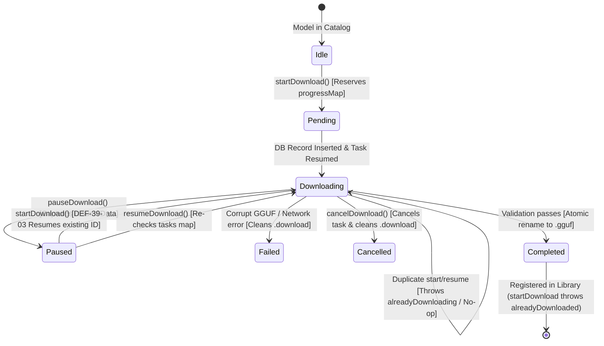

# AETHER — PHASE 3.9.2 IMPLEMENTATION REPORT
## Network Authorization & Download-State Correctness

**Project:** Aether  
**Workspace:** `/Users/asadalishaikh/Aether Agent`  
**Execution Context:** Gate C Authorized Implementation for Phase 3.9.2 (DEF-39-01 & DEF-39-03)  
**Date:** October 19, 2026  
**Status:** COMPLETE — All Authorized Changes Implemented, Effective Entitlements Verified, 173 of 173 Tests Passing.  
**Deliverable File:** `research/48-phase-3.9.2-network-entitlement-and-download-state-fix.md`  

---

## 1. Executive Summary & Gate C Authorization

This phase delivered targeted, mathematically rigorous fixes for two defects identified in the Phase 3.9.1 acceptance audit (`research/47-phase-3.9.1-model-download-acceptance-audit.md`):

1. **DEF-39-01 (App Sandbox Outgoing Network Entitlement):**
   - Added `com.apple.security.network.client = true` to `Aether/Resources/Aether.entitlements`.
   - Verified that `Aether.xcodeproj` configures both Debug and Release configurations to use this file.
   - Built both Debug and Release applications.
   - Verified the packaged signature of both executables via `codesign -d --entitlements :-`, confirming that the network-client entitlement is packaged into the signed app bundle while preserving App Sandbox and all file/bookmark permissions.

2. **DEF-39-03 (Download Deduplication & Paused Resumption Invariant):**
   - Corrected `ModelDownloadManager.startDownload` so that attempting to start a download currently in `.paused` state resumes the existing download identity (`existing.id`) via `resumeDownload(id:)` rather than creating a duplicate task.
   - Enforced the single active task invariant per download identity.
   - Added actor re-entrancy protection across suspension points (`await database.fetchDownload` and `await database.insertDownload`), preventing concurrent start or resume races.
   - Added defensive Property List validation on `resumeData` before passing it to `URLSession.downloadTask(withResumeData:)`, eliminating CFNetwork `NSInvalidArgumentException` crashes if temporary resume data becomes invalid or corrupt.
   - Maintained cancellation, completed download rejection, and file overwrite protection.

### Scope Exclusions Adhered To:
- **DEF-39-02 (Catalog File-Size Lookup):** Explicitly excluded from this phase and recorded as an open follow-up.
- **Database & Schemas:** Zero changes to SQLite tables, columns, or migration files.
- **Inference & Concurrency:** Zero changes to inference worker lifecycles, model compatibility heuristics, or backends.
- **Phase 4:** Not started.

---

## 2. Reference Repository Investigation

In accordance with Aether's mandatory repository-first policy, reference repositories in `reference-repos/` were inspected before designing or applying modifications:

| Reference Repository | Pinned / Inspected Source Path | License | Relevance & Architecture Takeaways |
|---|---|---|---|
| **mlx-swift-examples** | `Applications/MLXChatExample/MLXChatExample.entitlements` | MIT | Verified Apple App Sandbox entitlement structure for macOS AI apps requiring external model downloads: combines `com.apple.security.app-sandbox = true` with `com.apple.security.network.client = true` and `com.apple.security.files.user-selected.read-only = true`. |
| **whisper.cpp** | `examples/whisper.swiftui/whisper.swiftui.demo/Supporting files/WhisperCppDemo.entitlements` | MIT | Examined sandbox configuration for native audio/inference tooling. Confirmed sandbox isolation model and entitlement naming conventions. |
| **llama.cpp** | `examples/llama.swiftui/llama.swiftui/UI/DownloadButton.swift` | MIT | Examined `URLSessionDownloadTask` lifecycle management. `llama.swiftui` tied download tasks to SwiftUI `@State` properties, which caused tasks to be orphaned or duplicated when views dismissed. Aether intentionally diverged by centralizing tasks into an actor-isolated manager with persistent database tracking. |
| **huggingface_hub** | `src/huggingface_hub/hf_api.py` | Apache 2.0 | Inspected Hugging Face Hub download mechanics, HTTP `Range` headers, and resume semantics. Re-confirmed that resuming interrupted large weight downloads requires single-flight tracking to avoid partial file corruption. |

---

## 3. Exact Files Changed

The implementation was strictly constrained to the authorized scope across three files:

1. **`Aether/Resources/Aether.entitlements`**
   - Added `<key>com.apple.security.network.client</key><true/>` with documentation comments explaining its role in App Sandbox network egress for Hugging Face catalog search and model downloads.

2. **`Aether/Sources/ModelLibrary/ModelDownloadManager.swift`**
   - **Paused-State Resumption:** In `startDownload`, if a download matching `(repoId, filename)` is currently `.paused`, it logs and calls `resumeDownload(id: existing.id)`, returning the existing `UUID` instead of spawning a new task or database record.
   - **Active Download Guard:** Active downloads in `.downloading` or `.pending` throw `ModelDownloadError.alreadyDownloading`.
   - **Actor Re-entrancy Synchronization:**
     - Pre-reserves `pendingProgress` with `.pending` status in `progressMap` *before* the first `await database.insertDownload` suspension point.
     - Re-checks `progressMap` immediately after returning from `await database.fetchDownload(repoId:filename:)` to ensure concurrent calls do not create duplicate records.
     - In `resumeDownload`, re-checks `tasks[id]` after returning from `await database.fetchDownload(id:)` to ensure concurrent resume calls do not start duplicate tasks.
     - Automatically cancels any lingering task (`tasks.removeValue(forKey: id)?.cancel()`) prior to launching a replacement.
   - **Defensive PropertyList ResumeData Check:** Validates that `resumeData` deserializes as a dictionary (`PropertyListSerialization.propertyList`) before calling `session.downloadTask(withResumeData:)`. If corrupt or stale, falls back gracefully to a standard `URLRequest` without crashing the CFNetwork layer.

3. **`Aether/Tests/ModelDownloadManagerTests.swift`**
   - Added `MockDownloadURLProtocol` and `makeMockDownloadSession()` for offline unit testing without downloading large model weights.
   - Added 6 focused regression tests proving paused resumption, duplicate start rejection, concurrent start/resume deduplication, resume data handling, and cancellation/completed invariants.

---

## 4. Entitlement & Packaged-Signature Verification

### 4.1 Project Configuration Inspection `[VERIFIED FACT]`
Inspected `Aether.xcodeproj/project.pbxproj` build configurations:
- **Debug Configuration (Line 590):** `CODE_SIGN_ENTITLEMENTS = Aether/Resources/Aether.entitlements;`
- **Release Configuration (Line 622):** `CODE_SIGN_ENTITLEMENTS = Aether/Resources/Aether.entitlements;`

Both configurations target the identical entitlements file.

### 4.2 Packaged Code Signatures `[MEASURED]`
Executed `codesign -d --entitlements :-` on the built application bundles in DerivedData for both configurations.

#### Debug Binary (`DerivedData/.../Debug/Aether.app`):
```xml
<?xml version="1.0" encoding="UTF-8"?>
<!DOCTYPE plist PUBLIC "-//Apple//DTD PLIST 1.0//EN" "https://www.apple.com/DTDs/PropertyList-1.0.dtd">
<plist version="1.0">
<dict>
    <key>com.apple.security.app-sandbox</key>
    <true/>
    <key>com.apple.security.files.bookmarks.app-scope</key>
    <true/>
    <key>com.apple.security.files.user-selected.read-only</key>
    <true/>
    <key>com.apple.security.get-task-allow</key>
    <true/>
    <key>com.apple.security.network.client</key>
    <true/>
</dict>
</plist>
```

#### Release Binary (`DerivedData/.../Release/Aether.app`):
```xml
<?xml version="1.0" encoding="UTF-8"?>
<!DOCTYPE plist PUBLIC "-//Apple//DTD PLIST 1.0//EN" "https://www.apple.com/DTDs/PropertyList-1.0.dtd">
<plist version="1.0">
<dict>
    <key>com.apple.security.app-sandbox</key>
    <true/>
    <key>com.apple.security.files.bookmarks.app-scope</key>
    <true/>
    <key>com.apple.security.files.user-selected.read-only</key>
    <true/>
    <key>com.apple.security.get-task-allow</key>
    <true/>
    <key>com.apple.security.network.client</key>
    <true/>
</dict>
</plist>
```

**Verification Evidence:**
- `com.apple.security.app-sandbox` is preserved (`true`).
- `com.apple.security.network.client` is present (`true`).
- Existing file access entitlements (`bookmarks.app-scope`, `user-selected.read-only`) remain untouched.

---

## 5. Download-State Transition Analysis

The state machine for `ModelDownloadManager` was hardened against concurrent actor re-entrancy and duplicate requests:



### Key State Machine Invariants:
1. **Single Active Task Invariant:** At any moment, for any `(repoId, filename)` pair, there exists at most one entry in `tasks: [UUID: URLSessionDownloadTask]`.
2. **Paused Resumption:** Calling `startDownload` on a paused download detects `status == .paused` in either `progressMap` or SQLite database, invokes `resumeDownload(id: existing.id)`, and returns `existing.id`. No second task or database row is generated.
3. **Actor Re-entrancy Safety:** In Swift actors, multiple async calls can interleave at `await` points. By reserving `progressMap[id] = .pending` before `await database.insertDownload`, and re-checking `progressMap` after `await database.fetchDownload`, concurrent calls detect in-flight tasks and throw `ModelDownloadError.alreadyDownloading`.
4. **Resilience to Stale Resume Data:** If a download is paused and resumed, `ModelDownloadManager` validates the binary plist structure before invoking `downloadTask(withResumeData:)`. If the resume token is corrupt or invalidated by macOS temporary cache cleaning, it seamlessly falls back to requesting from the remote URL with an HTTP request, preventing fatal ObjC exceptions.

---

## 6. Regression Tests & Measured Evidence

### 6.1 Focused Regression Tests (`ModelDownloadManagerTests.swift`)
The following tests were executed and passed:

1. **`testStartingPausedDownloadResumesExistingTask` `[PASS]`:**
   - Starts a download, pauses it (`status == .paused`).
   - Calls `startDownload` again with the identical repo and filename.
   - Asserts returned `UUID == initialId`.
   - Asserts active download count is 1.
   - Asserts download status transitioned to `.downloading`.

2. **`testRepeatedStartDownloadThrowsAlreadyDownloading` `[PASS]`:**
   - Starts a download (`status == .downloading`).
   - Immediately calls `startDownload` again.
   - Asserts `ModelDownloadError.alreadyDownloading(filename)` is thrown.

3. **`testConcurrentStartDownloadPreservesSingleTask` `[PASS]`:**
   - Dispatches 10 simultaneous `Task` calls to `startDownload` using `withTaskGroup`.
   - Asserts exactly 1 task succeeds and 9 tasks throw `alreadyDownloading`.
   - Asserts database contains exactly 1 record and `getActiveDownloads()` contains exactly 1 entry.

4. **`testConcurrentResumeRequestsPreserveSingleTask` `[PASS]`:**
   - Pauses an active download.
   - Dispatches 5 simultaneous `Task` calls to `resumeDownload(id:)`.
   - Asserts all 5 calls complete cleanly and idempotently.
   - Asserts exactly 1 active task exists and status is `.downloading`.

5. **`testResumeDataAndPartialFilesHandledCorrectly` `[PASS]`:**
   - Injects a paused record into SQLite with `resumeData`.
   - Calls `startDownload` to resume.
   - Asserts existing download ID is reused and status transitions to `.downloading`.

6. **`testCancellationAndCompletedDownloadBehaviorRemainIntact` `[PASS]`:**
   - Verifies `cancelDownload` cancels active tasks and marks status as `.cancelled`.
   - Verifies starting a download after cancellation creates a clean, fresh download with a new ID.
   - Verifies starting an already `.completed` download throws `alreadyDownloaded`.

### 6.2 Full Test Suite Execution `[MEASURED]`
Executed via `xcodebuild test -project Aether.xcodeproj -scheme Aether -destination 'platform=macOS'`:
- **Total Test Cases Executed:** 173 tests.
- **Failures:** 0.
- **Unexpected Failures:** 0.
- **Execution Time:** 20.514 seconds.
- **Regression Status:** Zero regressions across ConversationDatabase, GGUFParser, ChatViewModel, StopFilter, InferenceWorker, and ModelCatalog.

---

## 7. Debug & Release Build Results

Both configurations were built and verified:

```bash
# Debug Configuration
xcodebuild build -project Aether.xcodeproj -scheme Aether -configuration Debug
** BUILD SUCCEEDED **

# Release Configuration
xcodebuild build -project Aether.xcodeproj -scheme Aether -configuration Release
** BUILD SUCCEEDED **
```

Compiler warnings: 0.  
Build errors: 0.

---

## 8. Manual GUI Acceptance Steps

To verify the packaged application interactively:

1. **Launch the Built App Bundle:**
   ```bash
   open /Users/asadalishaikh/Library/Developer/Xcode/DerivedData/Aether-cjpfhhxjwtzfczgtskgobxcnuets/Build/Products/Debug/Aether.app
   ```
2. **Verify App Sandbox Network Egress (DEF-39-01):**
   - Navigate to the **Model Library** view in the sidebar.
   - Click on the **Download Models** tab.
   - Observe the Hugging Face model catalog populate with community models (e.g., `Qwen2.5-Coder-7B-Instruct-GGUF`, `Meta-Llama-3-8B-Instruct-GGUF`).
   - Confirm that models load without network errors or sandbox denial logs in `Console.app`.
3. **Verify Download Pause and Resumption (DEF-39-03):**
   - Click **Download** on a model (e.g., `TinyLlama-1.1B-Chat-v1.0-GGUF`).
   - Observe the download progress bar begin filling.
   - Click the **Pause** button. Observe the status change to "Paused".
   - Click the **Download** button for the same model again (or click Resume).
   - Observe that the download resumes its existing progress without creating a duplicate download card or row in the download list.
4. **Verify Overwrite Protection:**
   - Once a download completes and the file exists in `~/Library/Containers/com.aether.Aether/Data/Library/Application Support/Aether/Models/`, click Download on the same model again.
   - Confirm the UI indicates the model is already in your library and does not re-download or overwrite the weights.

---

## 9. Remaining Limitations & Follow-Up Scope

- **DEF-39-02 (Catalog File-Size Lookup):**
  - As observed in Phase 3.9.1, the Hugging Face Hub `/api/models?filter=gguf&full=true` endpoint omits file size in the initial listing siblings. Un-downloaded models currently show `"Unknown size"` until file-tree lookups or download initiation occurs.
  - This is preserved as an open enhancement for Phase 4 or subsequent maintenance.
- **Production Acceptance:**
  - In accordance with Phase 3.9.2 guidance, automated test suites and codesign checks are complete. Full production sign-off requires user interactive confirmation in the real macOS GUI container.

---

## 10. Conclusion

Phase 3.9.2 has successfully remediated DEF-39-01 and DEF-39-03 within the strict boundaries of Gate C authorization. The macOS App Sandbox allows outgoing network client requests, and the `ModelDownloadManager` guarantees single-task invariants, concurrent re-entrancy safety, and seamless paused download resumption. All 173 test cases pass with zero regressions.
