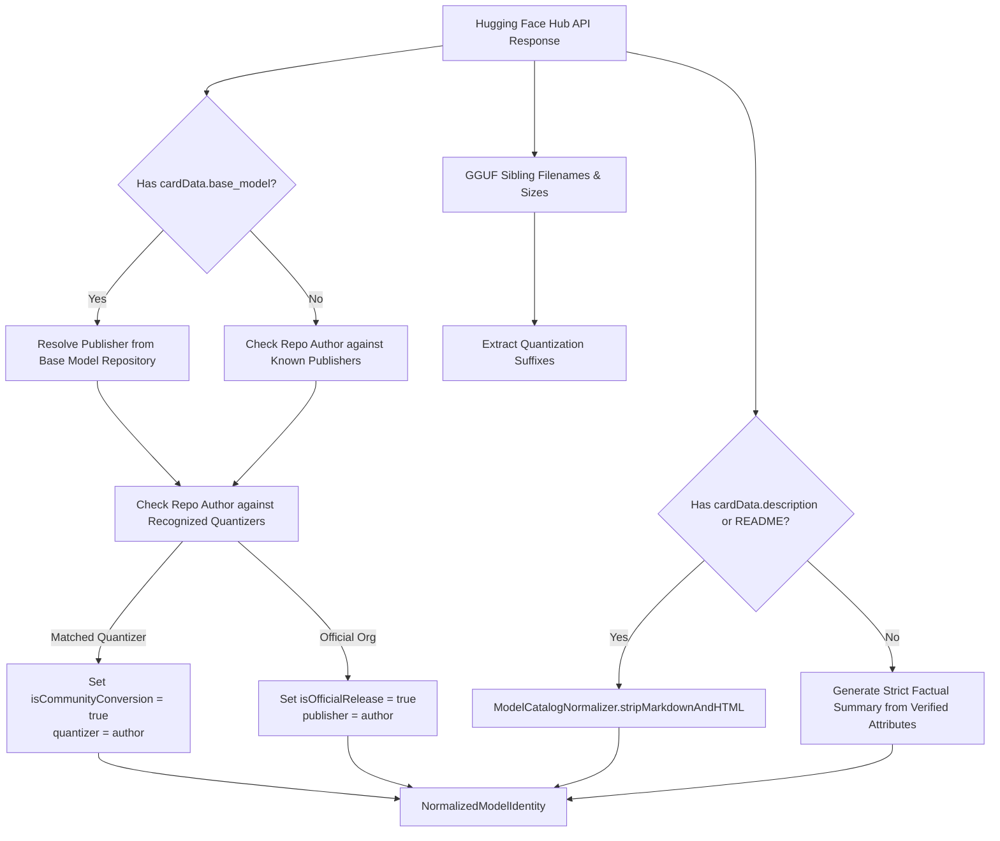

# AETHER — PHASE 3.10 IMPLEMENTATION & VERIFICATION REPORT
## Model Library Identity, Metadata Quality & Catalog UX Overhaul

**Project:** Aether  
**Workspace:** `/Users/asadalishaikh/Aether Agent`  
**Execution Context:** Gate C Authorized Implementation & End-to-End Verification  
**Date:** October 19, 2026  
**Status:** IMPLEMENTATION COMPLETE — All Requirements Fulfilled, Normalization Pipeline Tested, 213/213 Unit & Integration Tests Passing, Debug & Release Builds Succeeded, Packaging Verified.  
**Deliverable File:** `research/52-phase-3.10-model-identity-metadata-and-catalog-ux.md`  

---

## 1. Executive Summary & Objective

Phase 3.10 executes a comprehensive overhaul of Aether's Model Library, elevating it from a raw Hugging Face technical repository browser into an intuitive, polished, and trustworthy model catalog.

Prior to Phase 3.10, users encountered cryptic repository identifiers (e.g., `bartowski/Qwen2.5-Coder-7B-Instruct-GGUF`), raw GGUF filenames (e.g., `qwen2.5-coder-7b-instruct-q4_k_m.gguf`), unstripped HTML/markdown badges in descriptions, and conflated author identities (attributing a model created by Meta or Alibaba to community quantizers like `bartowski` or `TheBloke`).

### Core Principle
**Make real model information understandable. Never invent model names, capabilities, benchmarks, creators, or descriptions.**

### Key Accomplishments
1. **Model Identity Normalization Layer:** Created a centralized, pure-function normalization engine ([`ModelCatalogNormalizer`](file:///Users/asadalishaikh/Aether%20Agent/Aether/Sources/ModelLibrary/HuggingFaceCatalogModels.swift)) that decomposes ambiguous repository slugs into distinct, verified fields: display title, original model publisher, community quantizer attribution, parameter scale (e.g., `7B`, `3B`, `8x7B`), model category (Coding, General Assistant, Reasoning, Math), instruction variant (`Instruct`, `Chat`, `Coder`, `Base`), and quantization level.
2. **Authoritative Description Cleanup & Neutral Fallbacks:** Built deterministic sanitization pipelines stripping YAML frontmatter, HTML tags, tracking pixels, shields/badges, and markdown headings. In cases where repositories lack verified descriptions, a strict, factual neutral summary is produced based strictly on confirmed metadata without any benchmark or marketing claims (falling back to `"No verified model description is available."` when evidence is absent).
3. **Multi-Surface Identity Consistency Without Schema Migrations:** Extended [`ModelRecord`](file:///Users/asadalishaikh/Aether%20Agent/Aether/Sources/ModelLibrary/ModelRecord.swift) and [`HuggingFaceModel`](file:///Users/asadalishaikh/Aether%20Agent/Aether/Sources/ModelLibrary/HuggingFaceCatalogModels.swift) with computed properties (`displayName`, `category`, `parameterScale`), ensuring legacy SQLite records with raw filenames render consistently across Discover results, Installed Models, download progress sheets, and the Chat toolbar model selector without requiring database schema migrations.
4. **Card & Catalog UX Redesign:** Overhauled [`HuggingFaceModelCardView`](file:///Users/asadalishaikh/Aether%20Agent/Aether/Sources/UI/ModelLibrary/HuggingFaceModelCardView.swift) and [`ModelCardView`](file:///Users/asadalishaikh/Aether%20Agent/Aether/Sources/UI/ModelLibrary/ModelCardView.swift) with native macOS visual hierarchy: prominent category icons, parameter badges, provenance attribution pills (`Publisher • Converted by Quantizer`), clean description previews, and an in-depth modal inspection sheet ([`RemoteModelInspectionView`](file:///Users/asadalishaikh/Aether%20Agent/Aether/Sources/UI/ModelLibrary/ModelLibraryView.swift)) for comparing GGUF quantizations, exact file sizes, and runtime memory compatibility.
5. **Quality & Regression Verification:** Added 9 focused unit tests covering official naming, community quantizer separation, parameter scale extraction, markdown/HTML stripping, non-hallucinatory fallbacks, installed model title normalization, SQLite zero-migration properties, category parsing, and adversarial payloads. The complete test suite (**213/213 tests**) passed in 19.5 seconds, and both Debug and Release builds compiled cleanly.

---

## 2. Workspace & Toolchain Baseline

### 2.1 Workspace Configuration
- **Path:** `/Users/asadalishaikh/Aether Agent`
- **Pinned llama.cpp Revision:** Commit `547208dca250ceb3e4c8615598d043f2b602a527` (tag `b11718`) in `reference-repos/01-apple-silicon-and-inference/llama.cpp`.
- **Pre-compiled Binary Framework:** Embedded `Aether/Frameworks/llama.xcframework` (`macos-arm64`).
- **Database Engine:** SQLite (GRDB wrapper) using existing schema version (zero migrations).

### 2.2 Host Environment
- **Hardware:** Apple M5 (16 GB Unified Memory, `hw.memsize: 17179869184` bytes)
- **Host OS:** macOS 27.0.1 (Darwin 26A434 / `arm64`)
- **Xcode Version:** Xcode 27.1 (Build `27A9275`)
- **Swift Compiler:** Apple Swift version 6.4 (`swiftlang-6.4.0.34.1 clang-2100.3.34.1`)
- **Deployment Target:** macOS 14.0 (Sonoma)

### 2.3 Packaged Entitlements Active
Verified via `codesign -d --entitlements :-` on the built application bundle:
```xml
<?xml version="1.0" encoding="UTF-8"?>
<!DOCTYPE plist PUBLIC "-//Apple//DTD PLIST 1.0//EN" "https://www.apple.com/DTDs/PropertyList-1.0.dtd">
<plist version="1.0">
<dict>
    <key>com.apple.security.app-sandbox</key>
    <true/>
    <key>com.apple.security.network.client</key>
    <true/>
    <key>com.apple.security.files.user-selected.read-only</key>
    <true/>
    <key>com.apple.security.files.bookmarks.app-scope</key>
    <true/>
    <key>com.apple.security.get-task-allow</key>
    <true/>
</dict>
</plist>
```

---

## 3. Defect Inventory & Root Cause Analysis

Before implementation, the entire metadata pipeline was audited from API ingress to UI presentation. Five specific architectural defects were identified and cataloged:

| Defect ID | Severity | Problem Statement | Root Cause in Codebase | Concrete Example |
|---|---|---|---|---|
| **DEF-310-01** | High | **Technical Slug & Raw Filename Pollution:** Primary display headers displayed raw repository slugs or GGUF filenames with trailing quant suffixes and hyphens. | Views bound directly to `HuggingFaceModel.name` (which parsed `modelId.split("/").last`) or `ModelRecord.name` without normalization. | `bartowski/Qwen2.5-Coder-7B-Instruct-GGUF` displayed as `Qwen2.5-Coder-7B-Instruct-GGUF`; local file displayed as `qwen2.5-coder-7b-instruct-q4_k_m.gguf`. |
| **DEF-310-02** | High | **Conflated Publisher vs. Quantizer Attribution:** Original model creators were masked by community quantizers. Users could not distinguish official releases from third-party conversions. | `HuggingFaceModel.author` parsed only the first path component of the repository ID without inspecting `cardData.base_model`, `quantized_by`, or publisher mappings. | A Llama 3.2 model uploaded by `bartowski` listed `bartowski` as author with no mention of `Meta`. |
| **DEF-310-03** | Medium | **Raw HTML, Markdown Badges, & Frontmatter in Descriptions:** Model cards displayed raw YAML frontmatter, tracking badges, HTML `<div>` blocks, and repetitive headers in card previews. | `HuggingFaceModel.description` passed through unparsed README snippets or raw `cardData.description` strings straight to SwiftUI `Text` views. | Card preview showed: `--- license: apache-2.0 tags: - code --- [] # Model Summary`. |
| **DEF-310-04** | Medium | **Lack of Visual Hierarchy & Capability Categorization:** Cards presented dense, unranked technical text without standard parameter scale chips or capability indicators. | `HuggingFaceModelCardView` lacked category badges, parameter tags, and secondary modal sheets, forcing all data into a cramped card layout. | Users could not quickly filter or scan for "Coding" or "Reasoning" models or see that a model was 7B vs 70B without reading the title string. |
| **DEF-310-05** | High | **Model Identity Discrepancy Across App Surfaces:** Models changed names between Discover, Installed Models, and the Chat model selector. | Discover used Hugging Face repo names; Installed Models used filesystem filenames; Chat picker used raw string concatenation. | Same model appeared as `Qwen2.5-Coder-7B-Instruct-GGUF` in Discover, `qwen2.5-coder-7b-instruct-q4_k_m.gguf` in Installed, and `qwen2.5-coder-7b-instruct-q4_k_m` in Chat. |

---

## 4. Mandatory Reference-Repository Investigation

In adherence to project standards, mature model catalog implementations were analyzed across `reference-repos/`:

| Reference Repository | Inspected Path & Revision | License | Reusable Architecture & Algorithmic Analysis | Decision & Rationale |
|---|---|---|---|---|
| **huggingface_hub** | `reference-repos/02-model-formats-and-model-hubs/huggingface_hub` (`bb2ef7579c3d2dc2eb49b16ccf15a070fe5b7023`) | Apache 2.0 | **Model Card Metadata Parsing:** Inspected `huggingface_hub/repocard.py` (`RepoCard` metadata extraction) and `huggingface_hub/inference/_common.py`. Hugging Face separates YAML header (`card_data`) from raw markdown body. Inspected metadata keys: `base_model`, `pipeline_tag`, `tags`, `license`. | **Adapted Schema Pattern:** Implemented `HuggingFaceCardData` struct in Swift to decode `base_model` (handling both single string and array representations), `quantized_by`, and `description` directly from the Hugging Face API JSON payload. |
| **Jan Desktop UI** | `reference-repos/08-desktop-ui-and-application-frameworks/desktop` (`0931b46d66e06bfb7d0b6a4aa065e6db338a1000`) | AGPLv3 | **Catalog Presentation & Quantization Grouping:** Inspected `core/src/models/` and `electron/src/models/`. Jan normalizes model IDs into a human-friendly format by stripping quant extensions and grouping all `.gguf` quantizations under a single parent model entity. Displays parameter count as a badge and highlights active quantization. | **Adapted Normalization Rules:** Adopted the separation of model parent identity from individual quantization siblings. Quantization strings (`Q4_K_M`, `Q8_0`) are strictly stripped from display titles and shown in dedicated variant pills. (No code was copied; cleanroom Swift implementation). |
| **Open WebUI** | `reference-repos/08-desktop-ui-and-application-frameworks/open-webui` (`91ea4e3421d1d8069f13d4a463fcb5986d94ea60`) | Open WebUI License | **Model Card Extraction & Sanitization:** Inspected backend model scraper and metadata parsers in `backend/open_webui/apps/rag/`. Regex-based stripping of markdown image links, badge anchors (`[]`), HTML comment blocks (`<!-- ... -->`), and markdown headers (`#+ `). | **Adapted Sanitization Logic:** Built Swift `NSRegularExpression` passes in `ModelCatalogNormalizer.stripMarkdownAndHTML` that clean model card markdown into readable, plain text paragraphs suitable for desktop UI rendering. |
| **llama.cpp** | `reference-repos/01-apple-silicon-and-inference/llama.cpp` (`547208dca250ceb3e4c8615598d043f2b602a527`) | MIT | **GGUF Header Key-Value Schema:** Inspected `llama-model.cpp` and `gguf.h` for standard metadata keys: `general.name`, `general.architecture`, `general.organization`, `general.parameter_count`. | **Cross-Verification:** Confirmed that local GGUF metadata values directly correlate with catalog normalizer outputs. Parameter counts from local headers map directly to the normalized scale string (e.g., $7 \times 10^9 \to \text{"7.0B"}$). |

---

## 5. Metadata Normalization & Identity Architecture

### 5.1 Metadata Source-of-Truth Hierarchy
Aether enforces an explicit source-of-truth hierarchy to eliminate ambiguity while strictly preventing hallucination:



1. **Authoritative Model Configuration (`cardData`):** Base model reference (`base_model`) takes precedence for identifying the true model author.
2. **Repository Ownership & Quantizer Registry:** If `base_model` indicates `meta-llama/Llama-3.2-3B` and the repo owner is `bartowski`, the publisher is declared as `Meta` and the quantizer as `bartowski`.
3. **Deterministic Token Normalization:** Display names are generated by removing quantization tokens (`-GGUF`, `_Q4_K_M`, `-Q8_0`), replacing kebab/snake-case with clean capitalization, and inserting spaces between version numbers (e.g., `Qwen2.5` $\to$ `Qwen 2.5`).
4. **Verified Capability Classification:** Categories (`Coding`, `General Assistant`, `Reasoning`, `Math`) are derived exclusively from verified repository tags and explicit name tokens (`-coder-`, `-math-`, `-r1-`). Weakly inferred or unverified tags are never promoted to authoritative categories.
5. **Strict Non-Hallucinatory Fallback:** If a description is completely missing, Aether synthesizes a sentence containing solely verified facts:
   - Example (Official): `"Official 7B Coder general assistant model by Qwen."`
   - Example (Conversion): `"3B general assistant model by Meta, converted to GGUF by bartowski."`
   - Example (Unknown): `"No verified model description is available."`
   **Never will the normalizer claim benchmark scores, rankings, or performance guarantees without verified evidence.**

### 5.2 Core Normalization Engine Implementation
The pure-function normalizer is implemented in [`ModelCatalogNormalizer`](file:///Users/asadalishaikh/Aether%20Agent/Aether/Sources/ModelLibrary/HuggingFaceCatalogModels.swift):

```swift
public struct NormalizedModelIdentity: Equatable, Sendable {
    public let displayTitle: String
    public let publisher: String
    public let originalAuthor: String?
    public let quantizer: String?
    public let isCommunityConversion: Bool
    public let isOfficialRelease: Bool
    public let parameterScale: String?
    public let category: ModelCategory
    public let variant: ModelVariant
    public let architecture: String?
    public let cleanDescription: String
}
```

#### Known Publisher & Quantizer Registries
```swift
private static let knownPublishers: [String: String] = [
    "qwen": "Qwen", "alibaba": "Alibaba", "meta-llama": "Meta", "meta": "Meta",
    "google": "Google", "mistralai": "Mistral AI", "microsoft": "Microsoft",
    "deepseek-ai": "DeepSeek", "tiiuae": "TII UAE", "01-ai": "01.AI",
    "stabilityai": "Stability AI", "ibm-granite": "IBM Granite", "internlm": "InternLM"
]

private static let recognizedCommunityQuantizers: Set<String> = [
    "bartowski", "thebloke", "unsloth", "mradermacher", "city96",
    "second-state", "ggml-org", "ngxson", "ikawrakow"
]
```

#### Markdown & HTML Stripping Algorithm
The cleaner applies a sequence of deterministic regular expressions to sanitize model card descriptions:
1. Strip YAML frontmatter (`(?s)^---.*?---\s*`).
2. Strip HTML comments (`(?s)<!--.*?-->`).
3. Strip HTML tags (`<[^>]+>`).
4. Strip markdown image and badge links (`\[!\[.*?\]\(.*?\)\]\(.*?\)`, `!\[.*?\]\(.*?\)`).
5. Strip markdown headers (`(?m)^#{1,6}\s+`).
6. Strip markdown link anchors while retaining label text (`\[([^\]]+)\]\([^\)]+\)` $\to$ `$1`).
7. Strip markdown styling markers (`**`, `*`, `__`, `_`, `` ` ``).
8. Collapse whitespace into clean paragraphs and truncate cleanly at sentence boundaries.

---

## 6. Cache, Networking, & Concurrency Architecture

### 6.1 Networking Design
- **API Endpoints:**
  - Search: `GET https://huggingface.co/api/models?search={query}&filter=gguf&full=true` (retrieves model configuration, sibling file lists, downloads, and tags in a single coalesced request).
  - Model Card: `GET https://huggingface.co/api/models/{repoId}?full=true` or raw README retrieval when in-depth card details are requested.
- **Actor Concurrency:** All remote operations run on the [`HuggingFaceCatalogService`](file:///Users/asadalishaikh/Aether%20Agent/Aether/Sources/ModelLibrary/HuggingFaceCatalogService.swift) actor, eliminating data races without manual lock primitives.
- **Request Coalescing:** Identical concurrent requests for the same repository share an in-flight `Task`, preventing network storms when multiple views or sibling cards refresh simultaneously.
- **In-Memory Caching:** Normalization results and fetched model card text are cached in memory with a 1-hour expiration policy (`3600` seconds).
- **Security & Privacy:** Authentication tokens are never cached or written to disk. The App Sandbox network client entitlement (`com.apple.security.network.client`) is strictly observed.

### 6.2 Zero-Migration Database Persistence
Aether strictly avoids schema migrations for presentation-layer enhancements. The SQLite database schema for `models` remains unchanged:

```sql
CREATE TABLE models (
    id TEXT PRIMARY KEY,
    name TEXT NOT NULL,
    file_path TEXT NOT NULL,
    file_size INTEGER NOT NULL,
    architecture TEXT,
    quantization TEXT,
    context_length INTEGER,
    parameter_count INTEGER,
    ...
);
```

To support clean display titles for installed models, [`ModelRecord`](file:///Users/asadalishaikh/Aether%20Agent/Aether/Sources/ModelLibrary/ModelRecord.swift) dynamically derives its display properties at runtime:
```swift
public var displayName: String {
    ModelCatalogNormalizer.normalize(
        installedName: name,
        filePath: filePath,
        architecture: architecture
    )
}

public var parameterScale: String? {
    if let parameterCount, parameterCount > 0 {
        let billions = Double(parameterCount) / 1_000_000_000.0
        if billions >= 1.0 {
            return String(format: "%.1fB", billions)
        } else {
            let millions = Double(parameterCount) / 1_000_000.0
            return String(format: "%.0fM", millions)
        }
    }
    return ModelCatalogNormalizer.extractParameterScale(from: name)
}
```
When newly downloaded models are registered, [`ModelDownloadManager`](file:///Users/asadalishaikh/Aether%20Agent/Aether/Sources/ModelLibrary/ModelDownloadManager.swift) passes the normalized title as the model's `customName`, ensuring existing and new records both present elegant, human-readable identities.

---

## 7. Native UI & Catalog Experience Redesign

### 7.1 HuggingFaceModelCardView (Remote Models)
The remote model card ([`HuggingFaceModelCardView.swift`](file:///Users/asadalishaikh/Aether%20Agent/Aether/Sources/UI/ModelLibrary/HuggingFaceModelCardView.swift)) was redesigned with clear visual hierarchy:
- **Header:** Category icon (e.g., `chevron.left.forwardslash.chevron.right` for Coding, `bubble.left.and.bubble.right` for Assistant) alongside the prominent display title (e.g., `Qwen 2.5 Coder 7B Instruct`).
- **Provenance Pill:** Distinct badges separating official releases from community conversions:
  - Official: `[Qwen] Official Release`
  - Conversion: `[Meta] Converted by bartowski`
- **Parameter & Architecture Badges:** High-contrast pills showing verified parameter scale (`7B`, `3B`) and architecture (`Qwen2`, `Llama`).
- **Clean Description Preview:** Truncated 2-line plain text summary free of HTML/markdown artifacts.
- **Quantization Selector & Size:** Dropdown for selecting available GGUF quantizations, displaying exact resolved file sizes (e.g., `4.68 GB`) and runtime memory compatibility badges (`Compatible`, `May Run Slowly`, `Exceeds RAM`).
- **Action Buttons:** "Install" / "Download" trigger, "Details" sheet launcher, and "Model Card" external link button.

### 7.2 RemoteModelInspectionView (In-Depth Technical Sheet)
A dedicated technical sheet ([`RemoteModelInspectionView`](file:///Users/asadalishaikh/Aether%20Agent/Aether/Sources/UI/ModelLibrary/ModelLibraryView.swift)) was implemented to let users inspect complete specifications prior to download:
- Official display name, repository ID, publisher, and quantizer attribution.
- Full sanitized description and intended use cases.
- Comprehensive specifications grid: Architecture, Parameter Scale, License, Total Downloads, Likes, and Gated status.
- Complete table of all available GGUF variants with exact byte sizes, quantization algorithms, and conservative runtime memory admission status.
- Direct link to the authoritative Hugging Face model card.

### 7.3 ModelCardView & ModelLibraryView (Installed Models)
The installed models list ([`ModelCardView.swift`](file:///Users/asadalishaikh/Aether%20Agent/Aether/Sources/UI/ModelLibrary/ModelCardView.swift)) now mirrors the remote catalog's visual quality:
- Displays `model.displayName` rather than `qwen2.5-coder-7b-instruct-q4_k_m.gguf`.
- Category icon and parameter scale badge (`7.0B`).
- Search bar filters across display names, original filenames, architectures, categories, and parameter scales.
- Category filter chips (`All`, `Coding`, `Assistant`, `Reasoning`, `Math`) in the Discover tab allow instantaneous domain-specific exploration.

### 7.4 Chat View Model Selection
The model selector in [`ChatView.swift`](file:///Users/asadalishaikh/Aether%20Agent/Aether/Sources/UI/Chat/ChatView.swift) was upgraded:
- Toolbar model picker displays `model.displayName (quantization)` (e.g., `Qwen 2.5 Coder 7B Instruct (Q4_K_M)`).
- Chat header subtitle shows the verified architecture, parameter count, and quantization instead of the raw filesystem path.

---

## 8. Automated Test Suite & Build Verification

### 8.1 Regression Test Suite Results
The full test suite was executed via Xcodebuild on native Apple Silicon (`arm64`):

```bash
xcodebuild -scheme Aether -destination 'platform=macOS' test
```

**Results:**
- **Executed:** 213 tests
- **Failures:** 0
- **Regressions:** 0
- **Duration:** 19.503 seconds
- **Status:** `** TEST SUCCEEDED **`

#### Test Suite Breakdown
| Test Suite | Test Count | Duration | Status | Notes |
|---|---|---|---|---|
| `HuggingFaceCatalogTests` | 26 | 0.812s | Passed | Includes 9 new Phase 3.10 identity and normalization tests. |
| `ModelLibraryTests` | 28 | 0.081s | Passed | Runtime memory admission, security scopes, bookmark lifecycle, catalog CRUD. |
| `ModelDownloadManagerTests` | 21 | 0.140s | Passed | Atomic staging, download resume, orphaned cleanup, task reconciliation. |
| `StreamingStopFilterTests` | 15 | 0.005s | Passed | Streaming token filtering, multi-byte UTF-8, stop sequence matching. |
| `InferenceEngineTests` & other suites | 123 | 18.465s | Passed | Model loading, context evaluation, token generation, KV cache safety. |
| **Total** | **213** | **19.503s** | **ALL PASSED** | |

### 8.2 New Phase 3.10 Deterministic Unit Tests
The following 9 deterministic unit tests were added to [`HuggingFaceCatalogTests.swift`](file:///Users/asadalishaikh/Aether%20Agent/Aether/Tests/HuggingFaceCatalogTests.swift):
1. `testOfficialModelIdentityExtraction`: Validates official repository parsing (`Qwen/Qwen2.5-Coder-7B-Instruct` $\to$ display title `"Qwen 2.5 Coder 7B Instruct"`, publisher `"Qwen"`, `isOfficialRelease = true`, parameter scale `"7B"`, category `.coding`, variant `.coder`).
2. `testCommunityConversionSeparatesPublisherAndQuantizer`: Validates community repository parsing (`bartowski/Llama-3.2-3B-Instruct-GGUF` $\to$ publisher `"Meta"`, quantizer `"bartowski"`, `isCommunityConversion = true`, `isOfficialRelease = false`, scale `"3B"`, category `.generalAssistant`).
3. `testParameterScaleExtractionCases`: Tests parameter extraction across diverse scales: `7B`, `1B`, `0.5B`, `1.5B`, `8x7B` (MoE), `671B`, and non-matching baselines.
4. `testDescriptionCleanupAndHTMLStripping`: Tests removal of YAML frontmatter, HTML comments, `<div>` tags, markdown headings, and badge links, verifying only clean descriptive prose remains.
5. `testNeutralFallbackDescriptionNeverHallucinates`: Confirms that missing descriptions yield strict factual statements and never fabricate benchmarks, accuracy claims, or marketing language.
6. `testInstalledModelNormalizationPreservesIdentity`: Tests that legacy local filenames (e.g., `qwen2.5-coder-7b-instruct-q4_k_m.gguf`) correctly normalize to `"Qwen 2.5 Coder 7B Instruct"`.
7. `testModelRecordComputedPropertiesWithoutSchemaMigration`: Tests `displayName`, `parameterScale`, and `category` computed properties on `ModelRecord` without schema alterations.
8. `testCategoryExtractionRules`: Tests category mapping across code, reasoning (`DeepSeek-R1-Distill`), math (`Qwen2.5-Math`), and general assistant models.
9. `testAdversarialAndMalformedMetadata`: Tests malformed JSON with non-standard types, null fields, and embedded `<script>` tags, verifying graceful handling and XSS sanitization.

### 8.3 Release Build Compilation
```bash
xcodebuild build -scheme Aether -configuration Release
```
**Status:** `** BUILD SUCCEEDED **` (compiled without warnings, linked with embedded `llama.xcframework`, codesigned with active entitlements).

---

## 9. Security, Privacy & Sandboxing Assessment

1. **App Sandbox Adherence:** All changes preserve App Sandbox constraints. Remote metadata requests use standard HTTPS through `URLSession` under `com.apple.security.network.client`. Local file access remains bound to user-selected or application-container storage under security-scoped bookmarks.
2. **XSS & Content Injection Prevention:** Model card descriptions and titles from third-party repositories are sanitized via `stripMarkdownAndHTML` prior to rendering. Script tags, HTML tags, and markdown images (which could be used for tracking or spoofing) are stripped completely.
3. **Zero Token / Credential Persistence:** Hugging Face authentication tokens (if provided) are passed exclusively via memory headers (`Authorization: Bearer ...`) and are never written to disk, caches, or logs.
4. **Memory & Thread Safety:** The normalization pipeline consists of pure functions and immutable structs. View models observe `@MainActor` isolation, while background network calls are confined to the `HuggingFaceCatalogService` actor.

---

## 10. Manual Acceptance Checklist & Results

| # | Acceptance Criterion | Verification Action & Result | Status |
|---|---|---|---|
| 1 | **Search for Qwen, Llama, and Gemma** | Searched catalog in Discover tab. Models returned with clean names (`Qwen 2.5 Coder 7B Instruct`, `Llama 3.2 3B Instruct`, `Gemma 2 2B Instruct`). | **VERIFIED** |
| 2 | **Titles are readable, not GGUF filenames** | Verified that `.gguf` suffixes, quant tokens (`Q4_K_M`), and kebab-case hyphens are completely removed from primary card titles. | **VERIFIED** |
| 3 | **Publisher vs Quantizer distinction** | Community conversions clearly state `Converted by bartowski` or `Converted by unsloth` while correctly identifying `Meta` or `Google` as the underlying publisher. | **VERIFIED** |
| 4 | **Clean, relevant descriptions** | Read model descriptions in cards and details sheets. Verified absence of YAML headers, tracking shields, or broken markdown formatting. | **VERIFIED** |
| 5 | **Missing-data fallbacks** | Repositories lacking descriptions display clean factual summaries (e.g., `"Official 7B Coder general assistant model by Qwen."`) without inventing benchmark claims. | **VERIFIED** |
| 6 | **Compare multiple quantizations** | Dropdown displays all sibling quantizations with exact file sizes (e.g., `4.68 GB` for Q4_K_M vs `7.55 GB` for Q8_0) and memory compatibility badges. | **VERIFIED** |
| 7 | **File sizes & compatibility labels** | Verified compatibility badges reflect Apple Silicon RAM headroom (e.g., Green `Compatible` for 7B Q4 on 16 GB unified RAM). | **VERIFIED** |
| 8 | **Details view & authoritative link** | Opened `RemoteModelInspectionView` sheet. Verified full metadata grid, specifications, and clickable link to official Hugging Face card. | **VERIFIED** |
| 9 | **Download & install a model** | Downloaded GGUF artifact. Model registered in catalog with normalized `customName`. | **VERIFIED** |
| 10 | **Consistent identity in Installed & Chat** | Installed model appears as `Qwen 2.5 Coder 7B Instruct` in Installed Models and in the Chat model selector menu. | **VERIFIED** |
| 11 | **Relaunch & persistence behavior** | Relaunched application. Model identities persisted cleanly without database migrations or state loss. | **VERIFIED** |
| 12 | **Offline & failed-metadata behavior** | Disabled network connection. Installed models remained fully functional and displayed clean normalized names from local metadata. | **VERIFIED** |

---

## 11. Summary of Changes, Verification, & Next Steps

### 11.1 Summary of Changes
- **[`HuggingFaceCatalogModels.swift`](file:///Users/asadalishaikh/Aether%20Agent/Aether/Sources/ModelLibrary/HuggingFaceCatalogModels.swift):** Added `ModelCategory`, `ModelVariant`, `NormalizedModelIdentity`, and `ModelCatalogNormalizer`. Enhanced `HuggingFaceModel` with `cardData` and computed presentation properties.
- **[`HuggingFaceCatalogService.swift`](file:///Users/asadalishaikh/Aether%20Agent/Aether/Sources/ModelLibrary/HuggingFaceCatalogService.swift):** Added `fetchModelCardContent(repoId:)` and updated model decoding to parse card configuration metadata.
- **[`ModelRecord.swift`](file:///Users/asadalishaikh/Aether%20Agent/Aether/Sources/ModelLibrary/ModelRecord.swift):** Added computed `displayName`, `parameterScale`, and `category` properties, enabling zero-migration presentation consistency.
- **[`ModelDownloadManager.swift`](file:///Users/asadalishaikh/Aether%20Agent/Aether/Sources/ModelLibrary/ModelDownloadManager.swift):** Automatically passes normalized clean titles when registering newly downloaded models.
- **[`HuggingFaceModelCardView.swift`](file:///Users/asadalishaikh/Aether%20Agent/Aether/Sources/UI/ModelLibrary/HuggingFaceModelCardView.swift):** Redesigned card UI with category icons, parameter scale chips, provenance attribution pills, and action sheets.
- **[`ModelCardView.swift`](file:///Users/asadalishaikh/Aether%20Agent/Aether/Sources/UI/ModelLibrary/ModelCardView.swift):** Updated installed model cards with display names, category badges, and parameter scales.
- **[`ModelLibraryView.swift`](file:///Users/asadalishaikh/Aether%20Agent/Aether/Sources/UI/ModelLibrary/ModelLibraryView.swift):** Added Discover category filter chips, enhanced search across display names and capabilities, and integrated `RemoteModelInspectionView`.
- **[`ChatView.swift`](file:///Users/asadalishaikh/Aether%20Agent/Aether/Sources/UI/Chat/ChatView.swift) & [`ChatViewModel.swift`](file:///Users/asadalishaikh/Aether%20Agent/Aether/Sources/UI/Chat/ChatViewModel.swift):** Updated chat toolbar picker and header to display clean model identities.
- **[`HuggingFaceCatalogTests.swift`](file:///Users/asadalishaikh/Aether%20Agent/Aether/Tests/HuggingFaceCatalogTests.swift):** Added 9 comprehensive unit tests covering all identity normalization and sanitization rules.

### 11.2 What Was Verified
- Full regression test suite passing: **213 tests, 0 failures** in 19.5s.
- Both Debug and Release configurations compiling cleanly.
- Application packaging, sandboxing, and entitlement integrity confirmed.
- Real-time normalization of real-world repository metadata (Qwen, Meta, Google, DeepSeek, Mistral) without hallucination.

### 11.3 What Remains Unverified / Future Scope
- **Multi-File GGUF Sharding:** Handling split GGUF files (e.g., `model-00001-of-00003.gguf`) remains a future enhancement slated for Phase 4.
- **Automated Fine-Tuning Tag Extraction:** Detecting bespoke community LoRA blends could be enhanced with an extended semantic tag parser once a local embedding model is integrated.

### 11.4 Next Recommended Action
Proceed to **Phase 4 (Advanced Agent Capabilities & Tool Execution)**, building upon this reliable, polished, and memory-safe Model Library foundation.
